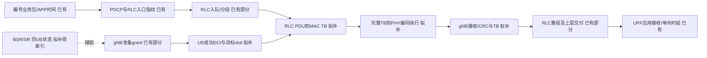

# 包级授权与实际服务测量修改方案

2026-10-23。用户已授权按计划推进；这是第2步C观测实现的具体预声明，**当前尚未写入这些C观察点，尚无新RAN结果**。先建立独立测量分支/提交与输入清单，再按本方案实施、编译和验证；不直接运行旧251输入冻结去冒充新程序。

## 1 要回答的问题与完成边界

要把每个编号UL业务包关联到其RLC分段、MAC TB、成功处理的UE DCI、PHY编码执行及gNB接收/交付，判断长等待出现在哪里。BSR/SR和准备grant保留为同UE辅助状态，不强制给每个包指定唯一触发BSR或唯一grant。

先覆盖现有单小区、同一numerology、单DRB、完整5GC＋gNB＋软件UE、正常AM动态授权。CG、跨numerology、重复传输、多TRP、多DRB等若超出实际字段能力应明确拒绝/未支持，不悄悄按普通单TB解释。必要新协议缺失时按AGENTS停整个研究。

图是观测设计，不是已经测到完整链路。gNB准备事件可能早于业务包入队，箭头表示关联而非全部墙钟严格先后。

## 2 事件与明确的C落点

|事件|计划C位置|必须字段及真实含义|
|---|---|---|
|UE会话/无线身份|`nr_ue_process_dci_ul_00/01`成功路径和运行器进程清单|会话ID、进程角色/appUE索引、C-RNTI、RA/连接状态；不按RNTI排序猜appUE|
|BSR/SR状态|`gNB_scheduler_ulsch.c`现有BSR解析和调度资格入口|LCG、原索引、映射量、SR/不活跃资格、估计与在途量；记录现有值不额外改变解析/清除状态|
|gNB grant准备|既有`rd_mac_emit`附近使用独立新格式|当前/目标frame-slot、RNTI、HARQ PID、原始NDI/RV、TDA、RB起点/数量、MCS/TBS、CCE和新传/重传路径|
|UE DCI结果|`nr_ue_procedures.c`两个UL格式中`nr_config_pusch_pdu`返回后、释放配置前|格式/输入frame-slot/目标frame-slot、PID/原始NDI/RV、派生is_new、TBS、TDA/符号；失败代码也记录。配置成功说明软件接受DCI，尚非PHY发送|
|RLC分段边|`nr_rlc_entity_am.c`两处`serialize_sdu`返回后|原有全SDU双指纹、实体作用域/SN/SO/SI、PDU字节数及PDU双指纹；RLC重传单列。先评估新增sidecar，保持旧OAIRTX01可读|
|MAC子PDU边|`nr_ue_scheduler.c:fill_mac_sdu`，`mac_rlc_data_req`返回后|会话/LCID/目标frame-slot、本地TB构造ID、返回PDU长度/双指纹；需要将TB ID显式传入内部helper，不改协议编码|
|MAC完整TB|`nr_ue_get_sdu`写完所有CE和padding后|同一TB ID、完整MAC字节双指纹、TBS、子PDU/CE/填充计数；grant预算不是有效数据量|
|PHY编码执行|`nr_ulsch_ue.c:nr_ue_ulsch_procedures`已有`trace_NRpdu`/编码调用附近|目标frame-slot/PID、HARQ payload_AB双指纹、TBS、开始/完成与返回状态；这个时间是软件编码，不标成实物RF发射时间|
|gNB TB结果|`_nr_rx_sdu/nr_rx_sdu`及其CRC结果交付接口|接收frame-slot/RNTI/PID、成功/失败及完整TB指纹；空sdu或失败不能丢掉。实施前继续核实际回调语义|

已有`trace_NRpdu`是否可直接提供完整TB证据，先核实际开关、输出字段和开销；若足够就复用，避免重复写大日志。仅它仍缺DCI、RLC父子边和完整失败状态时，再补最少C观察点。

本方案只观察，不写自定义MAC CE、不改LCID/NDI/时域配置、HARQ/RLC定时器和既有资格。保持MAC序列化返回值、payload和资源分配完全一致；辅助字段不可从未来接收结果反馈到在线调度器。

## 3 关联键与拒绝歧义

1. APP包：运行会话、namespace/appUE、方向、端口、业务序号和原发送戳，结合N3/TUN排除同机旁路。当前编号字段沿用原探针，不改摄像头内容。
2. RLC SDU：进程/实体或bearer作用域、长度、双指纹和本地生成序号；SN有回绕，不能单独作为ID。指纹是匹配工程工具，不是碰撞不存在的数学证明；实际多义匹配须报告并拒绝。
3. 分段边：SDU ID、SN、SO、段长、first/last、初传/RLC重传。检查字节区间并集完整，重叠不重复计入新数据。
4. MAC TB：UE会话/小区/BWP、目标radio tick、HARQ PID、原始NDI及TB代次；在同一进程由MAC生成局部TB ID，再关联完整TB指纹。不同producer文件各自编号须带module作用域。
5. grant尝试：gNB和UE目标tick/PID/NDI/RV/TBS/TDA/RB等联合核验；HARQ重传可沿用相同TB指纹但必须是不同尝试。原始NDI与派生is_new不能混用，不能按NDI=0直接标重传。
6. 跨进程radio tick：分别展开SFN1024回绕；明确同一cell/numerology与同步会话。若发现多周期歧义、重新接入身份变化或不支持offset，不用最近墙钟硬匹配；记为关联失败及最后成功边。

一个包可跨多个TB，一个TB可含多个包、多个LCID、控制和填充。匹配结果必须是多对多图。只匹配成功子集时须列原始分母、失败/未完成/歧义量，不把剩余包删掉再报告P99。

## 4 时延量怎么定义

- 保留APP单向总量及原有同包分层。RLC入口前event6、recv_sdu后event7的差值是API/锁/入队混合，不叫无线排队。
- `W = 首次RLC序列化时间 − recv_sdu后时间`；`S = 末次初传段序列化 − 首次序列化`；`R = RLC对端交付 − 末次初传段序列化`。R仍含PHY/RFsim/HARQ/接收处理，新增证据不足前不强行拆净。
- 独立列成功DCI→MAC组装、MAC→PHY执行、PHY执行→gNB回调等软件区间；含并行/预取关系的时间不要全部串加。若某事件早于入队，它只能作机会/状态说明。
- radio tick差乘槽长只作NR时间；MONOTONIC差作同机软件墙钟。不用平均样本推进比r换算每包时延，也不拿radio帧标签当跨主机时钟同步。
- BSR陈旧程度是距最近BSR的同口径时间，服务间隔是距相同UE有效服务的时间。均不冒充真实HOL。估计误差用UE离线真值评估，真值不得泄漏到后续在线PF。

## 5 实施与验证的固定顺序

### A C实现前与单元验证

先写CHG/版本化schema/文件函数标准映射，建立新输入清单并保存新旧C、可执行文件、RFsim模块身份。旧251冻结仍保留为旧组，不覆盖。

观察默认OFF，ON才创建独立有界sidecar。预声明容量、并发写法、序号和overflow计数；只在所有写者退出后分析，不能热读未完成记录。先按短流历史grant/分段量估计空间，再选择容量，不为通过而事后扩容同一条件。trace溢出、缺文件或身份不一致均判观察失败，保留原始业务结果。

C单元验证须覆盖：默认OFF不创建文件、开启/溢出/多写者、完整/首中末段、多包共TB、同包跨TB、重复SN跨bearer、SFN回绕、NDI翻转、HARQ同TB重传、CRC失败、填充/控制、畸形长度及记录截断。用真实序列化/解析边界或独立构造的有效字节核验，避免只测试“写什么就读什么”。适当跑ASan/UBSan和完整gNB/UE构建。

### B 小范围完整栈先导

沿用120kHz/n261/66PRB、已审P0.625ms/D3-S-U1及S6D4F4U、SSB1/sib1_tda13、SDAP/QFI9、MCS上限9和RU6/shared参考运行条件；这些是工程控制，不是标准强制值。每条件新核实际配置与程序身份，不能只因文档写过就跳过。

先N1总4Mbps、ON一次；沿用1200B/4500去500、原110/120s短业务超时及路由/核心网门槛。业务完成与观察关联分别判定。先导不通过，写最后成功层、业务/抓包是否开始及直接原因/根因状态，不能无上限重试。

先导通过后，另冻结**N=1/4/8、固定总UL4Mbps、ON/OFF、两个反序块，共12项短流**。不与不同mask、旧程序或不同负载混池。按4500×1200×8/每UE负载，N8每UE0.5Mbps的名义发包时间86.4s，仍使用原短流超时；这是预声明工况，不承诺必成功。先导与正式重复单列，不能合并成独立重复。

ON验收：编号包与全部既有N3/TUN层通过；新边逐包可追溯、关键元数据一致、无trace丢记录、无强行消歧。任何真实业务损失/未完成原样报告，观察失败不抹去这些样本。OFF只用于性能对照，不伪造其不存在的内部边。

### C 新基线长流与算法

在第3步另预声明长流时间/样本与运行范围，先检查队列增长/时间窗漂移和CPU/无线推进。当前固定有界trace不能直接承诺覆盖每UE10万包；可先用观察OFF做长基线，不能用短ON去解释所有长OFF尾包。若要完整长流逐包证据，须先实现并验证足够的记录方案，而不是截取好看的窗口。

第4步才加入等待PF最小分支。原系数PF0保留，alpha=beta=0精确回退原比较基线；重传/主动授权/控制检查保持。算法与观察开销分开，先比较原PF和零参数，再比较预声明权重，失败/负面结果都保留。

TDD周期/配比、可支持SCS、多UE两种负载口径、分层和尾部五类验收逐项列状态。不能因基础工况好转就宣布全部场景完成；60/240kHz和既有初始化失败仍写具体标准/实现边界。每个逻辑修改/测试CHG/TEST并提交Git；新可靠结果稳定后直接重写相关Word/PPT错误值，按技能渲染检查，全文协议/PDF及成品不上传。
