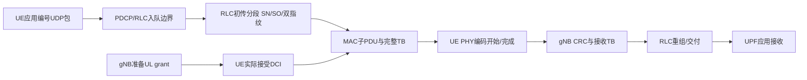

# 单UE上行包级服务先导结果

2026-10-23。**真实OAI C代码中的新增观察点已通过完整5GC＋gNB＋软件UE RFsim先导：4500包全部关联，4000包统计，上行P99为3.806491ms。** 本轮完成测量能力的单UE验收；多UE新基线、长流及优化算法仍待按顺序实施。

初试业务已完整，但PHY观察字段取错而失败；该初试和纠正轮分别保留，详[失败原因与修正](首次先导失败原因与修正.md)。纠正后session45900 exit0，子进程停止，sudo核无RAN、无netns。没有真实射频，摄像头内容未改。

## 条件和已完成到哪里

|项目|本次条件/结果|
|---|---|
|程序|研究分支新增默认OFF C观察器；实际启用全部观察，代码对应946b8d1233的运行源|
|无线|120kHz/μ3、n261、66PRB；0.625ms周期、完整槽D3/S/U1，S为6D4F4U；SSB1/sib1_tda13、MCS上限9、SDAP/QFI9|
|主机|RU6；UE主线程CPU4；其他RAN初始mask0,1,7,12–23，运行前后实际线程/模块核验通过|
|业务|N1固定总UL4Mbps、UDP1200B、4500包去500预热；原110/120秒业务/接收超时|
|路径|核心网新PFCP、TUN/UL预检、APP/N3/TUN/QFI关联及旧分层/RLC检查通过|
|新增观察|7个producer全部无溢出；MAC/DCI/PHY实际μ均3；4500包的9241个初传分段边闭合|
|身份|294输入前后一致，冻结SHA47c6553d45898a6451754576f3306525521f7f8bbe81f4d2f4caeb5f2f807bb2|

具体D/U/S、SSB、TDA、MCS、CPU和负载是按标准字段及本fork选定的工程工作点，**3GPP没有强制本项目采用此唯一配置**。完整原文和精确读段见[source_provenance_v2.json](source_provenance_v2.json)，字段/函数见[README](README.md)；不能将本次有限先导写成整个Release或所有TDD/SCS一致性认证。

## 数据包经过哪些观察点

边通过全SDU/PDU/TB双指纹、局部TB ID、实体作用域及目标radio tick/PID/NDI/RV/TBS等共同核验。一个包可跨TB，一个TB可含多个包。SFN回绕展开后只接受唯一整周期偏移；重复/不一致/无法关联会失败，不按最近墙钟强配。箭头表达关联，准备grant可早于到包。

## 时延定义与本次结果

设同一包应用发送/接收戳为s/r，RLC入队后、首次/末次初传序列化、对端交付戳为a/b/c/d，均为本机CLOCK_MONOTONIC纳秒：

\[
T_{app}=\frac{r-s}{10^6},\quad W=\frac{b-a}{10^6},\quad S=\frac{c-b}{10^6},\quad R=\frac{d-c}{10^6}\quad\text{ms}.
\]

\[
T_{app}=W+S+R+O,\qquad O=T_{app}-\frac{d-a}{10^6}.
\]

每包检查a≤b≤c≤d、初传字节区间并集覆盖完整SDU，以及相邻时间差的整数恒等式。O包含本测量RLC区间之外的应用、协议和核心网等边界，并不命名成某个单独协议层。P99采用4000个逐包总量的经验分位，**分段P99不能相加**。

|同包组成/ms|4000包平均|同一批最慢40包平均|
|---|---:|---:|
|首次RLC序列化前等待W|1.153640|2.835463|
|初传分段序列化跨度S|0.399701|0.505709|
|末次初传至RLC对端交付混合段R|0.481558|0.650905|
|RLC区间外其余测量边界O|0.078741|0.115008|
|应用总时延|2.113640|4.107086|

上行总时延P99：**3.806491ms**。最慢40包占统计样本的1%，该表右列是同包均值，不是各段P99。它们的W占平均总量69.038%，支持优先追查首次RLC序列化之前的等待；W仍受授权/主机执行/队列状态等影响，不能凭这一比例确定唯一根因。

PHY编码调用的按包关联工作量平均0.034070ms、同最慢40包平均0.039501ms。它包含在既有混合过程且同TB工作可能被多个包共享，因此不能再加到上述表中，也不能直接跨包求和当CPU总成本。PHY软件编码时间不是实物RF发射时长。

## 新增证据带来的判断

- 4000统计包中，401包至少有一次所用授权在其RLC入队前已被gNB准备。它证明授权和到包不总是严格串行；不能给每包强行安排“先独立SR，再BSR，再grant”的固定流程，也不能用grant−入队算负排队。
- 本批4000包的关联尝试未观察到CRC失败或HARQ重传，RLC重传同样未出现。这只对应当前先导，不推断多UE、受损信道或长尾总体都没有重传；合成失败夹具与真实未出现的失败事件分开。
- 4000统计包按初传段数：1段84包、2段3626包、3段289包、4段1包。当前负载下“一个1200B包必在一个时隙/一个TB内完成”的假设不成立。
- 初试P99 4.009077ms与纠正轮3.806491ms分别保留。程序观察身份不同且每轮只有一次，差值不用于估计调度优化收益；本轮尚未实施算法。

数学推导中的机会等待是NR时间、特定到达/服务假设下的模型量；这里是同机完整RFsim软件墙钟。分解恒等式通过只证明同口径统计自洽，不等于已验证完整时延预测模型。必须结合后续同程序、多UE、OFF/ON和长流对照。

## 来源、命令与后续

首选TS38.211 V19.5.0 §4.3.2/表4.3.2-1，38.212 V19.4.0 §7.3.1.1.1/2，38.214 V19.5.0 §6.1.2.1，38.321 V19.4.0 §5.4.1/5.4.2/5.4.3.1.3/5.4.5/6.1.3.1，38.322 V19.3.0 §5.2.3.1/§6.2.2.4/§6.2.3.3–5；P01 III/IV本地PDF2–4辅助逐包边界，P30v3 PDF4–6/22–23辅助核模型假设，P31v3 PDF3/9–11辅助架构和预测评测边界；教材13.1.1.2本地PDF530–532辅助调度背景。日志/哈希/时钟/门槛与本项目分解是工程选择，不虚构标准给每层固定耗时。原文可读、无下载，用户所选版本不冒称独立核官网最高。

实际完整命令见README、TEST217/218；安全结果及独立复核在[evidence/pilot-02/summary.json](evidence/pilot-02/summary.json)。原始业务/trace/日志及294清单仅本地`results/ul-service-01/pilot-plan-02`、`pilot-runs-02`，旧`pilot-runs-01`不删不覆盖。Word/PPT本轮未改。

下一步按授权：用现行程序另预声明N1/N4/N8、固定总UL4Mbps、OFF/ON、两反序块12个短基线；之后单独长流检查队列增长与尾部样本，最后实现等待PF算法。每个新阶段继续先核原文、CHG/TEST、新输入冻结及Git，不重启本已结束先导。
