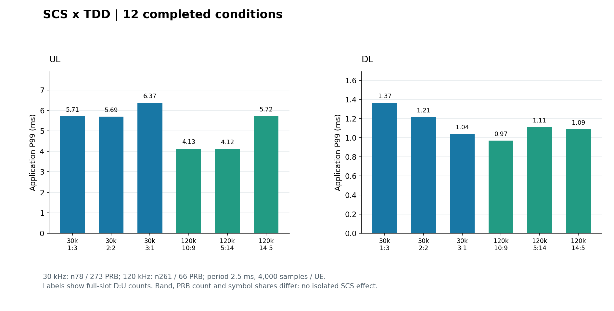
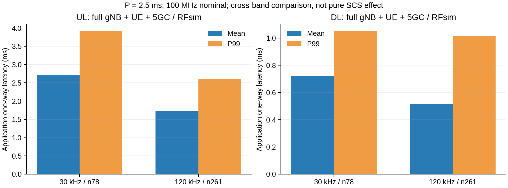

# SCS 时延分析：做过的实验、图片与错误案例

[⇄ TDD](TDD_已做实验与错误案例.md) · [≋ SCS](SCS_已做实验与错误案例.md) · [♧ 多 UE](多UE_已做实验与错误案例.md) · [▤ 分层时延](分层时延_已做实验与错误案例.md) · [⌁ 尾时延](尾时延_已做实验与错误案例.md)

先看 [SCS 参数集、时隙公式与协议表格](../算法知识点说明/不同SCS/实验结果之前_SCS与资源边界.md)。本页保留 2026-10-22 完整 5GC + gNB + UE RFsim 的历史业务数据，没有新增实验。

**批次纠正（2026-11-06）：下面这组共同规则数据来自 MAC 子头纠正前的程序，不能作为修复后现行性能基准。** 当时确实完成了业务和包关联；后来 CHG-213/214 发现并修正 UE 短 MAC SDU 的子头及预算问题。其他 TDD/SCS/DL 尚未由修复版完整重测覆盖。此前本页强调了更早一组图与共同规则表的区别，却遗漏共同规则表也属于纠错前程序，这里直接纠正。原始数值保留历史身份，不换版本标签，也不减一个固定值代替重测。

## 实际做过什么

共同规则重测 `common-policy-rerun/short` 中，SCS × TDD 共 12 个条件，全部完成。每个配置分别测 UL 和 DL：

|SCS|频段与资源|完整槽 D:U 候选|共同条件|
|---|---|---|---|
|30 kHz|n78，273 PRB|1:3、2:2、3:1|单 UE，周期 2.5 ms，1200 B UDP，4500 包去前 500 包|
|120 kHz|n261，66 PRB|10:9、5:14、14:5|同上；每个方向 4000 包统计|

频段、PRB 数和符号占比会同时变化。本页的实验叫“两个可运行配置族的交叉比较”，不足以识别只改变 SCS 的纯因果收益。知识跳转：[相同带宽时为什么 PRB 数会变化](../算法知识点说明/不同SCS/实验结果之前_SCS与资源边界.md#同一个带宽prb-数也可能一起变化)。

## 历史共同规则批次的结果图与实际数值



图由历史共同规则批次的汇总重新绘制，没有重跑实验。每个柱是对应配置的一次完整测量；图中没有把不同配比合并平均。图名中的“共同规则重测”是当时的批次名，不代表已经完成后来 MAC 子头修复版的重测。

|SCS / 完整槽 D:U|UL P99 / ms|DL P99 / ms|
|---|---:|---:|
|30 kHz / 1:3|5.711723|1.365569|
|30 kHz / 2:2|5.692500|1.214995|
|30 kHz / 3:1|6.371009|1.041108|
|120 kHz / 10:9|4.132272|0.970027|
|120 kHz / 5:14|4.119065|1.109866|
|120 kHz / 14:5|5.721127|1.089062|

这组历史样本中，120 kHz 条件的 UL P99 较低，但 DL 并非每种配比都按相同次序变化。不能因此宣称“任何业务换成 120 kHz 都有固定比例改善”。完整条件、外部三段和逐 UE 指标见 [第二阶段原报告](#/doc/dcbc173e0d6fb47db)，其中当时使用的“当前”须按上述历史程序身份理解。

## 一个槽差四倍，为什么整包 P99 没有差四倍

你的槽长理解正确：30 kHz 的正常 CP 标称槽长为 0.5 ms，120 kHz 为 0.125 ms。但本组固定的是 **2.5 ms 的 TDD 周期**，因此一个周期分别包含 5 槽和 20 槽，并非把同一个周期缩短四倍。

|SCS|每槽标称时长|TDD 周期|每周期槽数|一个实际图样例子|
|---|---:|---:|---:|---|
|30 kHz|0.5 ms|2.5 ms|5|1 个完整 D 槽 + 1 个 S 槽 + 3 个完整 U 槽|
|120 kHz|0.125 ms|2.5 ms|20|5 个完整 D 槽 + 1 个 S 槽 + 14 个完整 U 槽|

两例 S 均配置 6D/4F/4U；这是本实验工程选择，协议没有逐项强制这两个图样。前例完整 U 槽总时长为 3 × 0.5 = 1.5 ms，后例为 14 × 0.125 = 1.75 ms，均未计入 S 的部分 U 符号。这个计算只说明方向块的时间尺度仍在毫秒级，不是某个包实际等待了多久。

**表中的 P99 测量的是应用发送到应用接收，不是一个槽的传输时间。** 当时每个条件单独启动完整栈、先做绑定 TUN 的 ICMP 路径预检，再运行单 UE、1200 B、2 Mbps 的编号 UDP；UL 与 DL 分别运行，每项 4500 包去前 500 包。对各自 4000 个包，按共享宿主单调时钟的发送/接收差计算 P99，ICMP RTT 不混入这张表。

频段还从 n78 变为 n261、PRB 从 273 变为 66，控制配置和方向符号份额也有差异。因此这张表既不能证明“只改 SCS 就获得这些收益”，也不能用来要求整包 P99 严格等于原来的四分之一。需要在修复版上先核对绝对时间图样、资源和处理条件，再作受控对照。

2026-11-06 只读复核：从 12 个原始 `matched_packets.csv` 的发送/接收纳秒时间戳重算全部 48000 个统计样本，12 个 P99 与旧表逐项一致，配置的 5/20 槽计数也一致。**这是旧数据复算，不是修复版新仿真。** 核验摘要见本阅读站 `校验/SCS历史批次复核_20261106.json`；原实验 TEST-177 与后续纠错 CHG-213/214/220 仍保留。

正常 CP 下，每 1 ms 子帧的槽数给出常用标称槽长换算：

```math
\Delta f=15\times2^{\mu}\ \mathrm{kHz},\qquad T_{\mathrm{slot}}=\frac{1}{2^{\mu}}\ \mathrm{ms}
```

这里的槽长不是应用发送至接收的完整时延。协议出处和正常 CP 每毫秒槽数见 [TS 38.211 参数集知识表](../算法知识点说明/不同SCS/实验结果之前_SCS与资源边界.md#3gpp-参数集与正常-cp-槽数表)。

## 跑过的错误与没有测到的部分

|案例|实际到哪里|为什么不能这样解释|现在怎样记录|
|---|---|---|---|
|60 kHz 完整栈未完成|本 fork 的 `get_samplerate_and_bw` 缺少 μ = 2 路径，未得到完整 UE 业务结果|参数集在协议中存在，不等于本地 fork 的频段、采样率和接入链路都实现了|明确写实现支持缺口，不画成 0 ms、不借 30/120 kHz 插值成实测|
|把 240 kHz 模型当 n261 实测|已有的是抽象模型，未取得本页条件下的完整业务测量|模型中的机会网格不等于 n261 实际可运行资源配置|模型和全栈实测分开，不能标作已跑业务结果|
|只用槽长公式解释 P99 差值|公式只描述时间网格|频段、PRB、方向符号、处理和宿主推进也参与变化|先核对资源边界，再描述本组样本观察；不能报告纯 SCS 因果增益|

这 12 项共同规则业务本身没有失败条件；上表的实现缺口和解释错误不冒充新的失败测量。读 [实验前置核对](../算法知识点说明/不同SCS/实验结果之前_SCS与资源边界.md#实验结果的前置核对) 可看到支持范围的区分。

## 更早历史原图：为什么不能混入共同规则历史表



这张图确实来自早期跑过的实验，原文件保留。其 120 kHz UL P99 大约在 2.6 ms，和上表共同规则重测的 4.119–5.721 ms 不是同一批数据。旧程序/控制条件与后续基线发生变化，拿旧柱状图配新的结果表，会让读者误以为同一实验自相矛盾；也不能把二者差值叫 SCS 或算法收益。主图已改为对应共同规则汇总重新绘制；两批都不构成后来 MAC 子头修复后的新基准。

## 来源与继续阅读

原报告：[第二阶段 SCS 与 TDD 交叉分析](#/doc/dcbc173e0d6fb47db)。协议表格和原文跳转：[TS 38.211 V19.5.0 §4.2/4.3.2、TS 38.104 V20.1.0 的频段/带宽表及 TS 38.214 V19.5.0](../算法知识点说明/不同SCS/实验结果之前_SCS与资源边界.md#来源与原结果)。这些协议支持参数含义和资源边界，不规定本页工程负载，也不保证端到端时延。

图与汇总、原文件 SHA 均保存在本阅读站 `说明/五类时延分析/`；主图和历史图的批次身份分开记录，旧报告仍可检索。

继续：[多 UE 已做实验与错误案例](多UE_已做实验与错误案例.md) · [返回 SCS 知识点](../算法知识点说明/不同SCS/实验结果之前_SCS与资源边界.md)
