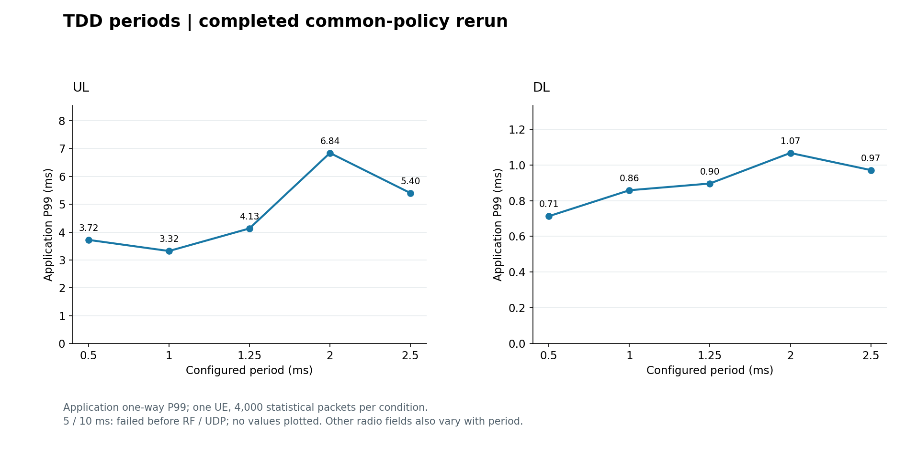
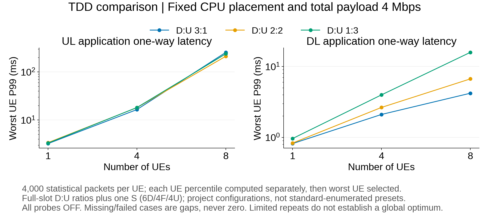
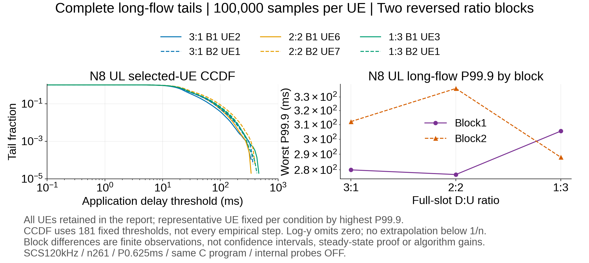

# TDD 时延分析：做过的实验、图片与错误案例

[⇄ TDD](TDD_已做实验与错误案例.md) · [≋ SCS](SCS_已做实验与错误案例.md) · [♧ 多 UE](多UE_已做实验与错误案例.md) · [▤ 分层时延](分层时延_已做实验与错误案例.md) · [⌁ 尾时延](尾时延_已做实验与错误案例.md)

先看 [TDD 配置、协议表格与时隙图](../算法知识点说明/不同TDD/实验结果之前_TDD配置与时隙图.md)。本页整理已经做过的同宿主完整 5GC + gNB + 软件 UE RFsim 实验；没有新启动实验。应用发送到接收的单向时延包含实现和宿主影响，不能直接当作真实空口时延。

## 实际做过哪些实验

|实验批次|改变什么|已完成到哪里|怎样读|
|---|---|---|---|
|共同规则重测 `common-policy-rerun/short`|单 UE 的完整槽 D:U 配比、周期和 S 槽符号|22 次尝试，18 项完整业务，4 项业务前失败|每 UE 4500 包，去前 500 包，4000 包统计；表格见第一阶段原报告|
|固定 CPU 的 TDD 确认 `tdd-confirmation`|UE 数 1/4/8、UL/DL、3:1/2:2/1:3；另加 8 UE UL 长流双块|24 个条件最终完整，共 25 次实际尝试，保留 1 次抓包失败|总负载固定 4 Mbps；18 个短条件 + 6 个长条件，不能和上一行合池|

第一批采用共同上行资格/MCS 上限规则及纠正后的 FR2 控制方向。第二批固定 CPU 放置，120 kHz、n261、66 PRB、周期 0.625 ms，S 槽为 6D/4F/4U，内部探针 OFF；短流每 UE 4000 个统计包，长流每 UE 100000 个统计包。1200 B、MCS 上限 9、这些配比和 CPU 位置都是项目条件，不是协议指定的唯一方案。显式 UL ICMP 预检是部署前提，RTT 不纳入单向 UDP。

知识跳转：[D:U 与 S 槽怎样一起计数](../算法知识点说明/不同TDD/实验结果之前_TDD配置与时隙图.md#从字段算出整周期而不是只记31) · [单向时延的发送和接收边界](../算法知识点说明/00_通信与时延基础知识.md#先画出发送和接收边界)

## 结果图：单 UE 周期重测

此图由已完成重测的 `current_matrix.json` 汇总值重新绘制，没有重跑实验。5 ms 和 10 ms 两种周期的双向条件没有业务时延，图中不画成 0。改变周期时，方向比例和 PRACH 等字段也会变化，因此图中的差值不是纯周期因果效应。

同批单 UE 配比结果可与图分开阅读：

|完整槽 D:U|UL P99 / ms|DL P99 / ms|
|---|---:|---:|
|3:1|3.581867|0.823138|
|2:2|3.125312|0.761477|
|1:3|3.360444|0.979670|

来源：[第一阶段完整报告与全部条件](#/doc/d82d72d1fe3098264)。为什么周期可能影响等待，见 [机会间隔与残余等待公式](../算法知识点说明/不同TDD/实验结果之前_TDD配置与时隙图.md#为什么周期可能带来等待)；这个简化模型不预测整条应用路径。

## 结果图：固定 CPU 后的短流和长流

此为已跑实验的原图，和上一节属于不同批次。8 UE 短流的 UL 最差 UE P99，按 3:1、2:2、1:3 依次约为 255.999、212.404、239.032 ms；DL 约为 4.205、6.696、15.848 ms。这里比较的是逐 UE 计算后选出的最差 P99，不能把所有 UE 混成一个分布。

|长流顺序块|3:1 的最差 UE P99.9 / ms|2:2 / ms|1:3 / ms|
|---|---:|---:|---:|
|块 1|280.002853|277.068722|305.577088|
|块 2，反序执行|312.180350|336.377900|288.060614|

两块的配比排名发生反转，不能只选最好的一块宣布某配比全局最优，也不是算法优化收益。完整主统计为 5112000 包，完整关联为 5175000 包；失败尝试单独保留。来源：[固定 CPU 的 24 条件报告](#/doc/d96e24251af6fb53b)。知识跳转：[P99、P99.9 与样本数](../算法知识点说明/尾时延/实验结果之前_分位数样本与慢包.md#为什么样本与配对很重要)。

## 跑过的错误案例：哪里错、为什么错

|案例|最后到哪里，业务与抓包是否开始|原因和影响|正确读法与处理|
|---|---|---|---|
|5 ms / 10 ms 双向共 4 项失败|gNB RF 启动前的 Msg3 K2 生成；UDP 未开始，抓包文件未创建|本 fork 生成 K2 = 34 / 74，超过所用 RRC 字段的 0..32 范围|属于参数生成实现限制；未取得该条件的业务时延，不能写成 3GPP 禁止该周期，更不能以 0 ms 补图|
|旧 FR2 双 SSB / SIB1 方向冲突|历史配置审计发现；不是本页纠正后测量的控制配置|旧双 SSB 1/33、默认 SIB1 符号 2..11 在部分图样中与固定 U 冲突|现行批次使用单 SSB 1 与 `sib1_tda13`（S2/L4）；控制开销也改变，跨组差值不能单独归于调度算法|
|8 UE UL、1:3、块 2 的原始抓包失败|UDP 已完整交付，应用和 N3 各 804000 包；UE7 TUN 捕获缺 2 包|缺发送序号 28033/28034；tcpdump 报 2 个 kernel drop。直接原因为捕获丢包，CPU/IO/缓冲的唯一根因未确定|保留该次 800000 个完整应用统计包作为独立证据，不能进入要求四边界完整的主表；相同参数只做了原先允许的一次接续，最终成功样本另列|

最后一例不是无线业务丢包：两包有应用记录，延迟分别为 15.446155、19.162576 ms；少的是 TUN 观察记录。详情：[原失败及严格接续说明](#/doc/d8ec7c047997b9ff1)。预检通过、应用交付、四边界抓包完整是不同的验收层次，见 [计时边界知识](../算法知识点说明/00_通信与时延基础知识.md#协议告诉我们路径实验告诉我们计时点)。

## 来源、协议和图片身份

TDD 方向含义和允许字段已在知识页逐项连接本地原文：TS 38.213 V19.5.0 §11.1、TS 38.331 V19.4.0 §6.3.2 `TDD-UL-DL-Pattern`。K2 范围查 [同版 §6.3.2 的 PUSCH-TimeDomainResourceAllocation 原文](#/protocol/38.331?version=19.4.0&q=PUSCH-TimeDomainResourceAllocation)。SIB1 的默认时域行见 [TS 38.214 V19.5.0 表 5.1.2.1.1-2](#/protocol/38.214?version=19.5.0&q=Table%205.1.2.1.1-2)。具体字段组合仍是工程选择。

全部图、已完成汇总值及 SHA 随阅读站保存，见同目录 `数据/来源与图片核验.json`、`数据/重绘图片核验.json`。两张固定 CPU 图片为原文件逐字节复制；周期图为同批汇总重绘。旧记录和失败证据保留在原报告链接中。

继续：[SCS 已做实验与错误案例](SCS_已做实验与错误案例.md) · [返回 TDD 知识点](../算法知识点说明/不同TDD/实验结果之前_TDD配置与时隙图.md)
