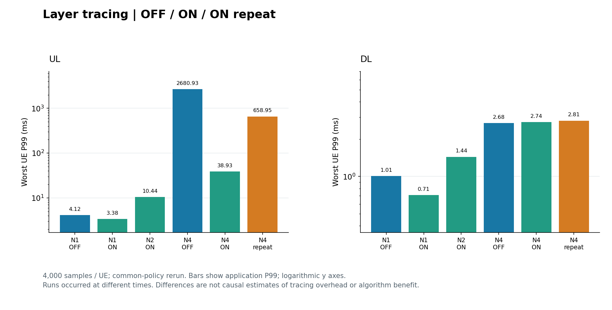
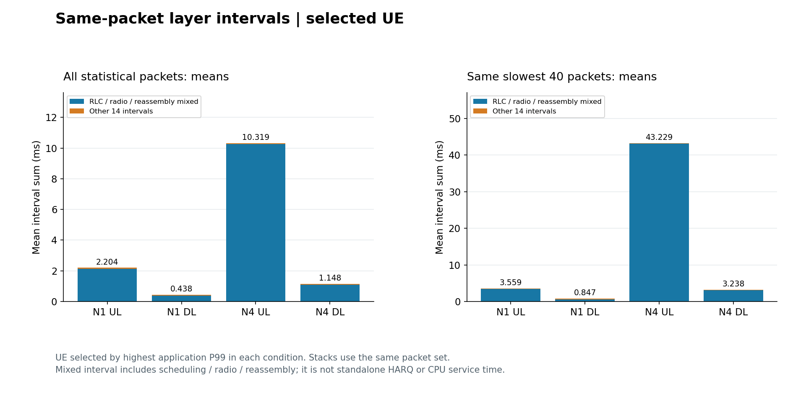
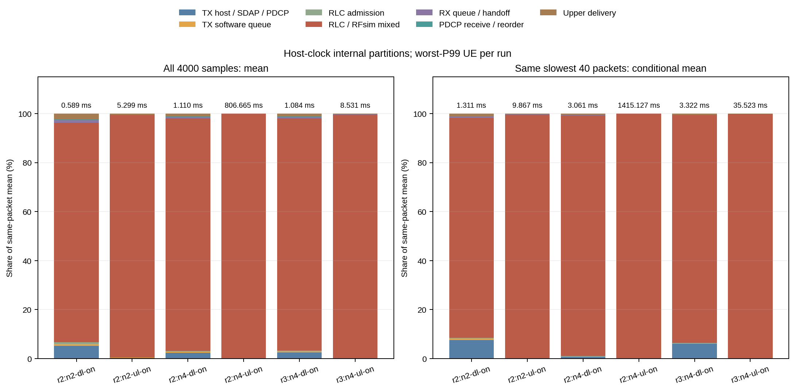

# 分层时延分析：做过的实验、图片与错误案例

[⇄ TDD](TDD_已做实验与错误案例.md) · [≋ SCS](SCS_已做实验与错误案例.md) · [♧ 多 UE](多UE_已做实验与错误案例.md) · [▤ 分层时延](分层时延_已做实验与错误案例.md) · [⌁ 尾时延](尾时延_已做实验与错误案例.md)

先看 [协议层次、时间戳边界与闭合公式](../算法知识点说明/分层时延/实验结果之前_协议层与计时边界.md)。本页是已经做过的内部 API/队列边界观察，不能把图中的每个区间直接叫作一个标准协议层的纯耗时。

## 已执行的条件和测量边界

共同规则 `common-policy-rerun/short` 的分层组共 12 项完整条件。N1 测 UL/DL 的内部探针 OFF/ON，N2 测 UL/DL ON，N4 测 UL/DL OFF/ON 并各重复一次 ON。每 UE 4500 包、去前 500 包后统计 4000 包，固定每 UE 2 Mbps、1200 B UDP。

8 个 ON 条件合计 99000 个完整关联包、1386000 条内部事件。每包有 14 个内部时间戳，加应用起止点，共形成 15 个相邻区间。总量使用同宿主单调时钟；外部 TUN/N3 抓包时间不是这些内部函数时间戳。

知识跳转：[协议层的功能与时间戳区间怎样区分](../算法知识点说明/分层时延/实验结果之前_协议层与计时边界.md#3gpp-用户面层次的功能表)。

## 结果图：探针 OFF、ON 和重复



|条件|UL 最差 UE P99 / ms|DL 最差 UE P99 / ms|
|---|---:|---:|
|N1 OFF|4.115415|1.007790|
|N1 ON|3.383198|0.707093|
|N2 ON|10.441863|1.438992|
|N4 OFF|2680.932658|2.684858|
|N4 ON|38.934167|2.739240|
|N4 ON 重复|658.948992|2.808833|

图由已完成汇总重新绘制。尤其 N4 UL 的三次观察差异很大，不能把 2680.933 → 38.934 ms 叫作“开探针使时延改善”，也不能简单相减当作探针开销：运行时间、顺序和状态不是同一个随机配对控制。

## 结果图：同一批包的分段均值与慢包



每个条件先按应用 P99 选择一个 UE，再对它的同一包集合计算分段。左图是该 UE 的全部统计包；右图是按应用总时延挑出的同一批最慢 40 包。图里没有把各段分别挑出来的最慢包拼接。

|ON 条件，按最高应用 P99 选 UE|全体包总均值 / ms|其中 RLC/无线/重组混合区间均值 / ms|同一批最慢 40 包总均值 / ms|
|---|---:|---:|---:|
|N1 UL|2.203956|2.124995|3.558743|
|N1 DL|0.437929|0.373528|0.847076|
|N4 UL|10.318761|10.247055|43.228788|
|N4 DL|1.147690|1.088827|3.238483|

这是条件均值分解。RLC 到对端 RLC 的区间仍混合调度、分段、PHY/HARQ、RFsim 与重组，不能由此报告独立 HARQ 耗时或纯 CPU 服务成本。N4 UL 的 ON 重复最慢 40 包均值为 667.891703 ms，和首次 ON 分开保留。

同包区间可逐包相加：

```math
\sum_{j=0}^{14}(t_{j+1}-t_j)=t_{15}-t_0
```

实际整数残差为 0，验证的是完整关联和差分闭合。这是恒等式检查，不能称为独立模型预测准确率。P99 不满足同样的相加关系，见 [同包闭合与 P99 的区别](../算法知识点说明/分层时延/实验结果之前_协议层与计时边界.md#分段必须按同一包同一口径闭合) 和 [慢包选取规则](../算法知识点说明/分层时延/实验结果之前_协议层与计时边界.md#慢包分解要选同一批包)。

## 跑过的失败与解释错误

|案例|测到了哪里|为什么错或为什么不足|处理与当前边界|
|---|---|---|---|
|旧恢复组 N2 UL 崩溃、N4 DL TUN 超时|前者在 SIB1/RA 后，后者等 TUN 超过 25 秒；UDP 和业务抓包均未开始|没有完整业务包，自然不能形成分层样本；不能用 gNB 启动代替内部时延成功|失败保留。新条目发布窗口和共享保护修正后，另一个旧策略新二进制组 6/6 完整；不覆盖旧失败|
|把混合大区间写成纯 HARQ/PHY|已得到 RLC 到对端 RLC 区间，未取得独立 HARQ/PHY 边界|一个差值跨越多个过程，无法唯一归因|直接标为“RLC/无线/重组混合区间”，未测项不填 0|
|把分段 P99 相加当应用 P99|各段分位可能对应不同包|分位统计不是线性运算|按同包先求总量，再计算该总量的分位；最慢包也固定同一集合|
|把短 ON 最慢 40 包当长流 P99.9 分解|短流 ON 只有每 UE 4000 个统计包；长流另属 OFF 条件|样本集合、时长和观察状态均不同；原缓冲容量也不支持直接把这些长路径全部开 ON|仅报告短 ON 条件均值，长流尾统计去尾时延入口阅读|

旧接入失败的直接证据和未确定根因，见 [恢复失败报告](#/doc/d2b31dd9909e8e6a0) 与 [同步修复复测](#/doc/dfb9212b31f7b7cc3)；解释也可回到 [多 UE 失败案例](多UE_已做实验与错误案例.md#跑过的失败案例接入失败不等于业务时延大)。

## 历史原图：保留批次，不替换当前表



旧图 N4 UL 全体均值约 806.665 ms、最慢 40 包均值约 1415.127 ms；本页当前共同规则首次 ON 为 10.318761、43.228788 ms。它们条件/程序身份不同，不是同一张图需要“修正坐标”，也不能把跨组差值解释为优化。旧图保留用于追溯，当前主图从对应批次汇总重绘。

## 来源与继续阅读

完整来源：[第四阶段内部边界与软件队列报告](#/doc/daea787b9d0e9e11e)。协议功能划分和精确版本跳转集中在 [分层知识页来源](../算法知识点说明/分层时延/实验结果之前_协议层与计时边界.md#来源与原结果)，包括本地 TS 38.300、38.322、38.323、37.324。15 区间和探针位置是工程观察设计，不是标准强制的分层时延预算。

图片、汇总和哈希随仓库保存；没有删异常数据、修改门槛或启动新实验。

继续：[尾时延已做实验与错误案例](尾时延_已做实验与错误案例.md) · [返回分层知识点](../算法知识点说明/分层时延/实验结果之前_协议层与计时边界.md)
