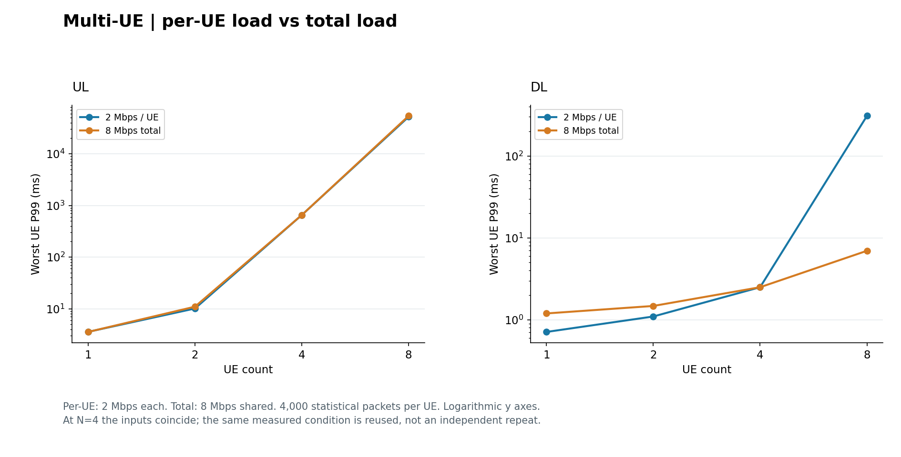
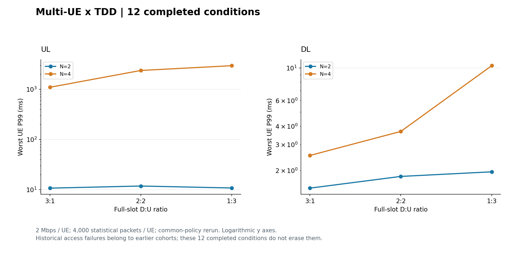
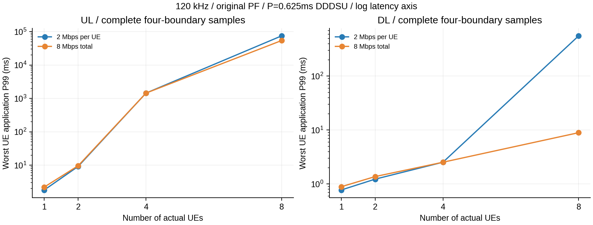

# 多 UE 时延分析：做过的实验、图片与错误案例

[⇄ TDD](TDD_已做实验与错误案例.md) · [≋ SCS](SCS_已做实验与错误案例.md) · [♧ 多 UE](多UE_已做实验与错误案例.md) · [▤ 分层时延](分层时延_已做实验与错误案例.md) · [⌁ 尾时延](尾时延_已做实验与错误案例.md)

先看 [多 UE 负载口径、调度对象与对照条件](../算法知识点说明/多UE/实验结果之前_多UE负载与对照条件.md)。本页都是已经执行的同宿主完整 RFsim 应用单向测量，1200 B UDP；共同规则短流每 UE 4500 包、去前 500 包后统计 4000 包。

## 实际做过哪些组

|组别|改变什么|完成情况|边界|
|---|---|---|---|
|共同规则多 UE 负载组|N = 1/2/4/8；固定每 UE 2 Mbps 与固定总量 8 Mbps；额外 N2 UL CPU4 条件|15 个独立条件全部完整|N4 两种负载输入相同，只实测一次，并非 16 次独立测量|
|共同规则多 UE × TDD|N = 2/4，UL/DL，完整槽 3:1/2:2/1:3|12/12 完整|不是早期失败组；每 UE 固定 2 Mbps|
|较早的接入恢复和同步修复|针对早期多 UE 接入失败做有限追加与新二进制复测|追加 6 项中 4 项完整、2 项业务前失败；之后独立同步修复组 6/6 完整|均为旧策略批次，不能与上述共同规则样本混合|

## 结果图：两种负载口径必须分开

主图按已完成汇总重新绘制，没有新实验。

|UE 数|UL 每 UE 2 Mbps / ms|UL 总量 8 Mbps / ms|DL 每 UE 2 Mbps / ms|DL 总量 8 Mbps / ms|
|---|---:|---:|---:|---:|
|1|3.572576|3.560415|0.710516|1.195496|
|2|10.131799|10.983512|1.096921|1.475152|
|4，同一输入只测一次|652.880471|652.880471|2.498555|2.498555|
|8|52101.269558|54204.902991|308.050265|6.953181|

表中是逐 UE 计算后的最差 P99，单位均为 ms；52101 ms 约为 52.1 秒，不是 52.1 ms。8 UE 的固定总量 DL 明显低于固定每 UE DL，说明比较之前必须说明总到达负载。UL 大值伴随顺序窗口增长，支持有限运行中发生积压的观察，不能据此唯一认定 CPU 根因或长期队列结论。

知识跳转：[固定每 UE 与固定总量的公式、例子](../算法知识点说明/多UE/实验结果之前_多UE负载与对照条件.md#两种负载口径) · [为什么要逐 UE 统计](../算法知识点说明/多UE/实验结果之前_多UE负载与对照条件.md#逐-ue-统计才能发现服务不均)。完整来源：[第三阶段负载与资源边界报告](#/doc/d4f62ed1d95097648)。

## 结果图：多 UE 与 TDD 交叉

4 UE UL 的最差 P99 按 3:1、2:2、1:3 约为 1092.265、2360.246、2936.521 ms；这组是固定每 UE 2 Mbps，不能直接和 TDD 页“固定总量 4 Mbps、固定 CPU 的确认组”相比并称优化。原报告：[第三阶段多 UE 与 TDD 交叉](#/doc/d55c967bc7725fa8e)。TDD 符号理解见 [完整槽与 S 槽](../算法知识点说明/不同TDD/实验结果之前_TDD配置与时隙图.md#从字段算出整周期而不是只记31)。

## 跑过的失败案例：接入失败不等于业务时延大

|批次/案例|最后成功位置与失败位置|业务/抓包是否开始|已知原因、修正与限制|
|---|---|---|---|
|旧策略恢复组 N2 UL 2:2|UE1 收到 SIB1、进入 RA 后发生 SIGSEGV|编号 UDP 和业务抓包均未开始|直接原因为空监测字段访问；找到新 SearchSpace 条目未初始化就发布的窗口，且 RRC 更新与正常读者未共享保护。旧现场没有完整线程栈，不能宣称排除全部生命周期问题|
|同组 N4 DL 2:2|UE3 TUN 等待超过原定 25 秒|编号 UDP 和业务抓包均未开始|接入未完整，TUN 超时是直接失败现象；不能从超时本身唯一判定协议、射频或 CPU 根因，也没有通过延长超时补出性能值|
|更早的 `Errno 99` 接收绑定问题|发生于旧接收器绑定阶段|不能视为完成业务|后续两次接入失败没有重新到达同一绑定点，因此那些失败不能证明 `Errno 99` 已经根治|

随后同步修复使新 SearchSpace/CORESET **先填字段，再发布**，并用已有 `mac_IF_mutex` 保护本次 RRC 更新与正常读者。独立新二进制 6 项完整，81000 包关联、72000 包统计；它证明有限复测有效，不会把旧失败变为成功，也不是时延优化收益。

为什么会错：读者若能看见尚未初始化完成的配置，就可能读到空的监测字段。协议规定 SearchSpace 的配置与监测语义，不规定本地 pthread 锁的实现。依据见 [同步修复报告](#/doc/dfb9212b31f7b7cc3) 中 TS 38.331 V19.4.0 §6.1.2 表 6.1.2-1、§6.3.2 SearchSpace 条件，以及 TS 38.213 V19.5.0 §10.1。失败现场与根因边界见 [恢复与失败说明](#/doc/d2b31dd9909e8e6a0)。知识回看：[对照条件和调度对象](../算法知识点说明/多UE/实验结果之前_多UE负载与对照条件.md#3gpp-的调度对象与本实验的控制量)。

## 历史图和两种常见解释错误

这张早期原图中的 8 UE UL 已达约 70 秒，而共同规则主表约为 52–54 秒；它们程序/控制基线不同。将旧图与新表配在一起，或者把两组差值当作优化效果，都会混淆批次。此处只作为读图时检查版本的反例。

另一个容易误读的点：额外 N2 UL CPU4 条件 P99 = 7.949963 ms，常规 N2 UL 为 10.131799 ms。单次差值不足以说明换 CPU 必然带来该改善，仍受时序、状态和有限重复限制。不要把观察相关性写成唯一因果结论。

## 来源与继续阅读

上述四份完整报告链接保留了旧条件、失败记录及引用。协议表格、负载公式和测量前提统一放在 [多 UE 知识页](../算法知识点说明/多UE/实验结果之前_多UE负载与对照条件.md)，其中区分 TS 38.300/38.321 原文与工程选择。两张主图来自共同规则汇总重绘，历史图逐字节复制；数据与 SHA 随仓库保存。

继续：[分层时延已做实验与错误案例](分层时延_已做实验与错误案例.md) · [返回多 UE 知识点](../算法知识点说明/多UE/实验结果之前_多UE负载与对照条件.md)
