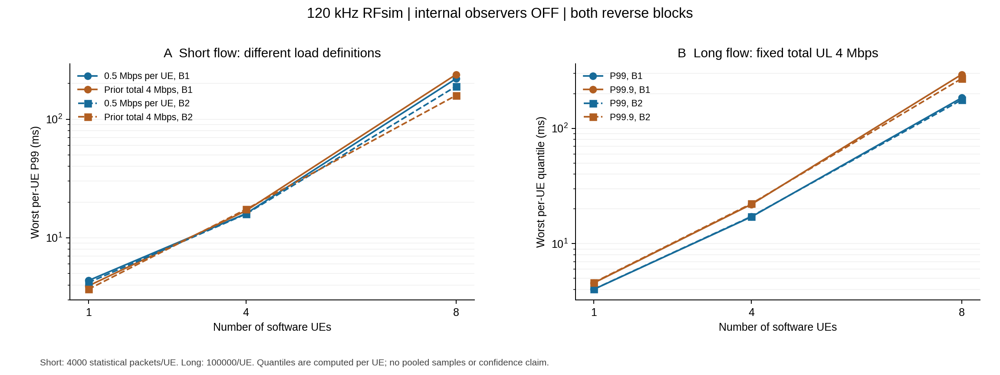
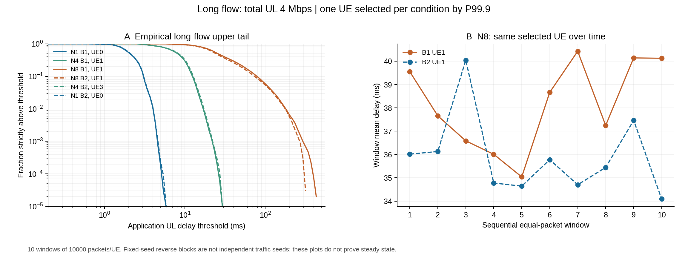

# 尾时延分析：做过的实验、图片与错误案例

[⇄ TDD](TDD_已做实验与错误案例.md) · [≋ SCS](SCS_已做实验与错误案例.md) · [♧ 多 UE](多UE_已做实验与错误案例.md) · [▤ 分层时延](分层时延_已做实验与错误案例.md) · [⌁ 尾时延](尾时延_已做实验与错误案例.md)

先看 [P99/P99.9、CCDF、线性插值与慢包身份](../算法知识点说明/尾时延/实验结果之前_分位数样本与慢包.md)。本页整理已有长流和失败记录，没有新跑实验。P99.9 是样本分位，不是机械臂期限，也不是协议保证。

## 做过的长流分三批阅读

|批次|实际负载和样本|已完成情况|阅读位置|
|---|---|---|---|
|共同规则独立长流 `common-policy-rerun/tail`|每 UE 2 Mbps，N1/N4 各 UL/DL；每 UE 100000 个统计包|4/4 完整，内部探针 OFF|下表与第五阶段原报告|
|固定每 UE / 长流基线 `long-baseline`|短流每 UE 0.5 Mbps，长流固定总 UL 4 Mbps；N1/4/8，两块反序|12/12 完整，2730000 包关联、2704000 包统计，内部探针 OFF|本页两张原图|
|固定 CPU 的 TDD 长流确认 `tdd-confirmation`|N8 UL，总量 4 Mbps，三配比 × 两块；每 UE 100000 个统计包|6 个长条件最终完整；24 条件总体保留 1 次抓包失败|[TDD 结果图和抓包失败](TDD_已做实验与错误案例.md#结果图固定-cpu-后的短流和长流)|

这三批即使都写“长流”，负载、程序/控制条件和研究问题也不完全相同，不能合池或拿跨组差值计算算法收益。

## 共同规则长流：保留大时延，不裁稳定段

|条件|总负载 / Mbps|统计样本 / UE|最差 UE P99 / ms|最差 UE P99.9 / ms|
|---|---:|---:|---:|---:|
|N1 UL|2|100000|3.824817|4.471456|
|N1 DL|2|100000|0.729235|0.964547|
|N4 UL|8|100000|25027.317994|25181.855108|
|N4 DL|8|100000|2.679417|4.195168|

各列分别取逐 UE 统计量的最大值；全部 UE 明细见 [第五阶段独立长流原报告](#/doc/d6bd8691c5e4276c4)。N4 UL 的顺序四窗均值持续增加，lag-1 样本相关约 0.99996，支持本次有限运行有积压/漂移，不能拿 IID 参考区间当真实总体置信保证；没有为了使图好看而删慢包。

## 结果原图：固定负载的短长流比较



此图属于 `long-baseline` 的独立 12 条件，不是上一节固定每 UE 2 Mbps 的 4 条件。长流总量固定为 4 Mbps，每 UE 发 100500 包、去前 500 包；两个块按 N1/4/8 与 N8/4/1 反序执行，种子固定，不能称独立种子重复。

|长流 UE 数|块 1 最差 UE P99.9 / ms|块 2 / ms|
|---|---:|---:|
|1|4.572863|4.612189|
|4|21.954384|22.254956|
|8|292.791259|269.637307|

N4 的这组 P99.9 约 22 ms，而上一节约 25 秒；总负载从 8 Mbps 到 4 Mbps、批次条件也不同。不能写成算法让时延下降了数百倍。知识回看：[固定总量与每 UE 负载](../算法知识点说明/多UE/实验结果之前_多UE负载与对照条件.md#两种负载口径)。

## 结果原图：尾部概率和顺序窗口



N8 所选 UE1 两块的 lag-1 样本相关约 0.918–0.921，超过 100 ms 的比例约 5.377%–5.888%，最长连续超过该门限的包串为 112/123 包。100 ms 是描述用的项目门限，不是已确认的机械臂 SLA。只看一个 P99.9 会丢掉慢包连续出现的信息。

经验超越率定义为：

```math
\widehat{P}(L>d)=\frac{1}{n}\sum_{i=1}^{n}\mathbf{1}\{L_i>d\}
```

图只表达观测样本，不外推到 $1/n$ 以下；对数坐标不显示 0。完整结果、执行顺序和全部 UE 见 [固定每 UE 与长流尾时延报告](#/doc/df9e74999c778198f)。知识跳转：[统计量完整定义](../算法知识点说明/尾时延/实验结果之前_分位数样本与慢包.md#先把统计量写完整) · [样本相关、分位与配对](../算法知识点说明/尾时延/实验结果之前_分位数样本与慢包.md#为什么样本与配对很重要)。

## 实际错误案例：离线脚本报错，不是无线实验失败

长流基线的 12 次完整业务本身没有失败或重试。RAN 全部回收之后，第一次执行离线 `verify_analysis.py` 和 `collect.py` 均以退出码 1 失败：

```text
TypeError: _quantile_dispatcher() got an unexpected keyword argument 'method'
```

|问题|实际情况|
|---|---|
|最后成功位置|12 项业务已经完成；离线合成检查未完成，实际收集只进入首个短流 flow，尚无 `evidence/current` 输出|
|直接原因|本机 `/usr/bin/python3` 使用 NumPy 1.21.5，所装 API 接受 `interpolation=`，脚本误用了较新接口的 `method=`|
|为什么不能归于无线或数据|异常发生在离线分位函数参数分派，尚未得到完整分析结果；没有包损坏或接入失败证据|
|实际修正|按本机安装源码核对后改用 `interpolation='linear'`，保持原定线性插值定义、样本、慢包和冻结输入；重新执行离线检查与收集，结果进入最终报告|
|不能声称什么|不能说首次分析通过，也不需要因 API 参数错误重跑或覆盖已完成的无线业务|

原始失败：[TEST-249](#/doc/d64cf0d9a734e34e8)；后续完整分析见上面的 12 条件报告。这个工程兼容问题的 3GPP/新数学推导不适用；分位定义本身见 [线性插值知识与完整公式](../算法知识点说明/尾时延/实验结果之前_分位数样本与慢包.md#本项目长流分析的线性插值口径)。

## 另外三种错误读法

|错误读法|为什么错|正确边界|
|---|---|---|
|本轮 2600000 个长流统计包未出现 >1000 ms，就认定总体风险为 0|有限观测没看到，不代表总体事件不可能；包还有相关性|写明本轮观测为 0，不外推零风险；门限是项目示例|
|每 UE 有 100000 包，就自动获得可靠的总体 P99.9 置信保证|样本数量不能消除强相关和漂移；IID 参考依赖假设|报告逐 UE、顺序窗口、相关性和有限重复，保留假设|
|短 ON 分层的最慢 40 包可以直接解释长 OFF 的 P99.9|不是同一个包集合，也不是同样探针状态和负载时长|短 ON 仅作对应条件的同包均值观察；长 OFF 没测独立内部因果分解|

抓包缺包还应与业务丢包区分：固定 CPU TDD 批次有真实的 2 包 kernel capture drop，完整应用记录仍在。原因和保留办法见 [TDD 的原失败案例](TDD_已做实验与错误案例.md#跑过的错误案例哪里错为什么错)。

## 来源与返回知识点

原报告的论文与协议引用继续保持历史身份；本页统计公式是项目分析方法，协议预算对照集中在 [尾时延知识页](../算法知识点说明/尾时延/实验结果之前_分位数样本与慢包.md#与协议预算怎样衔接)。P19 的本地版本和 PDF 页序依知识页来源说明，不改标签为后续全文版本。

两张图均为已跑实验原文件的逐字节副本，相关汇总与 SHA 一并保存。阅读或迁移此站不依赖原机器的运行目录。

返回：[尾时延知识点](../算法知识点说明/尾时延/实验结果之前_分位数样本与慢包.md) · [分层时延结果](分层时延_已做实验与错误案例.md) · [TDD 结果](TDD_已做实验与错误案例.md)
