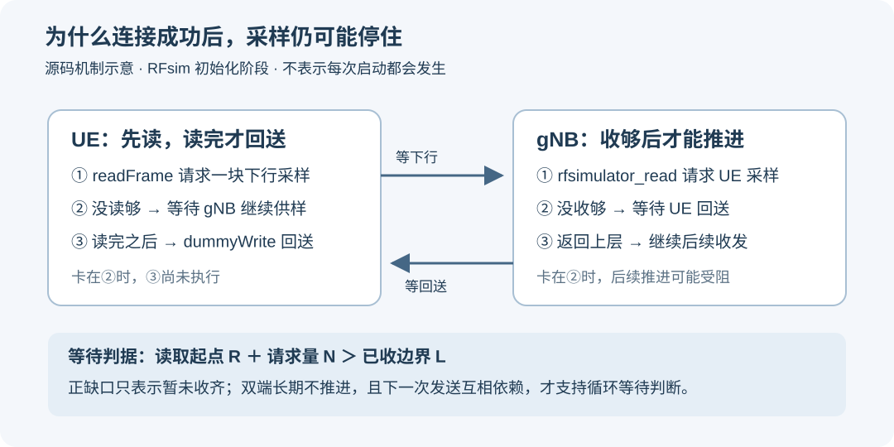

# RFsim 启动同步：设计方案与验证计划

我把这项工作作为独立的启动可靠性问题研究，与第一步 ping／UDP 时延基线分开。**C 实现已完成并编译通过：开启模式的 4 次独立自然启动均接入并完成 20/20 ping；一次关闭模式对照停在连接后。** 原始目录保持不变，修改在研究副本。正式当前侧 27 条件重测已完成并独立复算；有限启动样本不能作为全场景保证，也不等于已经降低业务 RTT。

[结果与分析总目录](研究结果与分析总目录.md) · [已有启动控制试验](原始程序启动失败_原因定位与控制变量全过程.md) · [第一步结果](第一步结果与分析.md) · [源码与日志知识](../算法知识点说明/十二步知识点/第一步/1_源码与当前代码.md)

## 我要解决什么

同一套原程序、同样的 RFsim 命令，有的运行可以同步、随机接入、注册并配置 UE 地址；有的运行停在 TCP 连接后，初始同步尚未开始。我希望让初始化能稳定推进，减少对连接发生位置的敏感性。

这次固定讨论原始 n261、27.54756 GHz、120 kHz、66 PRB、正常 CP、0.625 ms TDD：3 个完整 D 槽＋1 个混合槽（6D＋4F＋4U）＋1 个完整 U 槽。具体图样来自原配置，是工程取值，不是 3GPP 指定的唯一方案。

## 原理：读够一块才继续，可能形成相互等待

|位置|原代码怎样推进|可能等住的位置|
|---|---|---|
|UE 初始同步前|`readFrame` 先读取一块下行采样，读完才执行 `dummyWrite` 回送仿真采样|下行块没收齐，便不能回送下一块|
|gNB RFsim 接收|`rfsimulator_read` 等收到足够的 UE 采样，才返回上一层继续处理|UE 没送够，gNB 的后续处理与供样也可能无法推进|
|gNB 默认 TDD 供样|完整 D 槽、混合槽下行段等按实际方向分段写入|首读窗口与供样间隙相遇时，需要确认双方是否还能产生下一块|

记读取起点为 R、本次请求数量为 N、已收末尾边界为 L，单位均为采样计数。原接收函数在

$$
R+N>L
$$

时继续等待，缺口为

$$
\Delta=R+N-L.
$$

**出现正缺口本身不等于死锁。** 正常收发也会短暂等待。需要验证的是：两边的 R、L 是否持续不变，双方是否都必须等对方返回后才能执行下一次发送。旧受控试验已在特定初始化条件下证明过这种循环等待；本次自然停滞的精确缺口仍需补取，不能套用旧试验的数值。

这幅图是根据实际源码重画的机制示意，不是新的抓包或实验曲线。此前受控失败轮的一个例子如下，说明问题不在于“差 1”这句文字：

|一侧|读取起点 R|本次请求 N|已收边界 L|还差 R＋N−L|
|---|---:|---:|---:|---:|
|gNB|491520|15408|506863|65 个采样|
|UE|506863|15344|513504|8703 个采样|

gNB 需要 UE 再送 65 个采样才能返回；UE 还需收到 8703 个采样才能完成当前读取、执行下一次回送。如果双方推进都依赖这次读取返回，就形成“我等你，你等我”。**数字来自 2026-11-13 旧受控轮，不能当作今天每次停滞的缺口。**

混合槽下行段末与完整 D 槽末的供样位置不同，握手生成的 UE 初始读取起点、后续整槽读取窗口与发送间隙的相对关系也随之改变；长短 CP 还会改变每块实际采样数。此前改变握手位置、保持其他受控条件的试验支持这条机制。仅按墙上时间等待几秒再开 UE，不能精确选择仿真采样位置；也不意味着用户的手动启动方法错误。

## 为什么我关注供样块的结束位置

原代码接收客户端时，用最近写入块的结束边界 T 生成一个位于 T−1 的单采样同步包。因此相差 1 的告警会被主动触发；发送后边界仍为 T。昨天成功的日志也有同类告警，不能只看它判断失败。

我进一步按原配置把 T 换算到样本网格。FFT＝1024、短 CP＝72、长 CP＝136；这些数值来自实际日志及 `nr_parms.c`，不是所有 NR 配置的固定值。正常 CP、μ＝3 时，一帧 80 槽：

$$
N_s=14(1024+72)+64\mathbf{1}_{s\bmod4=0},\qquad B_s=\sum_{j=0}^{s-1}N_j.
$$

每帧总计 1,228,800 个采样，令 r＝T mod 1,228,800。完整 D 槽的结束边界为 B_s＋N_s；本配置混合槽的下行段结束边界为

$$
B_s+6(1024+72)+64\mathbf{1}_{s\bmod4=0}.
$$

|日志中的 T|换算出的最近供样结束位置|已有证据与局限|
|---:|---|---|
|423905312|帧内槽 77，第三个完整 D 槽末尾|片段随后断开，未显示接入成功|
|866641952|帧内槽 21，第二个完整 D 槽末尾|片段后续结果不完整，不计作已证实失败|
|99981050896|帧内槽 62，第三个完整 D 槽末尾|片段随后断开，未显示接入成功|
|100025217488|帧内槽 58，混合槽下行段末尾|后续随机接入、RRC 成功，并开始建 GTP 隧道；未提供该轮 ping|
|3575323120|帧内槽 48，混合槽下行段末尾|昨天保存的成功轮：348/348 ping，均值 0.834 ms|

这里定位的是**最近一次下行供样块的结束边界**，不是 UE 命令的启动时刻，也不是 TCP 到达的精确空口时隙。片段存在关联，加上旧受控证据，支持继续检查初始化供样机制；不能据此断言所有完整 D 槽末都失败、所有混合槽末都必定成功。

## 方案 A：已实现的 C 同步流程

我在研究副本 `radio/rfsimulator/simulator.c` 实现了这条流程，重新编译 `librfsimulator.so`。主 gNB／UE 程序不重编译，运行时加载新库；不是用脚本选择启动时刻。

|阶段|C 代码实际行为|为什么需要|
|---|---|---|
|TCP 已连接、待同步|`allocCirBuf` 设置原子 `pending_sync` 标记；`rfsimulator_read`／发送和信号叠加跳过该连接|连接不应在收到首个同步信息前成为普通收样依赖|
|推进到目标边界|沿用原来没有活动 UE 时的虚拟时间推进；保存 `tx_rf` 已传入的低四位 burst 标志|不写死每五槽的位置；当前混合槽 DL 末确有 `TX_BURST_END`|
|发送同步信息|RX 事件线程的 `synchronize_pending_clients` 在 `Sockmutex` 内只给新连接发送 `end−1` 的单采样标记，再清除 pending|不递归调用加锁函数，不向已有 UE 广播初始化包|
|正常收发|加入活动集合，严格按实际接收边界判断足量|不补出活动 UE 的必需数据，不跳过空口接入|
|待同步超时|超过 5 s 记录并移除该等待连接|这是工程保护值，不是 3GPP 的接入时限；此超时边界尚未实测覆盖|

仅推迟发送标记而仍让连接参加普通阻塞判据，会让 gNB 走不到目标边界。此次同时修改 pending 状态和接收判据：**待同步连接不阻塞推进，激活后恢复足量等待。** 正常业务无 pending 时跳过新增扫描／加锁流程。

配置开关为 `rfsimulator.sync_at_burst_end`，默认 0；两份配对 `.dpdk.conf` 分别取 0／1。它是本项目 RFsim 工程参数，不是 3GPP IE。启动仍在实际构建目录分终端直接执行，差别只在已注明的 `-O` 配置文件。

## 编译与自然启动验证结果

无线条件固定为本页原有 120 kHz 图样和低时延 MCS 上限 9 配置，UE 增益均为 20。没有 GDB、相位门控、连续供样或额外线程池参数。下面定位的是供样结束边界，不是命令启动时刻。

|轮次|开关|连接接受时的最近供样边界|实际同步边界|接入／20 包检查|pending 墙钟等待 / ms|
|---|---:|---|---|---|---:|
|开启第 1 次|1|第二个完整 D 槽末|混合槽 DL 末|成功，20/20|2.072|
|开启第 2 次|1|第三个完整 D 槽末|混合槽 DL 末|成功，20/20|1.021|
|开启第 3 次|1|第一个完整 D 槽末|混合槽 DL 末|成功，20/20|3.108|
|关闭对照 1 次|0|第二个完整 D 槽末|旧路径立即握手|未配置 UE IPv4，业务未开始|不适用|
|再次开启第 4 次|1|已在混合槽 DL 末|混合槽 DL 末|成功，20/20|0.012|

关闭对照的 TCP 仍连接，双方最后数据活动约 250.540 s 没有更新；只做了预先安排的这一次，没有反复尝试至选中失败。开启四轮都成功，支持本机本配置下这条 C 处理有效；**不能用 4 次成功保证任意启动都成功，也不能估计所有配置的故障概率。**

20 包检查平均 RTT 依次为 0.893、0.931、0.830、0.825 ms。第一轮用默认间隔，后三轮目标间隔 100 ms，均未去预热；只作各轮连通证据，不合池为正式时延结果。第 4 轮实际控制消息唯一核验 5QI 9／QFI 9，路由走 UE TUN；正式业务另做逐包 TUN／N3 关联。

pending 的墙钟等待包含仿真推进与轮询，不是新增加的纯空口时延，也不是业务 RTT。业务在接入、路由核验之后生成，启动耗时与稳态通信 RTT 分开统计。

## 修改后正式业务时延

27 条件全部通过，收齐 59,400 次完整事务，按每轮前 200 次预热后保留 54,000 次统计；独立从原生 ping、两端 CSV 和抓包关联时刻重算通过。四次启动的 20 包检查不混入这些统计。下表每行各有三轮、6000 个统计事务。

|业务|数据区 / B|测量字段 / B|平均 RTT / ms|三轮 P99 范围 / ms|最大 / ms|
|---|---:|---:|---:|---:|---:|
|ping|56|原生 ICMP|0.829|1.190–1.220|16.200|
|ping|16|原生 ICMP|0.832|1.210–1.250|18.500|
|udp|16|16|0.872|1.246–1.334|1.918|
|udp|256|16|1.392|1.953–1.972|18.158|
|udp|256|80|1.398|1.961–1.964|18.288|
|udp|1200|16|1.897|2.663–2.711|8.525|

当前 56 B ping 均值 0.829 ms，仍在约 0.8 ms 量级；此前同类数据为 0.790 ms，不能声称这次同步修复降低稳态 RTT。空口图样和业务调度未改，跨轮主机／到达相位未逐包配对锁定。存在十几至几十毫秒慢包，全部保留，未用预热或阈值删除它们。

本次支持“在本机固定配置下，延后到合适供样边界可避免已复现的初始化停滞”；不支持“所有配置永远不再失败”或“尾时延已优化”。[第一步五项正式结果](第一步结果与分析.md)分别展示格式、包长和基线，原始程序同条件三轮仍未完成。

## 方案 B：从首读与无发送区间的推进机制修复

更稳健的目标，是任意连接位置都能正确初始化。我会进一步检查首读窗口对齐、初始时间戳和无发送区间的推进关系，使双方不会因“先等对端读完”而同时失去推进能力。

若涉及补齐仿真时间区间，只能处理明确没有发送的区间，并保持信道／噪声模型一致；不能补出本应传输的真实数据，不能跳过接入过程或直接把缺样报告为成功。在后续 200 MHz、单 UE 的 RFsim 研究副本中，我沿用方案 A 的同步标记，并单独加入方案 B 的 UE 小区搜索供样。只补首块后仍在同步前停顿。持续给搜索阶段的空采样保留约一个槽的提前量后，候选图样已完成原生 56 B ping。其他 TDD 图样、多 UE 和真实射频仍需单独验证。 [200 MHz 对照结果](方案三的第二种_调整TDD.md)

## 实际修改范围与保留条件

|位置|状态|
|---|---|
|研究副本 `radio/rfsimulator/simulator.c`|已修改待同步状态、按真实 burst 激活、接收集合和清理|
|RU／真实设备接口|没有修改，复用已有突发标志|
|UE 首读分支|上述方案 A 构建未改；后续 200 MHz 方案 B 研究构建明确标记搜索阶段空采样|
|诊断工具|读取采样起点、请求量、已收边界，保留成功与失败快照|

原始目录、TDD 比例、SCS、频率和调度算法保持原条件。启动同步修复与 PF／QUEST／提前授权等业务调度算法分开，不能把它当成新的调度收益。

## 真实射频的适用边界

本次具体循环来自 RFsim：`--rfsim` 选择仿真库，UE 的 `dummyWrite` 回送也只在 RFsim 分支执行。真实射频选择设备驱动路径，不经过这套 RFsim TCP 单采样握手，所以不能直接认定它会出现同一个触发条件。

真实设备仍可能有时钟、供样、缓冲区或驱动阻塞问题。封装代码不能证明整条硬件链路绝无故障，本次也没有启动实际射频验证。本次修改仅编译到 RFsim 库，没有修改 DPDK 射频设备代码或接口。真实射频尚未验证。

## 我怎样验证方案

1. 冻结原模式与修改模式的程序、配置和命令，先做同条件单 UE 对照；增益 20 与 28 如需比较就单独记录，不混成一个条件。
2. 对成功和停滞都记录供样块结束位置、两端 R／N／L、首读完成位置和接入阶段，避免只看告警文字。
3. 比较正常启动、UE 重连、客户端中途退出和取消等待；不清掉失败轮，不用旧成功数据补新结果。
4. 验收同步、随机接入、注册、TUN 地址，再核路由与 TUN／N3 业务关联；完成后再看 ping 或 UDP。
5. 检查新增初始化等待、资源／CPU 开销和数据完整性。观测探针开启期间不统计正式时延基线。
6. 单 UE 机制验证后，再考虑其他合法 TDD／SCS 和多 UE，不能预先宣布全部场景已解决。

此前已取得正常运行快照：gNB 和 UE 的读取、接收边界都在持续变化。该次观测约 0.602 s 时达到 8 MiB 上限，保留了末行不完整记录，内核缓冲区溢出为 0；它只证明这一段有采样推进，不是新的 RTT。本次关闭对照取得了新的 TCP 停滞证据，未读该轮内部采样缺口；4 次开启启动验证已完成。5 s 超时、多个并发 UE、其他 TDD／SCS 和真实射频仍未覆盖，不能把旧控制数值当作新轮次的内部测量。

## 依据与复现入口

- 标准背景：TS 38.211 V19.5.0 §4.3.2、TS 38.213 V19.5.0 §11.1、TS 38.331 V19.4.0 §6.3.2 的 TDD 配置字段。标准提供时间网格和方向规则，不规定本软件必须在混合槽末握手；具体同步方案属于工程设计。本地版本不冒称已独立核实官网最高版。
- 实现依据：原 `simulator.c` 的 `startClient`、`flushInput`、`rfsimulator_read`；`nr-ue.c::readFrame`；`nr-ru.c::tx_rf` 和 `kill_NR_RU_proc`；`nr_parms.c::get_samples_per_slot/get_samples_slot_timestamp`；`radio/COMMON/common_lib.c::load_lib` 与 DPDKRF 封装。此前诊断字段按当时原库的 DWARF 核对；本次新库的模块加载和文件身份另行核验。原始目录未改。旧诊断工具固定原始库布局，不直接套用到本次新库。
- 测量边界：P01《Dissecting 5G New-Radio Latency》本地 IFIP Networking 2025 版 §III—IV、PDF 第 2—4 页；指定教材第 2 章、PDF 第 49—55 页。它们用于区分软件推进、接入和应用时延，不是本握手方案的来源。
- 只读复算与观测工具：研究仓库 `research/latency-analysis/rfsim-intermittent-v1/`。原始快照和失败保留在本地 `analysis-source-audit/rfsim-intermittent-20261117/`，不上传完整日志、密钥或大中间文件。

采样计数换算是本配置下的源码一致性推导；不是 3GPP 直接给出的总时延公式。修复方案、实现效果和论文中的业务时延结果应分别验收。
