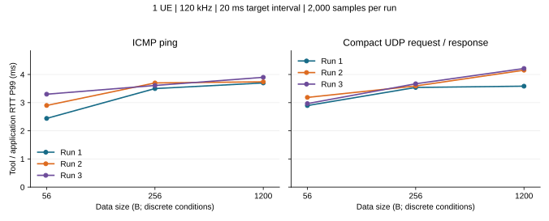
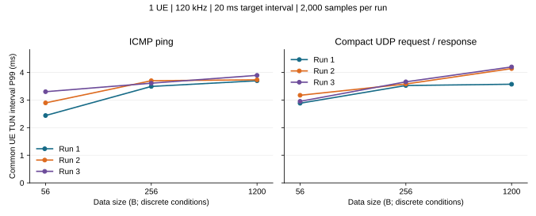
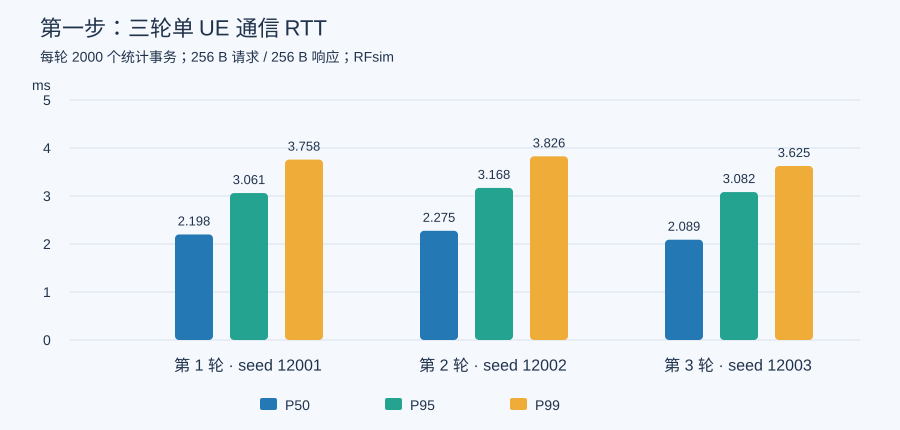
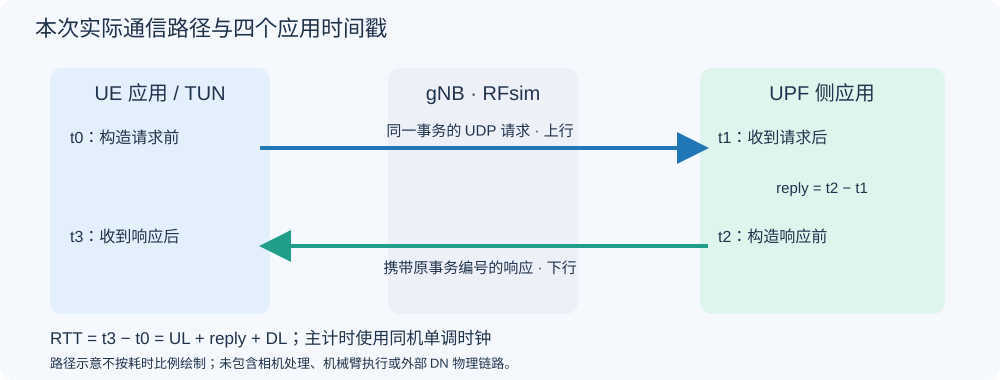

# 独立测量实验：原始版本 ping 与包头对照

实验编号：**E-MEAS-01**。这是测量方法/版本核验实验，**不占主线十二步编号**。本次为已有说明与证据重新归类，没有把旧数据改称新测量。

知识页：[原始版本、当前研究版本与测量方法对比](../算法知识点说明/测量方法与包头对比_知识点分析.md)。

## 先看各子项的真实状态

|子项|状态|证据与边界|
|---|---|---|
|80 B / 16 B 结构与功能|已核字段与日志实现|两套格式、序号范围、日志/时钟和跨层能力分别说明，不等于性能等价|
|精简 UDP / ping 三包长|18 次正式运行已完成|39600完整/36000统计，原始数据及两图保留，详见下文|
|原 80 B 三轮|历史数据保留|256 B、指数间隔、6600完整/6000统计；不与周期输入组直接作头压缩收益对比|
|严格同条件的 80 / 16 B 性能 A/B|尚未完成|需要同一 RAN / 总包长 / 到达计划 / 计时与观察开销；没有可填收益数值|
|原目录二进制 ping 复测|首次先导未接入；第二根只准备|RFsim连接已建立，但UE未到TUN；无本轮ping RTT，未填0或借历史值|

## 原目录二进制复测：做到了哪里

原目录 `/home/lbh/oiwireless/oi-wireless-ran` 源 HEAD `383aa52a31`。已复制其现有 12 个二进制/库，记录 SHA；原源码/二进制/配置没有改写，也没有重新构建。源码与二进制的完整历史构建对应尚未重新证明，因此准确身份是“原目录现有二进制”。为保留原核心状态，测试使用独立核心副本，部署 IP 重映射；不声称完整重建当时全部 5GC 环境。

首次 `original-ping-v1 / pilot-01` 实际运行 44.421 s：独立核心完成，gNB RF 启动，UE 与 RFsim TCP 已连接；25 s 内未出现 TUN 配置完成标志而停止，未进入业务ping与测量抓包。日志还有 Tx 时间次序提示，但根因尚未唯一定位，不能据此断言原始源码永久不可用。原核心状态保持，子进程和本轮资源已回收。

第二根 `original-ping-v2 / pilot-02` 仅增加原程序支持的 `--continuous-tx` 运行选项作供样诊断，原二进制/NR字段不改。该启动操作被用户中断；检查无 execution/runtime，无活动RAN/遗留实验资源，不能说已经执行或通过。该标志是实现运行选项，不是 3GPP 规定的调参方法。

后续复测计划独立保存：原命令形态/1 s 间隔、同目标1 s、同目标20 ms分别记录，不以平均值对比另一组P99。当前尚无新原始版本RTT值；历史约0.737 ms的5包均值只能按下文历史身份阅读。

## 精简 UDP / ping 的正式对照（既有数据）

**状态：已完成本轮单 UE 六条件基线。18 次正式运行全部通过，39600 次完整请求—响应，去预热后统计 36000 次；每轮独立复算并保留先导、旧基线与失败身份。**

我完成的是通信请求—响应 RTT 基线，不是机械臂动作闭环、真实射频或算法优化收益。ping 与 UDP 各测 56、256、1200 B，每条件三轮；下文先给这轮新结果，再保留原 256 B / 80 B 头 / 指数输入结果，两批不混池。

### 我实际测了什么

|项目|本轮实际条件|
|---|---|
|平台|同主机独立 5GC 副本 + gNB + 软件 UE，RFsim，无真实射频|
|版本|通信源基 61654513d5，运行源提交 159208eb2f；10 个哈希一致 ELF/模块；测量方法 step1-ping-udp-v2 / d2ccf26b08，无本轮无线 C 修改|
|无线|n261、100 MHz、66 PRB、120 kHz、正常 CP、MCS 上限 9|
|TDD|0.625 ms：3 完整 D + 混合槽 6D4F4U + 1 完整 U；完整槽 D:U = 3:1，混合槽不省略|
|调度/授权|PF、legacy 探测 F = 10 帧、SR = 40 槽 / offset = 3、业务 K2 = 4；保留配对私有 HOL 报告，关闭层内观察器|
|QoS 与路径|实际 NAS 5QI 9 / QFI 9，双向 N3 / TUN 和路由核验；UPF 侧回复端，无外部 DN 物理链路|
|业务|两工具数据各 56 / 256 / 1200 B；UDP 含 16 B 标记、请求响应等长；普通无选项 IPv4 内层分别 84 / 284 / 1228 B|
|到达与统计|目标间隔 20 ms；每条件 3 轮，每轮 2200 次、前 200 次预热、后 2000 次统计；正序、逆序、循环移位，单工具顺序运行|
|主机|沿冻结绑核，UE 主线程 CPU 4、gNB RU CPU 6、UDP 服务端 CPU 2、客户端/原生 ping CPU 3；线程和 RFsim 模块核验|

以上具体配比、包长、业务频率、绑核与样本数都是工程安排，不是 3GPP 强制工业方案。5QI 9 不等于已经验证工业关键控制业务。

### 六条件的三轮 P99 范围

这里的范围是三轮各自 P99 的最小值至最大值，不是合并三轮后重新计算的 P99。

|工具|数据长度 / B|工具/应用 RTT P99 范围 / ms|共同 UE TUN 区间 P99 范围 / ms|
|---|---:|---:|---:|
|ping|56|2.440–3.300|2.438–3.301|
|ping|256|3.500–3.700|3.492–3.699|
|ping|1200|3.700–3.900|3.698–3.893|
|udp|56|2.897–3.186|2.884–3.172|
|udp|256|3.540–3.671|3.525–3.659|
|udp|1200|3.585–4.214|3.572–4.198|

本组两种工具的三轮曲线都随 56 → 256 → 1200 B 非递减；这是当前配置与固定目标包率下的观察，不证明任意负载、相位或 SCS 下都单调。
同包长对应轮次的描述性对照中，ping / UDP 的高低会反转，所以没有证据支持某个工具在所有条件都更低。工具处理路径、实际节奏和相位尚未独立控制。





每个点对应一轮 2000 个统计事务，连线仅便于阅读，不是连续包长模型。ping 的自身 RTT 来自原生每回复输出，存在工具舍入；UDP 来自客户端单调时钟整数戳。显示位数不增加仪器精度。共同 TUN 区间仍含网络与回复端处理，不是纯空口。

### 各轮结果，不挑快轮

#### ICMP ping

|数据 / B|轮次|平均 RTT / ms|P50 / ms|P95 / ms|P99 / ms|最大 / ms|TUN P99 / ms|
|---:|---:|---:|---:|---:|---:|---:|---:|
|56|1|1.702|1.640|2.270|2.440|3.990|2.438|
|56|2|1.813|1.680|2.550|2.900|4.130|2.897|
|56|3|1.843|1.800|2.770|3.300|4.400|3.301|
|256|1|2.362|2.380|2.730|3.500|4.640|3.492|
|256|2|2.280|2.130|2.990|3.700|4.200|3.699|
|256|3|2.418|2.530|2.960|3.610|4.060|3.609|
|1200|1|2.781|2.820|3.230|3.700|5.380|3.698|
|1200|2|2.713|2.800|3.190|3.740|4.890|3.732|
|1200|3|2.640|2.680|3.290|3.900|4.510|3.893|

#### 精简 UDP

|数据 / B|轮次|平均 RTT / ms|P50 / ms|P95 / ms|P99 / ms|最大 / ms|TUN P99 / ms|
|---:|---:|---:|---:|---:|---:|---:|---:|
|56|1|1.871|1.875|2.529|2.897|3.364|2.884|
|56|2|1.935|1.918|2.695|3.186|3.824|3.172|
|56|3|1.740|1.722|2.530|2.966|3.571|2.953|
|256|1|2.282|2.271|2.983|3.540|4.565|3.525|
|256|2|2.290|2.275|2.966|3.593|4.660|3.580|
|256|3|2.291|2.265|3.147|3.671|4.637|3.659|
|1200|1|2.745|2.744|3.423|3.585|4.453|3.572|
|1200|2|2.692|2.677|3.355|4.154|5.287|4.139|
|1200|3|2.698|2.680|3.402|4.214|4.602|4.198|

### 实际间隔与比较限制

|工具|数据 / B|三轮实际 TUN 平均间隔范围 / ms|
|---|---:|---:|
|ping|56|20.593222–20.625282|
|ping|256|20.504361–20.732656|
|ping|1200|20.558954–20.737710|
|udp|56|19.999981–19.999991|
|udp|256|19.999983–19.999984|
|udp|1200|19.999982–19.999984|

两工具的参数目标都是 20 ms，但实际发送节奏可能不同；TUN 还包含本地协议推进。跨工具结果同时受内核/应用回显、计时、到达节奏及无线相位影响，不能用差值单独证明“UDP 协议比 ICMP 多耗多少空口时间”。固定包率时，大包的 Mbps 也提高，本轮没有隔离负载因素。

### UDP 四应用时刻的平均分解

|数据 / B|轮次|上行应用区间均值 / ms|回复区间均值 / ms|下行应用区间均值 / ms|应用 RTT 均值 / ms|
|---:|---:|---:|---:|---:|---:|
|56|1|1.576472|0.003152|0.291016|1.870641|
|56|2|1.649835|0.003111|0.281793|1.934739|
|56|3|1.464263|0.003330|0.272083|1.739676|
|256|1|1.977217|0.003694|0.300641|2.281553|
|256|2|1.974429|0.003697|0.312040|2.290166|
|256|3|1.965576|0.003660|0.321507|2.290742|
|1200|1|2.295028|0.005884|0.443884|2.744796|
|1200|2|2.237290|0.005956|0.448877|2.692123|
|1200|3|2.242818|0.005883|0.448859|2.697560|

四个时刻在 UE / 服务端日志中按事务编号关联。逐事务整数恒等式、两端时钟域与抓包辅助边界已核；同一批事务的分段均值相加等于 RTT 均值，分段 P99 不能相加。t2 在构造回复前记录，所以回复区间不包含此后编码/发送的全部工作；这些按本定义进入下行区间。没有开启协议层探针，不把本表称为 PDCP/RLC/MAC/PHY 逐层耗时。

### 主线可以引用哪些已核条件

1. 六条件全栈路径与统计方法已跑通，可以支撑后续同程序对照；本轮仍只有 1 UE，不能从编号字段推断多 UE 已测。
2. 后续优先用精简 UDP 作为可控应用探针，原生 ping 保留为连接和 RTT 参照。理由是 UDP 支持我需要的事务身份、到达计划和四应用时刻，不因为某个工具测得更小就选择它。
3. 我先固定 256 B 请求/响应、20 ms 目标周期作为后续低负载起点；56 / 1200 B 保留为包长敏感性条件。这是便于隔离后续 UE 数与无线变量的工程基准，不是本轮证明的工业最佳包长。多 UE 竞争阶段再明确总负载/每 UE 负载矩阵。
4. 新旧 256 B 的总包长相同，但测量格式与到达过程不同；不能把差异当成“测量头少 64 B 带来的 RTT 收益”。本轮没有优化算法收益结论。
5. 每轮 2000 样本、三轮重复只用于描述性 P99；最大值不是绝对最坏界，不认证 P99.9 或长期工业可靠性。

### 失败、先导与可复核证据

v1 pilot-01 的 56 B ping 200/200 已交付，因额外 1 个内层 version6 背景 PDU 被误当 IPv4 解析而核验失败；旧根与 v1 代码保留。v2 对背景单独计数，目标 IPv4 的长度、身份、QFI、数据与完整性门禁不变。新 pilot-02 六条件 1200 完整/1080 统计全部通过，再执行本正式根；先导和失败样本都不并入正式统计。
本正式根运行总耗时 1163.408 s（含每次副本、接入、业务、核验和回收），核 2308 冻结输入。18 次完整日志、pcap 与两端 CSV 保留在本机；独立从原日志复算工具/应用 RTT、共同 TUN 和 UDP 分段，未另造第二套 pcap 解析器。结束核验原核心身份/运行状态不变，每轮子进程与本轮资源回收。

安全数据：[正式 summary.json](https://github.com/ming0526288/oiwireless-latency-analysis/blob/latency-standards-audit/research/latency-analysis/step1-ping-udp-results/evidence/main-01/summary.json)；运行与方法见[第一步启动命令](../启动命令/第一步启动命令.md)、CHG402 / TEST552。原文与精确条款沿下方来源区；具体业务参数是工程安排，不是标准强制。

原 256 B 三轮的结果、参数表与图仍保留在下面，仅代表当时旧输入；不与本轮混用。

## 原 256 B 三轮基线（保留）

我建立了单 UE、固定 120 kHz、PF 与既有授权机制下的通信 RTT 基线。6600 次请求和响应全部交付；去除每轮预热后，共统计 6000 次事务。这里测的是通信应用请求—响应，不是机械臂完整控制周期。

### 先看三轮 RTT 结果

|轮次 / seed|完整 / 统计事务|平均 / ms|P50 / ms|P95 / ms|P99 / ms|最大 / ms|
|---|---:|---:|---:|---:|---:|---:|
|1 / 12001|2200 / 2000|2.219019|2.198402|3.060864|3.757911|5.144820|
|2 / 12002|2200 / 2000|2.297152|2.274663|3.168281|3.826170|4.827559|
|3 / 12003|2200 / 2000|2.138456|2.089417|3.082376|3.624685|4.137617|



P50 是中位数。每轮 P99 由该轮 2000 个统计事务直接计算；三轮分别报告，没有用分段 P99 相加，也没有把先导样本拼入正式结果。此样本量与三次重启不足以认证长期可靠性或 P99.9。

### 这些时延分别经过哪里



|轮次|上行平均 / ms|服务端回复处理平均 / ms|下行平均 / ms|总 RTT 平均 / ms|
|---|---:|---:|---:|---:|
|1|1.905696|0.003976|0.309347|2.219019|
|2|1.976610|0.003806|0.316736|2.297152|
|3|1.840311|0.003953|0.294192|2.138456|

同一事务用同一时钟域的四个时刻：$t_0$ 为 UE 构造请求前，$t_1$ 为服务端 `recvfrom` 返回后，$t_2$ 为服务端构造响应前，$t_3$ 为 UE `recvfrom` 返回后。

```math
\begin{aligned}T_{\mathrm{UL}}&=t_1-t_0,\\T_{\mathrm{reply}}&=t_2-t_1,\\T_{\mathrm{DL}}&=t_3-t_2,\\T_{\mathrm{RTT}}&=t_3-t_0=T_{\mathrm{UL}}+T_{\mathrm{reply}}+T_{\mathrm{DL}}.\end{aligned}
```

逐事务用整数 ns 核对恒等式，再换算 ms。上行包含请求封包、系统调用和接收应用唤醒等；下行包含回复封包、系统调用及 UE 接收唤醒等。reply 不是完整的边缘计算或机器人决策耗时。抓包 REALTIME 另外校验，没有混入主指标 MONOTONIC。

### 我的场景参数与固定条件

|项目|实际采用的条件|
|---|---|
|应用背景|汽车零部件装配中的状态信息交互；合成测试，不处理视频或机械臂动作|
|平台|同一主机，独立 5GC 副本 + OAI gNB + OAI UE，RFsim，无真实射频|
|版本|通信源基 `61654513d5`，可追溯提交 `159208eb2f`；复用其已构建、哈希一致的 10 个 ELF/模块；本轮无生产 C 修改或新构建|
|频段 / 资源|n261，载频 27.54756 GHz，100 MHz，66 PRB，120 kHz，正常 CP；MCS 上限 9，不是每 TB 固定 MCS 9|
|TDD|周期 0.625 ms = 5 个槽；3 个完整 D、1 个混合槽、1 个完整 U；混合槽 6D + 4F + 4U，F 在此配置用作保护|
|TDA / K2|沿原实现：`min_rxtxtime = 4`，业务 TDA0 为 start 0 / length 13，TDA1 为 0 / 12，混合 TDA2 为 10 / 3，K2 = 4；不是逐 TB 资源实测|
|PF 与授权|上行日志确认 `scheduler = 0`；下行沿原 `pf_dl` 路径；legacy 探测、F = 10 帧保持；SR = 40 槽、offset = 3，日志已确认|
|QoS|每轮新 NAS 确认 5QI 9、QFI 9；N3 请求为 type 1 / QFI 9，响应为 type 0 / QFI 9|
|报告 / 观察|保留配对私有 HOL 报告；它不是普通标准 BSR/DSR。关闭额外 C 观察器；保留应用记录和被动抓包|
|请求 / 响应|各 256 B 应用数据，包含 80 B 测量头和 176 B 填充；不含 UDP/IP 头|
|发包|指数目标间隔，均值 20 ms，目标请求 0.1024 Mbps；不等待上一条响应才发送下一条|
|重复 / 预热|三轮 seed 12001 / 12002 / 12003，每轮 2200 次事务，前 200 次预热，后 2000 次统计|
|终端 / CPU|1 UE；主线程 CPU 4，gNB RU CPU 6，其余公共核 0,1,7,12–23；服务端 CPU 2、客户端 CPU 3|
|服务端位置|UPF 网络命名空间的 tun0 侧应用；没有外部 DN 物理链路；原核心网停止/运行状态保持|

**上述业务参数、具体 TDD 图样、绑核与重复次数是工程设计，不是 3GPP 强制的一套方案。** 单 UE 基线不能证明 PF 优于其他排序算法。

单位换算如下；它不证明无线容量或稳定负载条件：

```math
\lambda=\frac{0.1024\times10^6}{8\times256}=50\ \mathrm{packet/s},\qquad E[\Delta t]=20\ \mathrm{ms}.
```

普通 IPv4、无选项且无 IP 分片的记账长度为 256 + 8 + 20 = 284 B；每方向 IP 层名义速率约 0.1136 Mbps，不是空口总开销。实测三轮平均发包间隔为 19.918–20.211 ms；不能把随机间隔说成每次都固定 20 ms。

### 我验证了什么

- 6600 个唯一事务关联客户端发送、服务端接收/响应和客户端接收，没有缺失或重复事务。每轮 TUN/N3 各有 4400 个已编号方向包，双向 QFI 正确，抓包 kernel drop 为 0。
- UE 出口路由为 `oaitun_ue1`，服务端回复经 `tun0`；两端网络命名空间不同，四个抓包切点逐事务关联，排除应用同机旁路。
- 两端 boot ID 与时间命名空间一致。单事务 wall/monotonic 时长差的三轮最大值分别为 4.340 / 3.719 / 2.603 μs；主 RTT 始终只用单调时钟。
- 用原客户端整数时间戳和 `statistics.quantiles(method="inclusive")` 独立复算 6000 个统计事务，核对 18 个原始文件 SHA 和 2306 个冻结输入。逐包 GTP 解析没有在独立复核中重写，不冒称两套独立解析器。
- 正式脚本总耗时约 195.110 s，包含副本启动、接入、业务、校验与回收；测试结束无本次活动 RAN、容器或命名空间，原 MySQL 运行、原 AMF/SMF/UPF 停止状态保持。

### 失败先导和修正

|记录|实际做到哪里|原因与处理|
|---|---|---|
|v1 / pilot-01|Python 导入阶段；未启动核心副本、RAN 或业务|未使用的旧 gate 文件导入在主研究树不存在；v2 移除该导入，旧失败根保留|
|v2 / pilot-02|核心副本与 PFCP 抓包已启动；未启动 RAN/业务|PFCP 解析器仍写死旧 213 子网，无法匹配新 214 端点；v3 更正两个端点，真实捕获回放确认 Cause/sequence/FTUP 门禁通过，没有放宽协议判据|
|v3 / pilot-03|完整 200 次请求响应及校验通过|只作先导，不计入主结果|
|v3 / main-01|三轮正式全栈与复核通过|本文结果来自该根，未拼接旧测量或失败样本|

还纠正了方法引用：TS 38.213 的 SR 过程是 §9.2.4；§9.2.3 是 HARQ-ACK。冻结方法的早期说明引用编号错误，当前正文按已读原文更正；无线配置和程序未因此改变。

### 原 256 B 基线当时的结论

1. 我的单 UE 通信场景、请求响应关联与计时方法已跑通，可作为下一步同程序多 UE 对照的参照。
2. 三轮 RTT 中位数为 2.089–2.275 ms，P99 为 3.625–3.826 ms；这是当前 RFsim、合成业务和主机配置下的基线，不是算法优化收益或真实射频保证。
3. 按同一批统计事务的平均值，上行约占 RTT 的 86%。这只能定位到“上行应用区间较大”，尚未证明是 SR、TDD、CPU、重传或哪个协议层造成，需要后续分层与慢事务分析。
4. 不能把 0.125 ms 槽长当作应用 RTT 上限，也不能与旧 56 B ICMP ping、1200 B 多 UE 业务或另一版本程序直接作收益对比。当时计划先完成六条件工具 / 包长对照；该对照现见本页前部，后续增加 UE 仍需保持统一程序与输入。

### 协议、论文与证据入口

- TS 38.211 V19.5.0 §4.2/4.3.2 表 4.3.2-1；TS 38.104 V20.1.0 §5.3.2/5.3.5：时间网格、频段与资源边界。
- TS 38.213 V19.5.0 §11.1、[§9.2.4 SR 原文](#/protocol/38.213?clause=9.2.4&view=text)；TS 38.331 V19.4.0 §6.3.2 的 TDD/SR IE：配置字段，不强制本项目具体图样。
- TS 38.214 V19.5.0 §6.1.2.1/6.4；TS 38.321 V19.4.0 §5.4.1/5.4.4/5.4.5；TS 38.300 V19.4.0 §4.3.1.1/10.3：授权、准备与用户面背景。
- TS 23.501 V20.3.0 §5.7.3.3/5.7.3.4、表 5.7.4-1；TS 24.501 V20.1.0 §8.3.2.1/9.11.4.12/9.11.4.13：QoS 字段；单向 PDB 不能直接当本次 RTT 期限。
- TS 29.281 V19.2.0 §5.1/5.2.2.7、TS 38.415 V19.1.0 §5.5.2/5.5.3.3、TS 29.244 V20.1.0 §5.8.1/6.2.6.2/6.2.6.3：N3 容器和独立核心关联。
- P01《Dissecting 5G New-Radio Latency》，IFIP Networking 2025，§III–IV，本地 PDF 第 2–4 页；P24 QUEST，TNSM Vol. 23 / 2026 本地期刊版，§VI-B/C，第 8–9 页；指定教材 §13.1.1.2，本地 PDF 第 530–532 页。借用测量与调度背景，不移植论文绝对数值。
- 原文是用户本地可读版本；15 个协议 Word 分册及补充条款已核，不声明为官网最高版。
- [安全结果 CSV](https://github.com/ming0526288/oiwireless-latency-analysis/blob/latency-standards-audit/research/latency-analysis/step1-rtt-results/evidence/main-01/conditions.csv) · [安全结果 JSON](https://github.com/ming0526288/oiwireless-latency-analysis/blob/latency-standards-audit/research/latency-analysis/step1-rtt-results/evidence/main-01/summary.json)。完整日志、pcap 和凭据只在本机。

主线仅引用当前基线子集；本独立实验的历史命令与复核在下方集中保留。

[返回结果与分析总目录](研究结果与分析总目录.md)。


## 独立实验的执行命令与历史运行说明

以下内容从原第一步命令页移入，属于 E-MEAS-01，不占十二步编号。已存在的根不得重新 prepare 或覆盖。

### 新六条件：已执行的准备与短测命令

在研究仓库根执行以下命令，v2 先导 exit 0、六条件全部通过；输出根已经存在，禁止重新 prepare 或覆盖。v1 首次先导失败记录保留在 `pilot-01`，不能与本轮混用。固定周期与抓包关联已实现；正式三轮也已全部执行并通过独立统计复核。

```bash
cd /home/lbh/oiwireless/oi-wireless-ran-latency-analysis
/usr/bin/python3 -B research/latency-analysis/step1-ping-udp-v2/selftest.py
/usr/bin/python3 -B research/latency-analysis/step1-ping-udp-v2/prepare.py --kind pilot --output /home/lbh/oiwireless/analysis-source-audit/step1-ping-udp-implementation-20261112/pilot-02
sudo -n /usr/bin/python3 -B research/latency-analysis/step1-ping-udp-v2/run.py /home/lbh/oiwireless/analysis-source-audit/step1-ping-udp-implementation-20261112/pilot-02
```

### 新六条件：已执行的正式三轮与复核命令

以下命令已实际执行、exit 0；`main-01` 已结束，不能重复运行或覆盖。下次重测需全新根，并重新核对协议、环境与冻结输入。

```bash
/usr/bin/python3 -B research/latency-analysis/step1-ping-udp-v2/prepare.py --kind main --output /home/lbh/oiwireless/analysis-source-audit/step1-ping-udp-implementation-20261112/main-01
sudo -n /usr/bin/python3 -B research/latency-analysis/step1-ping-udp-v2/run.py /home/lbh/oiwireless/analysis-source-audit/step1-ping-udp-implementation-20261112/main-01
/usr/bin/python3 -B research/latency-analysis/step1-ping-udp-results/aggregate.py /home/lbh/oiwireless/analysis-source-audit/step1-ping-udp-implementation-20261112/main-01 --output /home/lbh/oiwireless/analysis-source-audit/step1-ping-udp-implementation-20261112/main-01-checked
```

18 条件、39600 完整 / 36000 统计事务与 2308 冻结输入均核验通过，耗时 1163.408 s（包括全部编排与回收）。结果见[第一步结果与分析](../研究结果与分析/第一步结果与分析.md)，规则和条件见[第一步规划](../文献导读/第一步规划_单UE通信RTT基线.md)。图表生成与发布脚本在研究树 `step1-ping-udp-results/`，不得反复覆盖已发布数据根。


以下保留原 256 B / 80 B 头 / 指数输入的历史实际命令，不能冒称新矩阵命令。

### 我采用的启动方式

**本轮已实际启动并运行独立核心网副本。** 其中 AMF、SMF、UPF 和数据库副本在测试期间运行，与 gNB、UE 一起完成请求响应；测试结束后，本轮副本已停止并回收。

编排顺序是：只读原数据库快照 → 启动本轮核心网副本 → 核验 PFCP → 启动 gNB → UE 接入 → 三个连通准备 ping → UDP 请求响应 → 抓包/统计核验 → 回收本轮资源。

`run-5gc.sh` 是原部署的启动入口，本轮编排器直接按独立配置启动核心网容器，所以无需调用它。原部署的 AMF/SMF/UPF 停止状态保持；这与本轮副本是否运行是两件事。实际副本 ID、启动日志与成功 PFCP 关联记录均已保存。

工作目录：

```bash
cd /home/lbh/oiwireless/oi-wireless-ran-latency-analysis
```

### 已实际执行的检查与完整启动命令

以下是本次历史命令，**现有实验根禁止重新运行或覆盖**。下次重测必须另选不存在的输出根，并重新核协议、资源与冻结输入；不能只修改旧根的数据。

```bash
# 本机探针/反例自测，exit 0
/usr/bin/python3 -B research/latency-analysis/step1-rtt-v3/selftest.py
# 准备先导并冻结输入，随后完整启动：均已执行
/usr/bin/python3 -B research/latency-analysis/step1-rtt-v3/prepare.py --kind pilot --output /home/lbh/oiwireless/analysis-source-audit/step1-rtt-20261111/pilot-03
sudo -n /usr/bin/python3 -B research/latency-analysis/step1-rtt-v3/run.py /home/lbh/oiwireless/analysis-source-audit/step1-rtt-20261111/pilot-03
# 准备正式三轮并完整启动：均已执行
/usr/bin/python3 -B research/latency-analysis/step1-rtt-v3/prepare.py --kind main --output /home/lbh/oiwireless/analysis-source-audit/step1-rtt-20261111/main-01
sudo -n /usr/bin/python3 -B research/latency-analysis/step1-rtt-v3/run.py /home/lbh/oiwireless/analysis-source-audit/step1-rtt-20261111/main-01
```

成功标志：`CASE_PASS main-r1`、`CASE_PASS main-r2`、`CASE_PASS main-r3`，进程 exit 0，根 `runtime.json` 中 `complete_plan = true`、`original_core_unchanged = true`。不能仅凭 gNB 的 `RF started` 当作业务通过。

### 基站、UE 和业务具体在哪里启动

|环节|实际程序与参数|记录位置，均在 main-01 下|
|---|---|---|
|核心网副本|`core_control.py::start_core`，独立 `latency-step1-*` 四容器，214 子网；先核配对 PFCP/Cause/FTUP|各轮 `core-identity.json`、`association-ready.json` 与私有日志|
|gNB|冻结的 `runtime/nr-softmodem`，配置 `configs/gnb.conf`，`--sa --rfsim --rfsimulator.serveraddr server --continuous-tx --thread-pool N`；DL/UL MCS 上限 9、F10、RU6|各轮 `traffic/commands.json` 的 gnb 项与 `gnb.log`|
|UE|冻结的 `runtime/nr-uesoftmodem`，`configs/ue0.conf`，`--sa --rfsim --rfsimulator.serveraddr 10.205.1.1 --continuous-tx --thread-pool N --band 261 -C 27547560000 -r 66 --numerology 3 --ssb 301 --ue-txgain 0 --ue-rxgain 20 --ue-main-thread-core 4`|各轮 `traffic/commands.json` 的 ue 项与 `ue.log`|
|请求响应|`probe.py server/client`，服务端端口 49100、客户端 49200，256 B、`.1024 Mbps`、2200 次、各轮 seed 不同；同一事务携带原发送时刻|各轮 `traffic/commands.json` 的 server/client 项、`flow0/` 三个应用 CSV|
|抓包|UE 的 `oaitun_ue1` 与 gNB N3，另抓取核心控制信令|各轮 `traffic/tun.pcap`、`traffic/n3.pcap`、`control.pcap`，仅本地|

完整实参以本地 `commands.json` 为准，表中是说明，**不是可脱离编排器直接重启的独立命令**；这些命令依赖编排器创建的命名空间、配置和副本。核心凭据和 UE 身份不写入网页或 Git。

### 只读查看与独立复核

```bash
# 查看安全结果表，不需要 sudo，也不会启动通信实验
cat research/latency-analysis/step1-rtt-results/evidence/main-01/conditions.csv
cat research/latency-analysis/step1-rtt-results/evidence/main-01/summary.json
# 重新从原应用时间戳复算，输出路径必须不存在；这一命令模板需换成自己的新路径
/usr/bin/python3 -B research/latency-analysis/step1-rtt-results/collect.py /home/lbh/oiwireless/analysis-source-audit/step1-rtt-20261111/main-01 --output /tmp/step1-rtt-review-NEW
```

`collect.py` 已用于生成仓库的 `evidence/main-01`，核验 6000 统计事务、18 原始文件 SHA 和 2306 冻结输入。上面的 `/tmp/...-NEW` 是新输出路径示意，尚未以该示例路径运行，不能当作已生成的结果。

### 失败和停止时看哪里

v1/pilot-01 在导入阶段失败，无通信启动；v2/pilot-02 的 PFCP 比对地址未迁移，未启动 RAN；v3/pilot-03 才是完整先导。旧根不覆盖。查看新根 `failure.json`、`execution.json`、各轮 `traffic/status.json` 和应用 result 文件，可判断停在接入还是业务。

本次已经自动停止。若需提前中断，应只针对本轮编排器，并逐项核验回收；本次没有新测中断清理路径。不要使用全局 `pkill`、停止原部署或全量 Docker 清理。是否清理成功要核 `runtime.json` 和资源状态，不能只凭终端返回。

### 依据与对应页面

通信参数/计时依据见本页“协议、论文与证据入口”及[配套知识页](../算法知识点说明/测量方法与包头对比_知识点分析.md)的来源定位；SR 使用 TS 38.213 V19.5.0 §9.2.4，初期方法引用的 §9.2.3 是 HARQ-ACK，当前已更正。脚本、网络地址、CPU、输出路径和 Git 是工程安排，不是协议强制命令；工程整理的新增 3GPP/数学推导不适用。

- [第一步规划](../文献导读/第一步规划_单UE通信RTT基线.md)
- [第一步结果与分析](../研究结果与分析/第一步结果与分析.md)
- [返回十二步启动命令总目录](../启动命令/启动命令总目录.md)
- [返回全部规划](../文献导读/算法实验规划_通信RTT与时延优化.md)
- [返回结果与分析总目录](../研究结果与分析/研究结果与分析总目录.md)


## 原始目录复测的命令与未完成项

实际执行并失败的是：

```bash
cd /home/lbh/oiwireless/oi-wireless-ran-latency-analysis
/usr/bin/python3 -B research/latency-analysis/original-ping-v1/prepare.py --kind pilot --output /home/lbh/oiwireless/analysis-source-audit/original-ping-20261112/pilot-01
sudo -n /usr/bin/python3 -B research/latency-analysis/original-ping-v1/run.py /home/lbh/oiwireless/analysis-source-audit/original-ping-20261112/pilot-01
```

第二根 `original-ping-v2/prepare.py --kind pilot --output /home/lbh/oiwireless/analysis-source-audit/original-ping-20261112/pilot-02` 已准备；启动请求被中断，无执行记录。收尾只读环境确认无活动 RAN / 实验资源，不把它写成已测。源目录的 12 个现有运行文件和两个配置已记录 SHA；两旧日志删除状态保留。复测结果与主要原因仍待后续实际运行和核验，不能拿历史五包均值替代。

本独立实验记录以 CHG403 / TEST553 及原 CHG399–402 / TEST549–552 为准；原始未接入的业务时延没有数值。主线总运行计数不重复加上引用的三轮。
