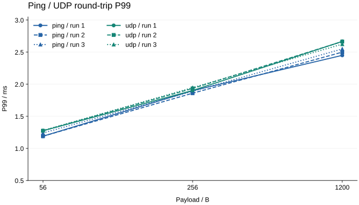
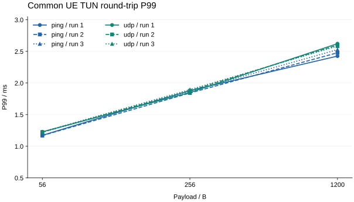

# 4. 各包长的 ping 与 UDP 对比

[规划](../../文献导读/第一步/4_各包长的ping与UDP.md) · [知识点](../../算法知识点说明/十二步知识点/第一步/4_各包长的ping与UDP.md) · [启动命令](../../启动命令/第一步/4_各包长的ping与UDP.md) · [返回第一步结果与分析](../第一步结果与分析.md)

## 固定 16 B 测量部分，改变填充

本轮为 **2026-11-18 新实测**：原核心网、单 UE、120 kHz、66 PRB、0.625 ms TDD（3D＋混合槽 6D4F4U＋1U），PF、HOL 关闭、MCS 上限 9、空闲授权资格 0。现在代码启用已编译 RFsim 混合槽下行段末同步 C 方案，分终端直接启动，不加连续供样或额外线程池。实际 5QI 9/QFI 9、TUN/UPF 路由与双向 N3 包关联均核验。RFsim 地址为 127.0.0.1，本轮业务 TUN 地址为 192.169.0.6，业务目标为 172.11.200.25。

56／256／1200 B 数据区分别为 16＋40、16＋240、16＋1184 B。两种工具各三轮，本项共引用 18 次运行（39,600 次完整／36,000 次统计），其中 56 B 直接复用第 2 项。

|工具|数据区 / B|平均 RTT / ms|三轮 P99 范围 / ms|统计最大 / ms|
|---|---:|---:|---:|---:|
|ping|56|0.820|1.190–1.240|2.020|
|ping|256|1.323|1.860–1.900|21.600|
|ping|1200|1.775|2.450–2.550|8.140|
|udp|56|0.870|1.275–1.279|2.237|
|udp|256|1.384|1.902–1.947|17.942|
|udp|1200|1.882|2.625–2.668|9.144|

固定目标包率 50 包/秒时，大包也提高字节负载；结果限定本配置和本负载，不把它称为纯包长的孤立因果效应。平均低不代表所有包都低，表中慢包全部保留。

Payload / B 为数据区字节数，P99 / ms 为第 99 百分位往返时延，run 为轮次。每点使用一轮 2000 个统计事务；连线辅助阅读，不是连续包长模型。

## 实测发送间隔与共同边界

|工具|数据区 / B|实际平均间隔 / ms|TUN RTT 均值 / ms|
|---|---:|---:|---:|
|ping|56|24.784|0.804|
|ping|256|20.391|1.307|
|ping|1200|20.700|1.759|
|udp|56|20.000|0.834|
|udp|256|20.000|1.345|
|udp|1200|20.000|1.842|

## 各轮结果

|工具|数据区 / B|轮次|平均 / ms|P50 / ms|P95 / ms|P99 / ms|最大 / ms|
|---|---:|---:|---:|---:|---:|---:|---:|
|ping|56|1|0.819|0.801|1.060|1.190|1.950|
|ping|56|2|0.818|0.801|1.070|1.190|1.820|
|ping|56|3|0.824|0.804|1.080|1.240|2.020|
|ping|256|1|1.316|1.270|1.710|1.900|7.290|
|ping|256|2|1.317|1.280|1.700|1.860|2.510|
|ping|256|3|1.335|1.280|1.710|1.890|21.600|
|ping|1200|1|1.775|1.740|2.270|2.450|8.140|
|ping|1200|2|1.765|1.730|2.270|2.500|7.990|
|ping|1200|3|1.786|1.750|2.310|2.550|7.900|
|udp|56|1|0.864|0.842|1.143|1.275|2.237|
|udp|56|2|0.874|0.851|1.143|1.276|2.094|
|udp|56|3|0.874|0.852|1.154|1.279|1.588|
|udp|256|1|1.388|1.336|1.720|1.902|17.942|
|udp|256|2|1.380|1.340|1.740|1.935|9.712|
|udp|256|3|1.383|1.343|1.783|1.947|2.392|
|udp|1200|1|1.875|1.831|2.413|2.668|9.144|
|udp|1200|2|1.879|1.846|2.429|2.665|3.124|
|udp|1200|3|1.892|1.849|2.436|2.625|8.478|

## 证据和计数

当前侧 21 次独立业务运行全部通过，共 **46,200 次完整事务／42,000 次统计事务**。每轮 2200，前 200 预热、后 2000 统计。第 1/2/4 项的现在代码 56 B ping 共用三轮；第 2/4/5 项的 56 B UDP 共用三轮；第 3/4 项的 256 B 精简 UDP 共用三轮。复用不增加独立运行或样本数。

本页使用 `说明/研究结果与分析/数据/第一步_56B共用基线重测_20261118.json`。原始 ping/CSV/pcap 及失败仅本地保留，独立复算逐事务核对通过；旧批次保留历史，不改名冒充新测。均值是三轮共 6000 个统计事务的合并均值，P99 范围是三轮描述分位的最小—最大，不是置信区间。具体配置/包长/周期为工程选择，协议版本和条款、论文及教材定位见本项知识点。
