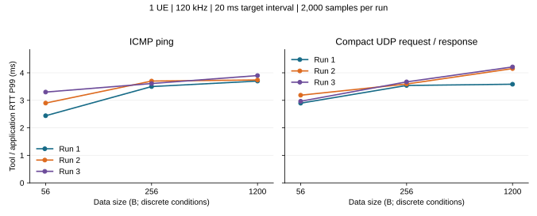
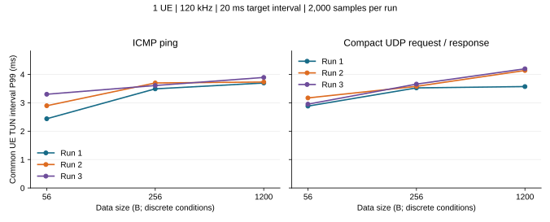

# 4. 各包长的 ping 与 UDP 对比

[规划](../../文献导读/第一步/4_各包长的ping与UDP.md) · [知识点](../../算法知识点说明/十二步知识点/第一步/4_各包长的ping与UDP.md) · [启动命令](../../启动命令/第一步/4_各包长的ping与UDP.md) · [结果与分析](4_各包长的ping与UDP.md) · [返回第一步结果与分析](../第一步结果与分析.md)

18 个正式条件各 2200 完整 / 2000 统计，合计 39600 / 36000。以下保留工具/三包长范围、18 轮表、两图、实际间隔与 UDP 平均分解。

### 我实际测了什么

|项目|本轮实际条件|
|---|---|
|平台|同主机独立 5GC 副本 + gNB + 软件 UE，RFsim，无真实射频|
|版本|现在代码；10 个运行文件与已冻结记录一致；本轮无无线 C 修改，详细代码与测量程序身份见日志|
|无线|n261、100 MHz、66 PRB、120 kHz、正常 CP、MCS 上限 9|
|TDD|0.625 ms：3 完整 D + 混合槽 6D4F4U + 1 完整 U；完整槽 D:U = 3:1，混合槽不省略|
|调度/授权|PF、legacy 探测 F = 10 帧、SR = 40 槽 / offset = 3、业务 K2 = 4；保留配对私有 HOL 报告，关闭层内观察器|
|QoS 与路径|实际 NAS 5QI 9 / QFI 9，双向 N3 / TUN 和路由核验；UPF 侧回复端，无外部 DN 物理链路|
|业务|两工具数据各 56 / 256 / 1200 B；UDP 含 16 B 标记、请求响应等长；普通无选项 IPv4 内层分别 84 / 284 / 1228 B|
|到达与统计|目标间隔 20 ms；每条件 3 轮，每轮 2200 次、前 200 次预热、后 2000 次统计；正序、逆序、循环移位，单工具顺序运行|
|主机|沿冻结绑核，UE 主线程 CPU 4、gNB RU CPU 6、UDP 服务端 CPU 2、客户端/原生 ping CPU 3；线程和 RFsim 模块核验|

以上具体配比、包长、业务频率、绑核与样本数都是工程安排，不是 3GPP 强制工业方案。5QI 9 不等于已经验证工业关键控制业务。

### 六条件的三轮 P99 范围

这里的范围是三轮各自 P99 的最小值至最大值，不是合并三轮后重新计算的 P99。

|工具|数据长度 / B|工具/应用 RTT P99 范围 / ms|共同 UE TUN 区间 P99 范围 / ms|
|---|---:|---:|---:|
|ping|56|2.440–3.300|2.438–3.301|
|ping|256|3.500–3.700|3.492–3.699|
|ping|1200|3.700–3.900|3.698–3.893|
|udp|56|2.897–3.186|2.884–3.172|
|udp|256|3.540–3.671|3.525–3.659|
|udp|1200|3.585–4.214|3.572–4.198|

本组两种工具的三轮曲线都随 56 → 256 → 1200 B 非递减；这是当前配置与固定目标包率下的观察，不证明任意负载、相位或 SCS 下都单调。
同包长对应轮次的描述性对照中，ping / UDP 的高低会反转，所以没有证据支持某个工具在所有条件都更低。工具处理路径、实际节奏和相位尚未独立控制。

每个点对应一轮 2000 个统计事务，连线仅便于阅读，不是连续包长模型。ping 的自身 RTT 来自原生每回复输出，存在工具舍入；UDP 来自客户端单调时钟整数戳。显示位数不增加仪器精度。共同 TUN 区间仍含网络与回复端处理，不是纯空口。

### 各轮结果，不挑快轮

#### ICMP ping

|数据 / B|轮次|平均 RTT / ms|P50 / ms|P95 / ms|P99 / ms|最大 / ms|TUN P99 / ms|
|---:|---:|---:|---:|---:|---:|---:|---:|
|56|1|1.702|1.640|2.270|2.440|3.990|2.438|
|56|2|1.813|1.680|2.550|2.900|4.130|2.897|
|56|3|1.843|1.800|2.770|3.300|4.400|3.301|
|256|1|2.362|2.380|2.730|3.500|4.640|3.492|
|256|2|2.280|2.130|2.990|3.700|4.200|3.699|
|256|3|2.418|2.530|2.960|3.610|4.060|3.609|
|1200|1|2.781|2.820|3.230|3.700|5.380|3.698|
|1200|2|2.713|2.800|3.190|3.740|4.890|3.732|
|1200|3|2.640|2.680|3.290|3.900|4.510|3.893|

#### 精简 UDP

|数据 / B|轮次|平均 RTT / ms|P50 / ms|P95 / ms|P99 / ms|最大 / ms|TUN P99 / ms|
|---:|---:|---:|---:|---:|---:|---:|---:|
|56|1|1.871|1.875|2.529|2.897|3.364|2.884|
|56|2|1.935|1.918|2.695|3.186|3.824|3.172|
|56|3|1.740|1.722|2.530|2.966|3.571|2.953|
|256|1|2.282|2.271|2.983|3.540|4.565|3.525|
|256|2|2.290|2.275|2.966|3.593|4.660|3.580|
|256|3|2.291|2.265|3.147|3.671|4.637|3.659|
|1200|1|2.745|2.744|3.423|3.585|4.453|3.572|
|1200|2|2.692|2.677|3.355|4.154|5.287|4.139|
|1200|3|2.698|2.680|3.402|4.214|4.602|4.198|

### 实际间隔与比较限制

|工具|数据 / B|三轮实际 TUN 平均间隔范围 / ms|
|---|---:|---:|
|ping|56|20.593222–20.625282|
|ping|256|20.504361–20.732656|
|ping|1200|20.558954–20.737710|
|udp|56|19.999981–19.999991|
|udp|256|19.999983–19.999984|
|udp|1200|19.999982–19.999984|

两工具的参数目标都是 20 ms，但实际发送节奏可能不同；TUN 还包含本地协议推进。跨工具结果同时受内核/应用回显、计时、到达节奏及无线相位影响，不能用差值单独证明“UDP 协议比 ICMP 多耗多少空口时间”。固定包率时，大包的 Mbps 也提高，本轮没有隔离负载因素。

### UDP 四应用时刻的平均分解

|数据 / B|轮次|上行应用区间均值 / ms|回复区间均值 / ms|下行应用区间均值 / ms|应用 RTT 均值 / ms|
|---:|---:|---:|---:|---:|---:|
|56|1|1.576472|0.003152|0.291016|1.870641|
|56|2|1.649835|0.003111|0.281793|1.934739|
|56|3|1.464263|0.003330|0.272083|1.739676|
|256|1|1.977217|0.003694|0.300641|2.281553|
|256|2|1.974429|0.003697|0.312040|2.290166|
|256|3|1.965576|0.003660|0.321507|2.290742|
|1200|1|2.295028|0.005884|0.443884|2.744796|
|1200|2|2.237290|0.005956|0.448877|2.692123|
|1200|3|2.242818|0.005883|0.448859|2.697560|

四个时刻在 UE / 服务端日志中按事务编号关联。逐事务整数恒等式、两端时钟域与抓包辅助边界已核；同一批事务的分段均值相加等于 RTT 均值，分段 P99 不能相加。t2 在构造回复前记录，所以回复区间不包含此后编码/发送的全部工作；这些按本定义进入下行区间。没有开启协议层探针，不把本表称为 PDCP/RLC/MAC/PHY 逐层耗时。

### 失败、先导与可复核证据

v1 pilot-01 的 56 B ping 200/200 已交付，因额外 1 个内层 version6 背景 PDU 被误当 IPv4 解析而核验失败；旧根与 v1 代码保留。v2 对背景单独计数，目标 IPv4 的长度、身份、QFI、数据与完整性门禁不变。新 pilot-02 六条件 1200 完整/1080 统计全部通过，再执行本正式根；先导和失败样本都不并入正式统计。
本正式根运行总耗时 1163.408 s（含每次副本、接入、业务、核验和回收），核 2308 冻结输入。18 次完整日志、pcap 与两端 CSV 保留在本机；独立从原日志复算工具/应用 RTT、共同 TUN 和 UDP 分段，未另造第二套 pcap 解析器。结束核验原核心身份/运行状态不变，每轮子进程与本轮资源回收。

安全数据：[正式 summary.json](https://github.com/ming0526288/oiwireless-latency-analysis/blob/latency-standards-audit/research/latency-analysis/step1-ping-udp-results/evidence/main-01/summary.json)；运行与方法见[第一步启动命令](../../启动命令/第一步启动命令.md)、CHG402 / TEST552。原文与精确条款沿下方来源区；具体业务参数是工程安排，不是标准强制。

旧 80 B 测量头的 256 B 结果保留在[2. 80 B 与 16 B 的 UDP 对比](2_80B与16B的UDP.md)，不与本页的新输入混用。
