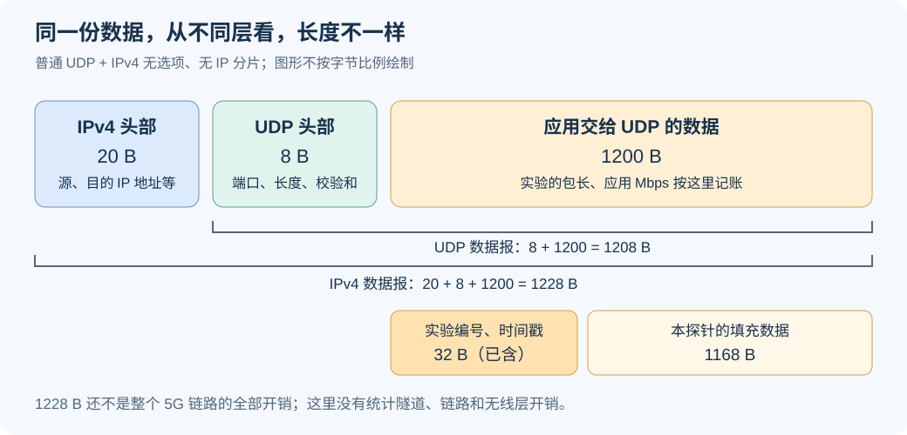
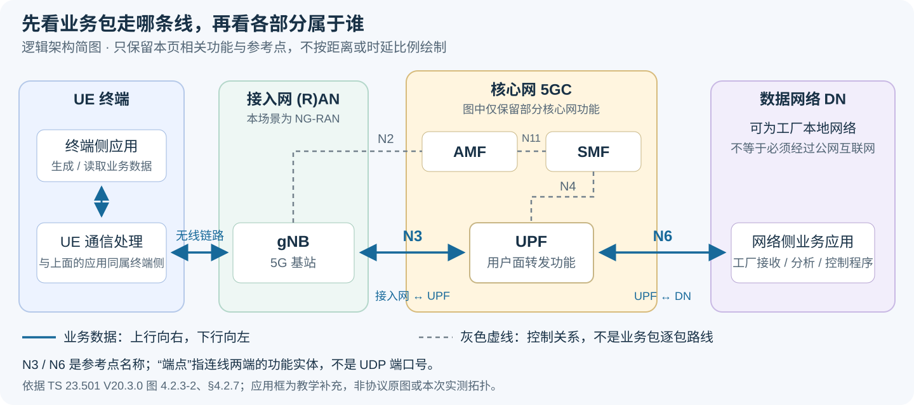
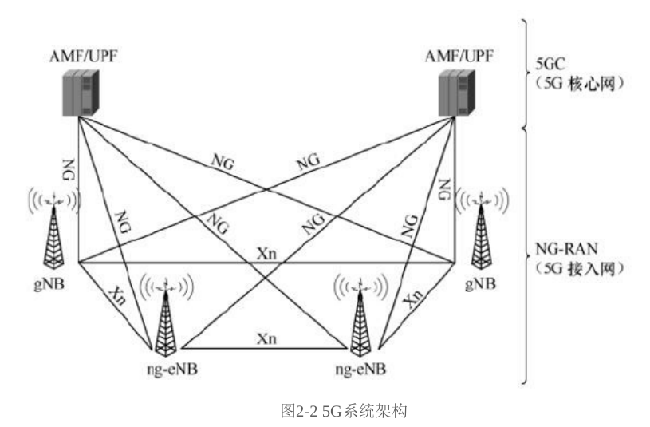
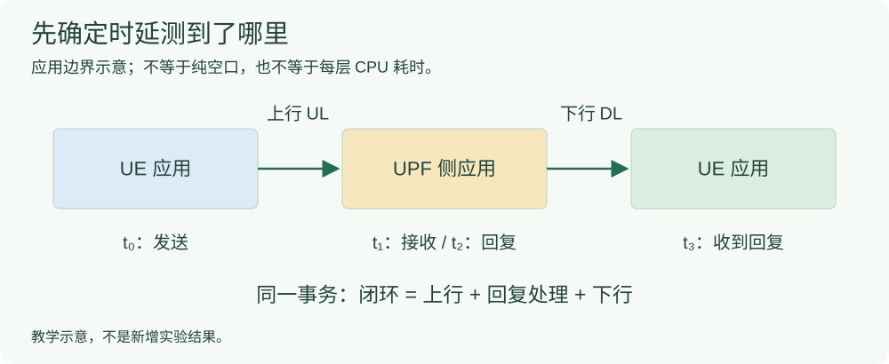
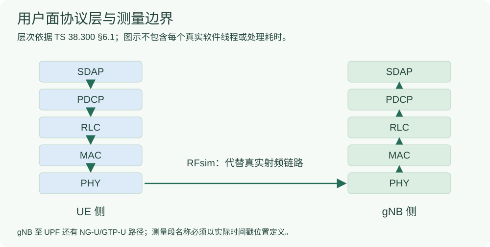

# 通信与时延基础：读实验结果前先确定什么

先读这一页，再进入不同 TDD、不同 SCS、多 UE、分层时延和尾时延。这里的图是教学示意，数值例子不是新实验结果。

## 单位、包长和负载必须一起看

|符号|含义与单位|读结果时需要确认的事|
|---|---|---|
|$L$|本页换算中的应用数据长度，byte|本实验 1200 B 不含 UDP/IP 头部；具体层次见下节|
|$R$|业务生成速率，Mbps|是每个 UE 的速率还是全部 UE 的总速率|
|$\lambda$|平均到达率，包/秒|由速率和包长换算，不等于每秒成功交付包数|
|$\Delta t$|平均发包间隔，秒|平均间隔不等于随机业务每个间隔都相同|

采用十进制 Mbps，且 $L$ 与 $R$ 使用同一负载口径时：

```math
\begin{aligned}
\lambda&=\frac{R\times10^6}{8L}\quad[\text{包/秒}],\\
\overline{\Delta t}&=\frac{8L}{R\times10^6}\quad[\text{秒}].
\end{aligned}
```

例如 $L=1200$ byte、$R=8$ Mbps，平均约 $833.33$ 包/秒，平均间隔 $1.2$ ms。这是单位换算；不证明无线链路能稳定承载，也不规定业务必须使用均匀间隔。

> **实验口径**：包长、到达分布、预热包数和统计包数属于实验设计。3GPP 没有替本项目指定这些具体数值。

## 应用负载、UDP、IP 和头部是什么意思

可以把一次发送想成寄快递：**应用数据是包裹里的东西，协议头部是帮助运输和投递的面单。** 面单本身也要占字节，因此从不同层数同一个包，长度会不同。

这里 B、byte、字节是同一个单位，1 B = 8 bit；Mbps 中的小写 b 指 bit。

“应用”就是发送和接收数据的程序。在本实验里，它是生成编号数据包、记录收发时间的测试程序。“应用负载”指程序交给下一层的这些数据；“8 Mbps 业务负载”指按应用数据口径配置的产生速率，不是 CPU 占用率，也不是无线带宽。

### UDP：把一条消息交给对方程序

UDP 全称 User Datagram Protocol，中文是**用户数据报协议**，是一种传输层协议。应用可以通过它一条一条发送消息。UDP 本身不保证每条消息必定到达、按顺序到达；应用或下层仍可能有自己的重传机制。

普通 UDP 的基本头部是 **8 B**，包含四个字段，每个 2 B：

|字段|通俗含义|
|---|---|
|源端口|发送方使用的应用端点编号|
|目的端口|接收设备应把消息交给哪个应用端点|
|长度|UDP 头部与 UDP 数据加起来有多长|
|校验和|帮助检查传输中数据是否发生差错|

端口不是网线插口，可以理解成设备里区分不同通信程序的“门牌号”。这些字段按 [RFC 768 的 Format/Fields](https://www.rfc-editor.org/rfc/rfc768)解释。此处讲普通 UDP；另有 [RFC 9868](https://www.rfc-editor.org/rfc/rfc9868.html) 扩展选项，本页没有把它的额外内容算成固定 8 B 开销。

### IP：让包找到目标地址

IP 全称 Internet Protocol，中文是**网际协议**，是一种网络层协议。它在包里放入源 IP 地址、目的 IP 地址等信息，供网络转发。可以把 IP 地址理解成设备在网络中的地址，把 UDP 端口理解成到达设备后应用的门牌号。

“IP 头部”就是包前面保存这些控制信息的部分。这里使用 **IPv4 且没有选项**的例子，其头部是 **20 B**：按 [RFC 791 §3.1](https://www.rfc-editor.org/rfc/rfc791#section-3.1)，IHL 以 32 bit 为单位，最小为 5，所以 5 × 32 ÷ 8 = 20 B。带选项或使用 IPv6 时不能照搬 20 B。

### 本实验的 1200 B 到底包括什么



核对原实验 `tdd1/udp_packet_probe.py::send`、`multi-ue/probe.py::send`：程序先构造指定长度的数据，再通过 `sendto` 交给普通 IPv4 UDP 套接字。**设置 1200 B 时，是 UDP 的应用数据为 1200 B；UDP/IP 头由协议栈另外处理。**

|观察位置|算哪些字节|本例长度|
|---|---|---:|
|应用交给 UDP 的数据|应用数据|1200 B|
|UDP 数据报|UDP 头 + 应用数据|8 + 1200 = 1208 B|
|IPv4 数据报，无选项、无 IP 分片|IPv4 头 + UDP 头 + 应用数据|20 + 8 + 1200 = 1228 B|

还有一种容易混淆的“头”：本探针在应用数据里放了 **32 B 测量标记**，包含识别标志、包编号和发送时间戳，之后再填充 1168 B，合计 1200 B。这个标记是实验程序定义的，**已经算在 1200 B 里面，不要再加一次 32 B**；它也不是标准 UDP 的 8 B 头部。填充数据用于测试，不代表已经处理摄像头或机械臂的真实内容。

### 为什么 8 Mbps 还要说明是否包含头部

本实验编号 UDP 业务的目标 Mbps 按应用数据计算。若每包应用数据 1200 B、目标应用速率 8 Mbps，则名义平均包率为：

```math
\lambda=\frac{8\times10^6}{1200\times8}
        \approx833.33\ \mathrm{packet/s}.
```

在普通 UDP、IPv4 无选项且无 IP 分片、包率相同的记账假设下，加入这些头部的 IP 层数据量相当于：

```math
R_{\mathrm{IP}}=R_{\mathrm{app}}\frac{1200+8+20}{1200}
              =8\frac{1228}{1200}
              \approx8.186667\ \mathrm{Mbps}.
```

**8 Mbps 和 8.186667 Mbps 是同一包率下的不同计数边界，不是做算法后吞吐量变好了。** 后一个数是教学换算，不是本次抓包实测；实际发送间隔、丢包和重传等还要另测。不能用 IP 层包长 1228 B 代入应用口径的 8 Mbps，却仍宣称业务输入与原来完全一样。

### 抓包长度和无线开销还能不能直接这样算

**知道抓包位置、协议头和分片情况后，可以计算该位置的包长；但不能把这个包长直接当成无线资源消耗，也不能只靠包长算出完整业务时延。** 先说明“上行、下行”是什么，再看同一个包在不同位置的包装。

### 上行、下行和上行业务包是什么意思

方向以 **UE 终端**为参照。UE 是用户设备，本实验里是软件终端；gNB 是基站。**“终端侧应用”就是运行在 UE 内部的程序，不是 UE 前面另外一台设备。** 为了区分应用计时点与通信处理，本页把 UE 内部展开成“应用程序”和“UE 通信协议栈”。

|方向|无线侧是谁发给谁|应用业务路径的通俗读法|
|---|---|---|
|上行 UL，Uplink|UE → gNB|UE〔应用程序 → UE 协议栈〕→ gNB → UPF → 网络侧接收应用|
|下行 DL，Downlink|gNB → UE|网络侧发送应用 → UPF → gNB → UE〔UE 协议栈 → 应用程序〕|

例如 UE 里的视频发送程序、机械臂状态上报程序，或本实验的 UDP 测试程序，都是“终端侧应用”。应用生成数据后，把它交给 UE 内部的网络及无线通信处理；画出这一步，是为了说明数据经过哪里、时间从哪里开始记录。**不能把“应用 → UE”理解成多经过了一台设备或新增一段空口传输。**

软件实现中，应用与通信协议栈可以是不同进程。这里的 UE 表示终端侧的功能范围，不表示应用代码必须写进 UE 协议栈的同一个程序里。

路径画的是功能顺序，网络侧应用的实际位置仍以该次实验为准。“上、下”与设备摆放的高低、哪台电脑先启动没有关系；即使 UE、gNB 和核心网都运行在同一台电脑上，上下行的定义也不变。无线侧方向与两侧协议栈见 [TS 38.300 V19.4.0 §5.2](#/protocol/38.300?clause=5.2&version=19.4.0)、[§5.3](#/protocol/38.300?clause=5.3&version=19.4.0) 和 [§6.1](#/protocol/38.300?clause=6.1&version=19.4.0)。

**“上行业务包”就是终端侧应用向网络侧应用发送的业务数据包。** 例如，假设摄像头或机械臂控制器接在 UE 侧：

- 摄像头把视频发给网络侧分析程序，是上行业务；一段视频通常分成很多个包。
- 机械臂把位置、速度、状态反馈给控制台，是上行业务。
- 网络侧控制台把“移动到指定位置”的指令发给机械臂，是下行业务。

这里的设备连接关系只是场景示例，不是本实验新增的视频处理或真实机械臂测试。**包的方向由发送端和接收端决定，不由视频、反馈、指令这些内容名称决定。** 如果视频由网络侧服务器发给 UE，它就是下行。

对本实验的上行 UDP 测试，可以把一个包读成：“UE 侧测试程序生成编号和时间戳 → 经 UE/gNB 无线侧协议栈 → 经 gNB—UPF 路径 → 网络侧程序收到”。它携带的是测量标记和填充数据，不是真实视频。“上行时延”从哪里开始、到哪里结束，还要看探针；若计时从应用发送到应用接收，就包含实际经过的整条应用路径，不能全部叫纯空口时延。

上行业务传输也可能需要下行控制，例如 gNB 把上行授权发给 UE，随后 UE 在指定资源上发上行数据。**授权消息向下发，并不会把 UE 随后上传的业务包变成下行业务。** 上行授权机制见 [TS 38.321 V19.4.0 §5.4.1](#/protocol/38.321?clause=5.4.1&version=19.4.0)。

### “网络侧”是什么意思，网络侧应用在哪里

**“网络侧”是相对于 UE 终端说的。这里的“网络侧应用”，指 UE 通过 5G 网络与之通信的对端业务程序，例如工厂控制服务器上的接收程序或视频分析程序。** 它不是一种新协议，也不是一台固定设备的名称。

“网络侧”这个宽泛说法要结合上下文读：讨论网络设施时，基站、核心网功能等都可属于网络一侧；而本页路径中的 **“网络侧接收应用”特指最终读取业务数据的程序，不是把基站、UPF 和应用合称为一个节点**。

|部分|本例中的对象|主要作用|
|---|---|---|
|终端侧|UE 及其内部的发送应用|生成并发送业务数据|
|接入网|gNB 基站|提供无线接入|
|核心网用户面|UPF|处理、转发用户数据包|
|数据网络一端的业务应用|工厂服务器上的接收/分析程序|读取位置反馈、视频等业务内容|

例如，假设机械臂控制器接在 UE 侧，工厂服务器运行接收程序：**UE 内的应用上传位置反馈，工厂服务器上的应用接收反馈；前者称终端侧应用，后者在这条路径中称网络侧应用。** 服务器再向 UE 发运动指令时，它仍是网络侧应用，只是业务方向变成下行。

**网络侧应用可以部署在工厂本地或边缘服务器，不要求经过公网互联网。** “网络侧应用”和“核心网”也不是同义词：核心网提供连接和转发等功能，对端应用处理具体业务。协议的结构依据是 [TS 23.501 V20.3.0 §4.2.7](#/protocol/23.501?clause=4.2.7&version=20.3.0) 的 N3/N6 端点与 [§6.2.3](#/protocol/23.501?clause=6.2.3&version=20.3.0) 的 UPF 功能；“终端侧/网络侧应用”在这里是讲解用的角色名称，不是新增标准网络功能。

本实验中，网络侧接收应用就是接收编号 UDP 包并记录时间的测试程序。它可以和其他组件同宿主运行；具体部署位置、命名空间和计时终点以该次实验记录为准，不能仅凭“网络侧”就推断它在另一台电脑上，或已经测过一段额外外部网络。

### 对照架构图：N3、N6 的“端点”到底是谁

**有原图：3GPP 的 [TS 23.501 V20.3.0 §4.2.3，图 4.2.3-2（点击直达本地转换 PDF 第 49 页）](#/protocol/23.501?clause=4.2.3&version=20.3.0&page=49) 是非漫游 5G 系统的参考点架构图。** 其中用户面主线为 `UE — (R)AN — UPF — DN`，N3 标在接入网与 UPF 之间，N6 标在 UPF 与 DN 之间。以下按该图及 [§4.2.7](#/protocol/23.501?clause=4.2.7&version=20.3.0) 简化重绘，把应用所在的角色补上，方便与本页文字对照。



*图：依据本地 TS 23.501 V20.3.0（2026-09）图 4.2.3-2、§4.2.7 重绘；UPF 功能见 §6.2.3。原图还有其他网络功能和参考点，这里省略。应用框、分区颜色和业务方向为教学补充，不是协议原图，也不是本次实测部署。该本地版本已核封面与相关内容，未独立核实其为官网最高版本。原 Word 中这张图为 EMF 矢量图，现已在本地转换 PDF 第 49 页核对，可点击上方链接直接查看；转换 PDF 非官方下载 PDF，原 Word 仍保留。*

这里的 **“端点”就是一条逻辑连接两端的对象**：N3 的两端是接入网和 UPF，N6 的两端是 UPF 和数据网络 DN（Data Network）。它不是说 N6 直接接到某一个应用进程；应用通过数据网络通信，实际还有哪些路由、交换或主机处理，须看部署。**架构端点也不等于 UDP 端口号或 GTP-U 的 TEID**，后两者属于更具体的协议寻址/隧道标识概念。

读图时先沿蓝线看业务包：**终端内的应用 → UE 通信处理 → gNB → UPF → 数据网络中的业务应用**；下行反方向。AMF、SMF 画在上方，是核心网的控制面功能，蓝色业务路径不表示每个业务包还要依次交给 AMF、SMF 处理。灰虚线仅保留 N2、N4、N11 控制关系，完整控制过程和其他接口没有展开。

**你提到的那本 5G 教材也有图。** [§2.2.1、本地 PDF 第 40 页的图 2-2“5G 系统架构”](#/paper/book?page=40) 如下：



*来源：《5G移动通信系统设计与标准详解》，§2.2.1，图 2-2，本地 PDF 第 40 页，仅裁取图与图题；未重绘图内内容。[第 41 页](#/paper/book?page=41) 另有图 2-3“4G 和 5G 系统架构对比”。本地 PDF 的部分压缩流有解析警告，但本次所用第 40 页图像与图题已经渲染并目视核对。*

教材这张图适合看 **5GC 核心网与 NG-RAN 接入网的分界**，但没有展开 UE、DN 和 N6，因此本页的 N3/N6 端点以较完整的 3GPP 架构及参考点定义为准。图里的 `AMF/UPF` 是概括画法，不能读成 AMF 与 UPF 是同一个功能，也不能把 UPF 当作整个核心网。

### UPF 是什么意思，和接收应用是什么关系

**UPF = User Plane Function，中文为“用户面功能”。它是 5G 核心网中的一个功能组件，负责用户数据包的路由、转发等处理。** “核心网”包含多个功能，UPF 是其中之一，不能把 UPF 当作整个核心网的另一个名字。定义与功能见 [TS 23.501 V20.3.0 §6.2.3](#/protocol/23.501?clause=6.2.3&version=20.3.0)。

在当前业务路径中，上行包到达 gNB 后，通过 N3 送到 UPF；UPF 按规则处理并送向数据网络，最终由业务接收程序读取。下行时反方向传送。N3、N6 的端点定义见 [TS 23.501 §4.2.7](#/protocol/23.501?clause=4.2.7&version=20.3.0)。

|对象|通俗作用|本实验怎样理解|
|---|---|---|
|UE 内部的应用程序|产生业务数据，或接收数据|带编号和时间戳的 UDP 测试程序|
|UE 内部的通信协议栈|处理这些数据，使其能够经无线侧收发|软件 UE 的相关网络及无线协议处理|
|gNB|提供基站侧无线接入与数据处理|软件基站|
|UPF|在核心网用户面处理、转发包|核心网中的用户面功能组件|
|网络侧接收应用|读取业务内容，或记录接收时间|本实验接收 UDP 包的程序|

**UPF 和接收应用承担不同功能：前者负责网络转发处理，后者消费业务内容。** 它们可以部署在不同机器，也可以在同一宿主机或相关网络环境中运行；画成两个功能不等于必有两台物理机器。本实验究竟在哪个程序收到就结束计时，应查看实际探针与启动命令，不能把“包到 UPF”自动当成“接收应用已经收到”。

### 业务包：视频、传感器数据和机械臂指令都可以

“业务数据”指应用希望传给对方的内容，例如摄像头的视频数据、温度读数、机械臂位置反馈，或“移动到指定位置”的指令。应用把这些内容交给网络发送后，本页把承载它们的数据包称为“业务包”。视频通常拆成很多个包发送，并不是一段视频只对应一个包。

**机械臂的控制指令属于应用业务；5G 网络自身的控制信令则用于注册、建连接等网络操作。** 两者都带有信息，不能只凭“带信息”或名称里有“控制”就认定是同一类包。在当前 gNB—UPF 路径中，前者可以由用户面运输；gNB 与 AMF 之间的 NG-C 承载网络控制信令，参见 [TS 38.300 V19.4.0 §4.3.1.2](#/protocol/38.300?clause=4.3.1.2&version=19.4.0)。AMF 是负责接入和移动性管理的核心网功能。

本实验用带编号、时间戳和填充数据的 UDP 包代替实际业务输入，**没有真的发送视频或机械臂运动指令**。1200 B 是本实验应用数据的长度，含已有的 32 B 测量标记。下文选择 IP/UDP 业务作例子；实际视频或指令应用还可能采用其他传输协议，不能一概认为内层都有 UDP。

### NG-U 和 N3：本场景中指向同一段用户面连接

|名称|含义|连接谁与谁|
|---|---|---|
|NG-U|NG 用户面接口；NG 是 Next Generation，U 是 User Plane|NG-RAN 节点与 UPF；在本场景中就是 gNB 与 UPF|
|N3|5G 系统架构中的一个参考点，可先理解成架构图对这段连接的命名|接入网 (R)AN 与 UPF；在本场景中就是 gNB 与 UPF|
|N6|UPF 与数据网络之间的参考点|UPF 与承载网络侧应用的数据网络|

UE 是用户设备，gNB 是 5G 基站，UPF 是核心网中负责用户数据转发等处理的功能。对当前 3GPP 接入的实验，**“NG-U 接口”和“N3 参考点”描述的是 gNB—UPF 这段用户面连接，不能把它们算成前后串联的两段传输或两份时延。** N3 也不是第 3 个网卡、3 个 UE，或一种额外协议头。N3 的一般定义还适用于其他接入网场景，本页没有将其全部等同于 gNB。

依据：[TS 38.300 V19.4.0 §4.3.1.1](#/protocol/38.300?clause=4.3.1.1&version=19.4.0) 定义 NG-U 端点与协议栈；[TS 23.501 V20.3.0 §4.2.7](#/protocol/23.501?clause=4.2.7&version=20.3.0) 定义 N3、N6 等参考点。这是逻辑连接关系，不要求设备必须位于不同电脑上。

```text
终端 UE ── 无线侧协议栈 ── gNB ══ N3 / NG-U ══ UPF ── N6 ── 数据网络中的应用
                                    ↑
                          本页讨论的 GTP-U 封装位置
```

这是通用功能路径示意。当前接收程序若直接位于 UPF 的网络环境中，实际测量终点仍以该次命令和探针为准，不能据图虚构一段已经测量的外部网络。

### 内层与外层：同一个业务包在 N3 上又加了一套运输头部

以 UE 向网络侧接收程序发送一个 UDP 包为例，先得到原业务的 IP 包：

```text
原业务包 = [内层 IP 头][内层 UDP 头][应用数据：本例 1200 B]
```

gNB 从无线侧恢复这个包后，为了将它送给 UPF，在外面再封装 GTP-U 和用于传输隧道包的 UDP/IP。于是 N3 上从外到内看到：

```text
[外层 IP 头：gNB → UPF]
  [外层 UDP 头：GTP-U 的运输端口]
    [GTP-U 头：隧道标识及按需携带的扩展]
      [内层 IP 头：UE 业务 IP → 网络侧业务接收 IP]
        [内层 UDP 头：发送应用端口 → 接收应用端口]
          [应用数据：1200 B，含本实验测量标记]
```

**内层回答“哪个应用发给哪个应用”，外层回答“把这个隧道包从哪个网络节点送到哪个网络节点”。** 它们是一次封装中的两套 IP/UDP 头；两套头部服务的端点不同，不是应用把数据发送了两遍。NG-U、N3 是连接的名称，GTP-U、UDP、IP 才是这里的协议名称。

UPF 收到上行包后，处理外层 IP/UDP 与 GTP-U 封装，取出原业务包，再按转发规则处理；下行反过来，由 UPF 封装、gNB 解封装，然后通过无线侧送给 UE。这个过程叫**封装与解封装**。GTP-U 本身是隧道协议，不意味着自动加密。上述内外层定义、封装与提取过程见 [TS 29.281 V19.2.0 §4.2.1](#/protocol/29.281?clause=4.2.1&version=19.2.0)、[§4.2.4](#/protocol/29.281?clause=4.2.4&version=19.2.0)、[§4.2.5](#/protocol/29.281?clause=4.2.5&version=19.2.0)；UDP/IP 承载关系见 [§4.4.1](#/protocol/29.281?clause=4.4.1&version=19.2.0)。

### “两层长度不能混在一起”具体怎么算

在**内外层均为 IPv4、没有 IP 选项、没有 IP 分片**且使用前述普通 UDP 的教学条件下，令 $H_{\mathrm{GTP}}$ 为 GTP-U 全部头部字节数，包含实际存在的可选字段及扩展：

```math
\begin{aligned}
L_{\mathrm{inner\ IP}}&=20+8+1200=1228\ \mathrm{B},\\
L_{\mathrm{N3,outer\ IP}}&=20+8+H_{\mathrm{GTP}}+1228\\
&=1256+H_{\mathrm{GTP}}\quad[\mathrm{B}].
\end{aligned}
```

[TS 29.281 V19.2.0 §5.1](#/protocol/29.281?clause=5.1&version=19.2.0) 规定 GTP-U 头部长度可变，最小为 8 B。因此上述条件下，使用最小头部作记账会得到 1264 B；**这不是本实验 N3 抓包的实测包长，也不能默认实际 5G 包只有 8 B GTP-U 头**。有扩展、IPv6、分片等情况必须按实际字段重新计算。

1228 B 已经包含 1200 B 应用数据；外层 IP 包又包含完整内层包。计算一次 N3 传输的 IP 层字节时，应数外层 IP 包这一整体，**不能再把 1228 B 或 1200 B 加一遍**。但如果研究目的本来是分别统计不同链路的资源消耗，应按链路各记一份，说明边界；这与误把嵌套内容重复计入同一个包不同。

抓包工具可能展开两套 IP、UDP 字段，要先辨认它们位于 GTP-U 里面还是外面。仅说“抓到了一个 UDP 包”或“`ip.len` 是多少”还不够，必须写明抓包位置、内外层和字段。外层 GTP-U 用户数据消息的 UDP 目的端口为 2152，依据 [TS 29.281 V19.2.0 §4.4.2.3](#/protocol/29.281?clause=4.4.2.3&version=19.2.0)；它不是内层测试应用的目的端口。

|你看到的字段或说法|应当怎样读|
|---|---|
|本探针 `sent.csv` 的 `payload_bytes`|程序交给 UDP 的字节数，本例为 1200|
|业务内层包的 `udp.length`|普通情形下包含 8 B UDP 头，本例为 1208；不要取成外层 UDP 的长度|
|业务内层包的 `ip.len`|包含 IPv4 头，本例在上述条件下为 1228|
|N3 外层包的 `ip.len`|包含外层 IPv4、外层 UDP、GTP-U 和完整内层包；本例为 $1256+H_{\mathrm{GTP}}$ B|
|抓包的 `frame.len`|捕获链路上的帧长度，含哪些内容取决于接口和封装，不等于应用数据长度|
|“空口实际传了多少”|还需区分无线协议、编码、资源分配及重传等，不能只凭 1228 B 得出|

### 抓包长度与无线开销为什么要分开

**抓包**可以理解成在指定网络接口上记录经过的数据包，查看头部、长度和时间。它看到的内容受抓包位置、接口类型和捕获设置影响；被记录的字节不一定就是无线信道上传输的全部内容。

|观察或统计位置|能回答什么|不能直接拿来代表什么|
|---|---|---|
|应用程序|本实验每次交给 UDP 的数据有多少，例如 1200 B|整条链路或空口实际消耗|
|UE 的 TUN 虚拟接口|IP 层的业务包；普通例子中是内层 IP/UDP 与应用数据|已经编码、调制后的无线信号|
|gNB—UPF 的 N3 链路|带外层 IP/UDP/GTP-U 的隧道包|UE—gNB 空口上的整套封装|
|无线侧协议记录、调度和 PHY 记录|分段、传输块、时频资源及重传等实际情况|只凭一个 IP 包长就得到的固定开销比例|

“无线开销”需要先指定统计对象：可以是无线协议头/填充占了多少字节，也可以是编码、参考信号、控制及重传等消耗了多少资源；这些不是同一个数。无线侧会处理业务数据，加入相应协议头，可能分段、复用或填充，再进行物理层处理。一个应用包不一定对应一个无线传输块。MAC 子头/控制元素/填充见 [TS 38.321 V19.4.0 §6.1.2](#/protocol/38.321?clause=6.1.2&version=19.4.0)，物理层处理背景见 [TS 38.300 V19.4.0 §5.2.2](#/protocol/38.300?clause=5.2.2&version=19.4.0)、[§5.3.2](#/protocol/38.300?clause=5.3.2&version=19.4.0)，上行传输块大小的确定见 [TS 38.214 V19.5.0 §6.1.4.2](#/protocol/38.214?clause=6.1.4.2&version=19.5.0)。本页不把这些机制换算成一个未经测量的固定百分比。

尤其要注意：**前面算的外层 IP/UDP/GTP-U 是 N3 链路的隧道封装，不能把这整套外包装当作 UE—gNB 空口上必然逐包携带的头部。** 包长计算要按所在链路进行；无线资源和重传开销还需无线侧的实际记录。本次只是概念说明，未新增抓包或真实射频测量。

记论文或实验表时建议明确写成：**“1200 B UDP 应用数据，目标应用负载 8 Mbps”**，不要只写“1200 B 的包”。这组包长、标记格式和负载是工程取值；UDP/IPv4 头部含义以 IETF RFC 为来源，3GPP 未强制本实验使用这些数值。

## 授权、提前授权、队列积压和尾时延

先把终端想成等待发货的人，基站负责安排共用的发货时间和位置。一个包可能既要等“安排发送机会”，又要等“前面的数据发完”。这两种等待可能交织，需要用实际记录区分，不能把所有慢包都说成同一个原因。

### 什么是授权

**上行授权就是基站给终端的一次无线发送安排**：在什么时间、使用哪些频率资源发送数据。这里讨论本实验的上行数据调度。可以理解成基站说：“接下来指定的这个发送机会，给你用。”

按 [TS 38.321 V19.4.0 §5.4.1](#/protocol/38.321?clause=5.4.1&version=19.4.0)，上行授权可以动态接收，也可以提前通过配置等方式安排。时域、频域资源的具体解释见 [TS 38.214 V19.5.0 §6.1.2.1](#/protocol/38.214?clause=6.1.2.1&version=19.5.0) 和 [§6.1.2.2](#/protocol/38.214?clause=6.1.2.2&version=19.5.0)。

|名词|通俗意思|
|---|---|
|UE|用户设备；本实验是软件终端|
|gNB|基站，负责安排共享无线资源|
|SR：调度请求|终端请求新传输的上行资源，可理解成“我需要发送机会”|
|BSR：缓存状态报告|终端把待发数据量等信息报告给基站，可理解成“我这里还有多少数据”|
|上行授权|安排一次具体的上行发送机会|

SR/BSR 的依据是 [TS 38.321 §5.4.4/5.4.5](#/protocol/38.321?clause=5.4.4&version=19.4.0)。这些是相关机制，**不是每一个包都必须单独按“SR → BSR → 授权”重新走一遍**；已有授权、缓存状态和触发条件会影响过程。

### 为什么提前授权可能让时延变小

“提前”的目标是把资源安排做得更早，从而缩短包到达后的部分等待。通俗流程是：

```text
有数据 → 等请求/调度机会 → 获得可用授权 → 在指定资源发送
```

如果基站根据已收到的缓存报告、近期流量或服务记录，较早安排了一个合适的上行机会，而且包赶得上那次发送的准备时点，就可能少等一段时间。**授权只是发送安排，收到授权不等于数据已经到达接收端。**

提前授权也不是随时可用的永久凭证：指定时间过去、或者包来晚赶不上，该次动态发送安排不能留到以后随便使用。没有目标业务数据时，安排的机会也可能只携带控制信息或没有带来预期的数据服务。因此“发得更早/更多”不能自动等于“时延更小”。

**资源预算约束**就是限制这类提前或试探性安排可以消耗多少资源，例如限制一定统计窗口内的次数或时频资源，并兼顾已有明确积压的 UE。这些预算和策略是拟研究的工程选择，协议没有强制本项目采用某个固定数值。业务是否可预测、信息是否滞后以及实际资源开销，都需要实验验证。

本选题中的“突发首包”，指一段空闲后或一次突发业务开始时到达的第一个包，不一定是终端注册后的第一个包。“业务状态感知”指利用已获得的缓存、来包与服务信息，不能提前读取未来的业务包。

### 队列积压是什么意思

**队列是等待处理/发送的数据，积压是待发数据堆起来了。** 像收银台前排队：顾客不断到达，收银速度一时跟不上，队伍就变长。

一个纯教学例子：假设包长相同、没有丢弃，原来等着 3 个包，又来了 5 个包，然后只发走 4 个，仍有 3 + 5 − 4 = 4 个包等着。这个例子不代表本机测量。持续到达快于实际服务，会持续积压；即使长期平均负载不高，短时突发也可能暂时排长队。

本研究需要区分 UE 协议栈里实际待发的数据，与基站通过 BSR 等信息得到的估计；报告可能有延迟，不能假定两者完全相等。队首是排在前面的包，HOL 是按所声明的队列入口计算的队首等待时间；它不是整条链路时延。

一次授权可承载的数据量有限，**一个应用包可能分几次才能发完**。如果同一个有积压的 UE 在两次有效数据服务之间等很久，包的完成时间就会被拉长。“服务间隔约束”的方向，是研究如何缩短这种长空档，同时兼顾其他 UE；只有实际携带相关数据的服务才有意义，不能用空授权把表面间隔刷小。

RLC AM 模式下的分段与发送背景见 [TS 38.322 V19.3.0 §5.2.3.1](#/protocol/38.322?clause=5.2.3.1&version=19.3.0)。这里的排队类比不是规定所有数据必须按简单先来先服务排序；具体测量还要声明队列层次和服务时刻。相关概念继续读[多 UE 的负载与对照条件](多UE/实验结果之前_多UE负载与对照条件.md)。

### 尾时延和 P99 是什么意思

把一批包的时延从小到大排列，右侧那些**少数、特别慢的包**构成分布的尾部。“尾时延”是对这部分慢包表现的关注，不是仅指最后到达的一个包，也不等于最大值。

平均值回答“总体平均等多久”。P99 是第 99 百分位数，可通俗理解为：**约 99% 的统计包，其时延不超过这个值**。例如某次统计 P99 = 10 ms，不表示每个包都恰好等 10 ms，也不保证今后的包一定满足同样分布；精确结果受样本量和分位数方法影响。

多数包很快、少数包偶尔等很久时，平均值可能看起来不错，用户仍会感到偶发卡顿。因此研究希望减少这些慢包及其发生频率，同时保留丢包、超时和未完成包，不能删掉慢包再报告更小 P99。[尾时延专页](尾时延/实验结果之前_分位数样本与慢包.md)给出本项目线性插值公式、样本与教学算例。

### 两个拟研究方向分别想减少什么

|拟研究方向|通俗目标|需要验证的条件|
|---|---|---|
|业务状态感知、资源预算约束的提前授权|让突发包少等一些请求与发送机会|包是否赶得上、是否存在到达规律、是否增加空授权或挤占其他 UE|
|队列积压与服务间隔约束的多 UE 调度|让排队数据更及时获得有效服务，更快发完|资源是否足够、各 UE 是否受益、是否把代价转给其他 UE、主机推进是否构成限制|

两项目前是研究目标，不能只凭名字就称为已实现的新算法、已验证创新点或保证 P99 降低。研究还应明确发送与接收边界、逐 UE 指标和资源代价。

## 先画出发送和接收边界



四个时刻必须关联到**同一事务**，且可以在同一时钟域比较：

```math
\begin{aligned}
T_{\mathrm{UL}}&=t_1-t_0, &T_{\mathrm{reply}}&=t_2-t_1,\\
T_{\mathrm{DL}}&=t_3-t_2, &T_{\mathrm{loop}}&=t_3-t_0
                           =T_{\mathrm{UL}}+T_{\mathrm{reply}}+T_{\mathrm{DL}}.
\end{aligned}
```

在本项目同宿主应用探针口径中，用可比较的单调时钟记录业务边界；N3/TUN 抓包另有时钟与校准要求。不能直接相减不同主机、不同钟源或不同包的时间戳。ping 的 RTT 也不能直接当成 UDP 单向时延。

### 之前 120 kHz 仿真的 ping 时延是多少，能代表业务吗

**查到的早期“2 ms 以内”记录，是小包 ping 的往返时延 RTT，不是视频处理、机械臂动作或完整 5G 注册过程的时延。** 2026-10-14 的单 UE RFsim 原始日志打印 `56(84) bytes of data`：56 B 是 ICMP Echo 的数据，另有 8 B ICMP 头；IPv4 无选项的包长为 84 B。回复行的 `64 bytes` 是 ICMP 头加数据，不含 IPv4 头。这里应称“当时使用的默认小包 ping”，不是 3GPP 规定一种固定包长的时延认证测试。

|旧日志中的完整槽 D:U 配置标签|包数|ping 平均 RTT / ms|观测最大 RTT / ms|
|---|---:|---:|---:|
|3:1|5|0.737|0.851|
|2:2|5|0.807|0.897|
|1:3|5|0.822|0.889|

另一轮 3:1 的平均/最大 RTT 为 0.769/0.868 ms，也是 5 包。以上均为**原程序、原配置的历史连通性记录**；完整槽比例标签不包含特殊槽内部符号，不能直接当成标准逐项强制方案。均值不是 P99，更不是“所有负载下都低于 2 ms”的保证；每轮只有 5 包也不足以支持可靠尾时延结论。原 runner 在 UE TUN 出现后执行 `ping -I oaitun_ue1 -c 5 -W 2 172.11.200.25`，UE 参数为 `--numerology 3`。这些记录没有被重新测量或改标成后续修复版结果；也不能只凭 TUN 绑定/低 RTT 认证无同机旁路或纯空口时延。

ping 发送 ICMP Echo Request 并等待 Echo Reply，计量的是去、回与响应处理构成的往返时间，不能直接称上行单向时延，也不能简单除以 2 认证上下行各耗时多少。其报文依据为 [RFC 792 的 Echo or Echo Reply Message](https://www.rfc-editor.org/info/rfc792/)；包长和 RTT 输出含义见 [iputils ping 手册的 -s 与 ICMP PACKET DETAILS](https://man7.org/linux/man-pages/man8/ping.8.html)。这里不是说 ICMP “绕过无线”：若实际路由经过完整用户面，它也会经历相关通信处理，区别在于端点、报文、负载和计时边界必须分别核对。

**真实业务并非必然超过 2 ms，而是不能沿用这组 ping 数值。** 小包、低负载、短路径的业务也可能很快；包长、到达频率、并发 UE、排队/资源机会、响应计算等变化时，需要按实际业务重新测。旧小包 ping 与后来的 UDP 业务不是严格同程序/同负载对照，不能把两者差值全部归因于包长或 UDP。

项目另有 2026-10-27 的历史通信应用闭环：UE 应用发 1200 B UDP 请求，UPF 侧回显应用收取并回复 1200 B，UE 应用收到响应才结束计时；总请求负载 4 Mbps，回复约 4 Mbps，120 kHz、PF、实际 5QI 9，1/2/3 UE 各 3 次。已有结果为：

|UE 数|应用请求—响应闭环均值 / ms|每轮最差单 UE 闭环 P99 的三次中位 / ms|
|---|---:|---:|
|1|2.441689|4.288529|
|2|4.676991|9.091126|
|3|7.037485|14.431726|

该批是已完成的历史回显业务，不是本次新测，也不是重传预算 C 修复后的新程序基线。闭环按同一事务 $t_3-t_0$ 计算，包含上行、实测回显处理与下行；不是三段 P99 相加。它仍没有包含视频采集/编解码、图像推理、真实控制算法或机械臂动作完成时间，不能将回显处理冒充这些业务计算。RFsim 墙钟结果也不能直接外推真实射频。

最后区分两种“控制”：**机械臂运动指令属于应用业务；RRC 建连接、NAS 注册等属于 5G 网络控制过程。** 后者有自己的流程边界，前述接入成功后 ping 不包含整段注册/建会话时间。控制面/用户面区分依据 [TS 38.300 V19.4.0 §4.3.1.1](#/protocol/38.300?clause=4.3.1.1&version=19.4.0)、[§4.3.1.2](#/protocol/38.300?clause=4.3.1.2&version=19.4.0) 和 [§6.1](#/protocol/38.300?clause=6.1&version=19.4.0)。

### 一个 Slot 是 0.125 ms，能否把处理算 3 槽、等待算 0～4 槽

**120 kHz、正常 CP 下，每个标称 Slot 为 0.125 ms，这一点是对的。** [TS 38.211 V19.5.0 §4.2、表 4.2-1](#/protocol/38.211?clause=4.2&version=19.5.0) 对应参数集 $\mu=3$；[§4.3.2、表 4.3.2-1](#/protocol/38.211?clause=4.3.2&version=19.5.0) 给出每个 1 ms 子帧的 8 个槽和每槽 14 个符号。因此：

```math
T_{\mathrm{slot}}=\frac{1\ \mathrm{ms}}{8}=0.125\ \mathrm{ms},\qquad
3T_{\mathrm{slot}}=0.375\ \mathrm{ms},\qquad
4T_{\mathrm{slot}}=0.5\ \mathrm{ms}.
```

**“一次完整往返通常需要 2～3 个 Slot，统一按 3 槽算处理”不能直接作为协议规定或本机测量结论。** 编码/译码等物理层处理见 [TS 38.300 V19.4.0 §5.2.2](#/protocol/38.300?clause=5.2.2&version=19.4.0)、[§5.3.2](#/protocol/38.300?clause=5.3.2&version=19.4.0)；MAC 调度、协议栈计算和等待发送机会还应区分。参数集会影响无线处理时序约束，但 CPU 上实际计算和排队耗时不能统一认定为 Slot 的固定倍数。

[TS 38.214 V19.5.0 §5.3](#/protocol/38.214?clause=5.3&version=19.5.0) 讨论 UE 的 PDSCH 处理与 HARQ-ACK 时序，使用 N1 等条件；[§6.4](#/protocol/38.214?clause=6.4&version=19.5.0) 讨论收到上行授权后准备 PUSCH 的时序，使用 N2 等条件，取决于参数集、处理能力和具体配置。**这些是特定无线过程的处理时序条件，不是 gNB、UE、UPF 和应用全部往返处理固定耗时 3 槽。HARQ-ACK 是无线链路反馈，也不是 ping 的 ICMP 回显回复。** 本页不从这些条款给出本机未测的固定处理时间。

如果为了先做敏感性分析暂设 $T_{\mathrm{proc}}=3T_{\mathrm{slot}}=0.375$ ms，必须写成“工程模型假设，待探针实测校准”，说明包含哪些处理、是否包含发射持续时间，不能写成通用经验定律或已测数值。

**“方向没到就要等”这个理解是对的，但“上下行合计一般等待 0～4 个 Slot”不是通用结论。** 对本项目传统非 SBFD TDD 工作点，方向由完整槽和混合槽中的 D/U/F 符号共同决定；还需要有效授权、准备完成和足够资源。原例完整槽 3:1 实际为 `D D D S U`，S 是 6D/4F/4U，周期 0.625 ms，而不是没有 S 的 `D D D U`。F 不能一概当成保护间隔，S 中的 U 符号能否承载该业务还须核 TDA、授权和实现。

只有明确了时隙边界到达、已有授权、无排队/重传、只使用完整 U 槽等教学假设，才能给出某一次上行方向等待 0～4 槽；任意时刻到达、上下行回包整体或错过当前发送准备时点时，不能沿用这个上限。[详细五相位表与连续到达反例见 TDD 知识页](不同TDD/实验结果之前_TDD配置与时隙图.md#为什么不是统一等待04个slot)。如果两个完整 D 槽之后紧接可用的上行起点，并且包恰在第一个 D 槽开始时准备好、其他条件全满足，才可在这个简化例子中说等 $2\times0.125=0.25$ ms；中间有 S 或还未取得授权时要另算。

此外，授权到目标 PUSCH 的 K2 偏移与发送准备、TDD 对齐可能覆盖同一段时间。**不能不核切点，就把 K2、固定“处理 3 槽”和整段方向等待全部再加一遍。** K2 定义见 [TS 38.214 §6.1.2.1](#/protocol/38.214?clause=6.1.2.1&version=19.5.0)，上行授权前提见 [TS 38.321 V19.4.0 §5.4.1](#/protocol/38.321?clause=5.4.1&version=19.4.0)。RFsim 的应用时间戳是主机墙钟/单调时钟口径，还需核对它与标称无线时间的推进关系，不能只靠若干槽相加拟合旧 ping RTT。

用于报告的建议表述：**“处理时延由物理层、协议栈和主机实际执行决定，按探针边界测量；TDD 方向等待取决于实际周期、符号图样、到达相位及授权条件，按可用发送机会计算。3 槽处理或 0～4 槽等待仅在明示的工程简化假设下使用，不是标准规定的完整往返时延。”**

#### 新实验：实际 ping 能验证到哪一步

2026-11-09 已新做 **gNB＋1 UE＋独立 5GC 的完整栈 RFsim**，不是只启动 gNB，也不是重用旧 5 包结果。新程序包含重传 RB 指针修复（构建源基 `61654513d5`），120 kHz、正常 CP、66 PRB，周期 0.625 ms，`D D D S U`、S 为 6D/4F/4U；PF、原主动探测 F=10 帧和 SR=40 槽配置保持。上述具体配置是工程取值，不是 3GPP 指定的唯一方案。

**这批 ping 每次从 UE 发起，先上行、再下行，测的是一次完整往返 RTT。** 实际 UE 业务地址为 `192.169.0.3`，目标是 UPF 容器内 `tun0` 的 `192.169.0.1`。请求到达该容器的本地 IP 协议栈，由内核生成 ICMP Echo Reply；没有另接视频/控制应用服务器，也没有延伸到外部数据网络服务器。

```text
请求：UE 内 ping → oaitun_ue1 → UE 用户面协议栈 → RFsim → gNB → N3/GTP-U → UPF 容器内核
回复：UPF 容器内核 → N3/GTP-U → gNB → RFsim → UE 用户面协议栈 → oaitun_ue1 → UE 内 ping
```

可以通俗说“出去再回来一圈”，论文中宜称 **ICMP 往返时延 RTT**。这里的“回环”若指 `127.0.0.1`/`lo` 的本机 loopback，就不是本次路径；同一物理主机上的 UE/gNB 网络命名空间与核心网容器相互隔离，实际路由为 `dev oaitun_ue1`、不是 `local`，双向 TUN/N3 抓包均有同一事务。它也不是包含感知、控制计算和机械执行的完整工业控制闭环。

“先上行”说的是**请求的业务方向**，不是让 TDD 周期从 U 槽开始。当前周期仍为 `D D D S U`，请求可能先等授权/可用 U 资源；回复再按 D 资源发送。若另做网络侧主动 ping UE，才是先下行、再上行；本表没有测那个相反起始方向。RTT 包含上行请求、对端回显处理和下行回复，不能直接当单向时延或默认上下行各占一半。

该路径的协议依据为 [TS 38.300 V19.4.0 §4.3.1.1](#/protocol/38.300?clause=4.3.1.1&version=19.4.0) 的 NG-U 用户面关系，以及 [TS 23.501 V20.3.0 §4.2.3、图 4.2.3-2](#/protocol/23.501?clause=4.2.3&version=20.3.0) 的系统架构；**实际 ping 端点与发起方向来自本批 `run.py`、`status.json`、路由和抓包，不是 3GPP 强制测试方案。** 本次仅补充已完成测试的解释，没有重启实验。

原生 ping 每 20 ms 发一个请求，分别用 56 B 和 1200 B **ICMP 数据**；每种包长做内部观察关闭/开启、3 次重复，共 12 条件。每轮 300 请求全部收到回复，前 20 包只预热：共 3600 完整事务、3360 统计事务。既有 `internet` 身份配置沿用 5QI 9，本批直接核验到双向 N3 的 **QFI 9**，没有重新从 NAS 空口独立认证 5QI；QFI 与 5QI 不可当成同一个字段。

|ICMP 数据长度|观察关闭：三轮平均 RTT 的中位数 / ms|观察开启：三轮平均 RTT 的中位数 / ms|关闭/开启各组实际最大 RTT / ms|
|---|---:|---:|---:|
|56 B|1.979|1.984|4.130 / 5.200|
|1200 B|2.901|2.863|5.240 / 9.160|

这里的“平均 RTT 的中位数”是先求各轮平均值、再取三轮中间值，不是逐包中位数。56 B 关闭观察的三轮均值为 2.231/1.979/1.870 ms；1200 B 为 3.031/2.901/2.778 ms。因此不能写成“120 kHz 的 ping 恒在 2 ms 内”。观察开关的配对均值差有正有负、尾部也有差异，不能据此宣布观察器零开销或开启观察能改善时延。每轮仅 280 个统计包，P99 是描述性统计，不能认证 P99.9 或长期可靠性。

同一批包还能在 UE TUN 与 gNB N3 上逐请求/回复对应，确认经过无线栈和隧道。下表用**观察开启组同一批 840 个统计事务的均值**，三段不重叠，所以可相加；工具 RTT 与抓包切点不同，另报而不强行混成一个数：

|ICMP 数据|TUN 请求→N3 请求 / ms|N3 请求→N3 回复 / ms|N3 回复→TUN 回复 / ms|三段抓包 RTT 均值 / ms|工具 RTT 均值 / ms|
|---|---:|---:|---:|---:|---:|
|56 B|1.688156|0.039656|0.284703|2.012514|2.020440|
|1200 B|2.381331|0.034664|0.465514|2.881508|2.888655|

上行、下行两段都混有协议处理、调度/发送等待和主机推进；中间段包含 UPF 转发、内核回显及主机网络路径，不能叫纯 UPF CPU 时间。表中因四舍五入可能有末位差；三段 **P99 不能照这样相加**。

现有内部探针得到两个局部量。每事务所用 UL `nr_ulsch_encoding` 调用累计墙钟耗时，56/1200 B 的组均值为 **5.55/30.36 µs**，只覆盖上行编码函数，未覆盖全部节点的计算。UE RLC 入队至第一次 PHY 编码开始，组均值为 **1.428/1.441 ms**，是混合等待，不是独立测出的纯 TDD 等待。56 B 统计包均为 1 个初传 RLC 片段；1200 B 为 770 个包用 2 片、70 个包用 3 片。固定包间隔下大包同时增加了字节负载，不能把全部 RTT 差都归于编码或分段。

已关联的 840/1750 次 UL 服务尝试均为 K2=4、目标槽号模 5 等于 4，即当前完整 U 槽位置。这支持本批实际服务方向与配置一致，不能据此断言标准禁止使用 S 中的 U 符号，也不能将 K2=4 解释成整个往返仅等 4 槽。

还有一个关键限制：观察开启条件的完整统计时间段内，RFsim 读取样本对应的无线时间与主机时间之比为 **3.106～3.337**，并非 1∶1。这个比例是时间段内样本推进观察，不是每包修正因子；不能将各包 RTT 直接乘除该比例，也不能把名义 0.125 ms 槽长直接当作本机同长度的等待。当前结果是软件仿真的主机时延，不是天线真实发射时刻。

**本次可下的结论：槽长 0.125 ms 正确；“方向没到需要等待”正确；完整往返处理固定 3 槽、UL/DL 总等待固定 0～4 槽，仍没有被本次测量证明，应作为有条件假设而非实测分项。** 尚未独立测全节点纯 CPU 和方向单独等待，不能用总 RTT 减去若干假设量填出这些缺项。数学反例说明 0～4 槽不是一般上界；混合等待大于 0.5 ms 本身不证明纯方向等待超过 4 槽。旧约 0.737 ms 的 5 包结果来自历史不同程序/配置，不能用它直接诊断当前退化。视频/机器人计算和动作仍未测。

复核未导入主分析器，独立解码并核对 3600 请求、7200 个 ICMP 校验和、TUN/N3 时间戳及统计；三份实验根共 7040 个冻结清单项保持。首次先导因本机 ping 不支持 `-e` 而未发出正式包，失败证据保留；新兼容方法另建根完成 80 包先导后才做本表，不拼接失败或先导样本。原四核心网容器身份保持，全部自建运行资源已回收。

本地原始根：`analysis-source-audit/ping-slot-validation-20261109/main-01`；复算代码与安全表：`oi-wireless-ran-ping-slot-validation/research/latency-analysis/ping-slot-results/`，分支 `latency-ping-slot-validation`，记录 CHG-369、TEST-518/519。来源版本/条款沿本节及方法 README，论文依据 P01 §III/IV（本地 PDF 2～4 页）、P02 §II/III（本地 PDF 2 页），教材 §13.1.1.2（本地 PDF 530～532 页）。本地用户提供版本已读，未冒称独立核实官网最高版。

## 协议告诉我们路径，实验告诉我们计时点

下面按 [TS 38.300 V19.4.0 §4.3.1.1](#/protocol/38.300?clause=4.3.1.1&version=19.4.0) 与 [§6.1](#/protocol/38.300?clause=6.1&version=19.4.0) 重排功能关系，不是逐层耗时表。

|位置|协议定义的关系|本研究还需补充的测量信息|
|---|---|---|
|UE 与 gNB 的用户面|两端通过 SDAP、PDCP、RLC、MAC 和 PHY 等功能处理业务数据|要说明时间戳取在接收数据、入队、取出片段还是处理结束，不能只写一个层名|
|gNB 与 UPF 的 NG-U|这一段用 UDP/IP 承载 GTP-U 隧道，里面再装用户的业务数据包|核对 TUN、路由和带业务标记的隧道抓包，确认数据实际走过该链路|
|应用发送至应用接收|发送测试程序与接收测试程序之间的总量|包含路径上的等待与处理；不能只凭总量就说是空口、GTP-U 或某层 CPU 的耗时|

### UE、gNB、UPF 和“用户面”分别是什么

**UE** 是用户设备，本实验用软件 UE 模拟终端；**gNB** 是 5G 基站；**UPF** 是 5G 核心网里的用户面功能，负责用户数据的转发等工作。这里说“用户面”，指承载实际业务数据的路径，例如测试 UDP 包、控制数据或视频数据；注册、配置等信令则属于控制面相关工作。

先把上行路径读成：**UE〔终端应用 → UE 的用户面协议栈〕→ gNB 的用户面协议栈 → GTP-U 隧道 → UPF → 网络侧应用**。方括号里的应用和协议栈同属于 UE，不是两个独立设备。下行按反方向理解。图只画功能顺序，不把每层画成固定耗时，也不替本实验新增一段未测的外部网络。



本页 N3 指接入网与 UPF 之间的用户面参考点，见 [TS 23.501 V20.3.0 §4.2.7](#/protocol/23.501?clause=4.2.7&version=20.3.0)；NG-U 的协议关系见 [TS 38.300 §4.3.1.1](#/protocol/38.300?clause=4.3.1.1&version=19.4.0)。同机实验的接收程序可能直接运行在 UPF 所在网络环境中，实际终点以该次启动命令和探针为准。

### SDAP、PDCP、RLC、MAC、PHY 每层做什么

|缩写与中文|通俗理解|与时延分析有什么关系|本地原文定位|
|---|---|---|---|
|SDAP：业务数据适配协议|把不同 QoS 流的业务映射到相应数据无线承载 DRB；可以理解为先确定“走哪条无线业务通道”|不同流如何对应承载，是比较不同 UE/QoS 前要核对的身份与路径，不是一个固定时延值|[TS 37.324 V19.0.0 §4.4](#/protocol/37.324?clause=4.4&version=19.0.0)|
|PDCP：分组数据汇聚协议|维护序号，并支持重排序、重复处理、加解密等功能；具体使用哪些功能取决于配置|在这里记录到的区间可能涉及处理、队列或重排序，不能只按“经过 PDCP”就指定耗时|[TS 38.323 V19.1.0 §4.4](#/protocol/38.323?clause=4.4&version=19.1.0)|
|RLC：无线链路控制|按下层能承载的大小分段，对端再重组；AM 模式还支持 ARQ 重传|包可能先在发送队列等待，再分几次交给 MAC；入队、第一片段输出和整包重组是不同事件|[TS 38.322 V19.3.0 §4.4](#/protocol/38.322?clause=4.4&version=19.3.0)|
|MAC：媒体接入控制|复用不同逻辑信道的数据、组织传输块 TB 等；gNB 侧调度器决定分配资源，UE 按授权组织发送|要分清获得授权、组好传输块和实际接收成功，不能把三者当同一时刻|[TS 38.300 §6.1](#/protocol/38.300?clause=6.1&version=19.4.0)、[TS 38.321 §5.4.1](#/protocol/38.321?clause=5.4.1&version=19.4.0)|
|PHY：物理层|把数据变成可传输的物理信号，并在接收侧恢复数据，涉及编码、调制等功能|软件编码/解码、等待目标时隙和真实射频传播是不同边界；RFsim 仍有软件执行和调度推进|[TS 38.300 第 5 章](#/protocol/38.300?clause=5&version=19.4.0)|

**SDU** 可以先理解成本层从上层收到、准备处理的数据；**PDU** 是本层按协议组织后交给下层或对端识别的协议数据单元。同一份业务数据在不同层的名称、头部和分段关系会变化。一个应用包可能跨多个 RLC 片段/传输块，一个传输块也可能装入多份数据，所以不能默认“一个应用包对应一次授权”。

### GTP-U 是什么意思：给业务包套一层隧道外包装

GTP-U 全称 **GPRS Tunnelling Protocol User Plane**，中文可读为“GPRS 隧道协议的用户面部分”。名称沿用历史，在 5G 用户面仍使用。**它在这里的作用，是在 gNB 和 UPF 之间封装并运输用户业务数据。**

可以把业务包理解成信件，GTP-U 和外层 UDP/IP 是运输这封信的外包装与配送信息。以本实验的 IP/UDP 业务为例，在 gNB—UPF 这一段，从外向内读：

```text
[外层 IP][外层 UDP][GTP-U 头及按需携带的扩展][内层 IP][内层 UDP][应用数据]
```

|部分|服务谁|为什么有两层|
|---|---|---|
|内层 IP/UDP|UE 应用与网络侧接收应用|保存原业务的地址、端口及应用数据；原来设置的 1200 B 仍是应用数据口径|
|GTP-U|gNB—UPF 隧道|封装用户数据，并携带隧道所需信息|
|外层 IP/UDP|gNB 与 UPF 的隧道端点|负责把整个隧道包运输到对端；外层地址/端口不能当成 UE 应用的地址/端口|

上行时，gNB 把已经从无线侧恢复的业务数据放入 GTP-U 包，发给 UPF；UPF 解封装后继续处理/转发原业务数据。下行时，UPF 封装、gNB 解封装，再经无线协议栈送到 UE。GTP-U 不是由测试应用自己添加的普通业务头。

GTP-U 头里的 **TEID** 是 Tunnel Endpoint Identifier，中文为“隧道端点标识符”。接收端用它定位对应的隧道端点；它不是应用包编号，也不能直接当成 UE 编号或 5QI。传送封装用户数据的 GTP-U 消息使用 UDP 目的端口 **2152**，但仅看到这个端口，还不能证明某个指定业务包走过了正确路径。

以上依据 [TS 29.281 V19.2.0 §4.2.1](#/protocol/29.281?clause=4.2.1&version=19.2.0) 的隧道说明、[§4.4.1](#/protocol/29.281?clause=4.4.1&version=19.2.0) 的 UDP/IP、[§4.4.2.3](#/protocol/29.281?clause=4.4.2.3&version=19.2.0) 的用户数据端口及 [§5.1](#/protocol/29.281?clause=5.1&version=19.2.0) 的头部/TEID 定义。本地封面为 2025-09，不把它改写成 2026-09。

### “入队、出队、探针在哪个函数”是什么意思

**入队**：数据被某个明确的队列接纳，等待后续服务。**出队/取出**：从该队列取出数据或片段准备处理/发送。必须补充“哪个队列、整包还是片段”，因为 RLC 可能先取出第一片段，剩余数据仍待发送，AM 也还可能保留等待确认的数据。

**探针**是实验人员加入或使用的时间记录点，例如在某个函数调用前后读取时钟、记录包 ID；它不是 3GPP 替本项目规定的固定测量点。下面以已有 `oi-wireless-ran-probe-residual` 树的实际代码为例说明位置，不表示所有历史实验都启用了同一套探针。

|代码位置/事件|可以怎样理解|不能据此直接声称什么|
|---|---|---|
|`tdd1/udp_packet_probe.py::send`、`multi-ue/probe.py::send`|在构造测量数据、调用 `sendto` 之前读取应用发送时刻|还不是 PHY 已发出信号的时刻|
|`tdd1/udp_packet_probe.py::receive`、`multi-ue/probe_durable.py::receive`|`recvfrom` 返回后读取应用接收时刻|不是第一比特到达天线或 gNB 的时刻|
|`nr_rlc_entity_am.c::nr_rlc_entity_am_recv_sdu` 的 `nr_rlc_sdu_segment_list_append`|这里是 AM 发送数据进入 `tx_list` 的代码锚点|找到这行代码不等于该批次已记录这里的独立入队时间戳|
|同文件 `generate_tx_pdu` 中的 `UST_RLC_INITIAL`|片段经 `serialize_sdu` 序列化后，记录初传片段相关事件|不是整包已经到达对端，也不是已经完成真实射频发送|
|`nr_ulsch_ue.c::nr_ue_ulsch_procedures` 中 `UST_PHY_BEGIN/END`|围绕 `nr_ulsch_encoding` 的软件观察点|不是完整 PHY 或空口耗时；编码局部 `duration_ns` 与整段事件间隔也需按代码定义区分|
|`gtp_itf.cpp::gtpv1uSend`|gNB 侧现有 GTP-U 发送实现的代码锚点|只定位函数不能给出 GTP-U 独立处理时延；N3 抓包也不是这个函数的进入/退出时间|

这里的 C 文件分别位于该树的 `openair2/LAYER2/nr_rlc/`、`openair1/PHY/NR_UE_TRANSPORT/`、`openair3/ocp-gtpu/`；应用脚本位于 `research/latency-analysis/`。实际结果仍要核对那一批程序的 SHA、启用开关、包/片段关联和有效样本，不能只凭函数名称分配各层毫秒数。

一个**教学例子，非新实验结果**：同一个包在 1 ms 入 RLC 队列，第一片段在 3 ms 被取出并输出，最后一个初传片段在 4 ms 输出。到第一片段输出的等待为 2 ms，初传片段输出跨度为 1 ms，到最后片段输出共 3 ms；对端接收、重组及应用交付仍在后面。这 3 ms 不能叫“RLC 函数连续执行了 3 ms”。

### 为什么同一台电脑还要检查是否旁路

**同机旁路**是指业务包被本机网络直接送到接收程序，绕过了原本想测试的 UE、gNB 或隧道路径。同机部署本身并不证明发生旁路；反过来，应用收到包或 ping 很快，也不足以证明路径正确。

已有实验的核对思路是：确认发送程序绑定的 UE TUN/命名空间及路由，在 UE TUN 和 gNB—UPF 的 N3 抓包中，关联同一业务的端口、包编号及发送标记，并核对隧道外层端点/封装等。TUN 是软件 UE 的虚拟网络接口；N3 是另一处观察边界。这里解释方法，不代表本次又执行了路由或抓包测试。

`multi-ue/probe.py` 中可见 `SO_BINDTODEVICE` 绑定；`multi-ue/analyze.py::captures/run` 关联应用记录与两处抓包。是否启用绑定、抓包过滤器是否正确以及隧道字段是否通过，还须连同该次实际命令、路由记录和验证摘要一起看。**抓到某段数据、核验真实 GTP-U 封装、证明全包走通路径，是需要相互补充的证据。**

### 应用总时延为什么不等于“纯空口时延”

本项目应用单向时延定义为：

```math
T_{\mathrm{app},i}=\frac{t_{\mathrm{rx,mono},i}-t_{\mathrm{tx,mono},i}}{10^6}\ \mathrm{ms}.
```

两个时间戳单位为 ns，必须对应同一个包并处于可比较的时钟域。这一段覆盖发送程序之后、接收程序交付之前的实际等待与处理，可能包括队列、授权、方向机会、协议栈、RFsim 推进、GTP-U/主机网络及接收程序调度等。

**总时延变大，只说明包更晚到达应用，不能单凭总量确定是哪一层变慢。** 要测某个软件函数的局部耗时，需要该函数附近的明确起止点；要分析队列等待，需要队列接纳与服务点；要声称真实空口时延，还要定义并取得相应真实无线边界。不同分段的 P99 也不能直接相加。继续看[分层计时的闭合与反例](分层时延/实验结果之前_协议层与计时边界.md)。

## 公式里的 E[·] 与 E[· | ·] 是什么

期望符号 E 后面的括号标明求期望的对象。P39《Value of Information in Networked Control Systems Subject to Delay》（CDC 2021 会议版）在 [§II 开头的符号说明，本地 PDF 第 2 页](#/paper/P39?page=2) 明确采用下面两种写法：

|记号|中文含义|阅读时看什么|
|---|---|---|
|`E[X]`|随机变量 X 的数学期望|方括号内整个 X 是求期望的对象；X 也可以是一个完整表达式|
|`E[X \| I]`|已知信息 I 时，X 的条件期望|竖线左边是求期望的对象，右边是已知的信息或信息集|
|`E[·]`、`E[· \| ·]`|展示算子形式时使用占位符|这里的 `·` 表示待填的位置，不是让人直接做乘法|

一个教学例子：X 以相同概率取 1 或 3，那么 E[X] = (1 + 3) / 2 = 2。条件期望还需要指定已知信息 I，不能把 I 漏掉后仍当作原式。P39 第 3 页式 (9)/(11)/(12) 中的条件期望与控制器可用信息有关；这不是本机 ping 时延或算法收益的新公式。

校对译稿时，方括号、条件竖线、上下标、转置标记和分式范围都必须对照原文。漏掉括号可能使算子的作用范围不清；漏掉下标会改变变量身份。不能只看“PDF 能打开”就说公式准确，也不能仅靠全文括号数量相等判断通过：参考文献编号也用方括号，区间还可能采用 `(a, b]`。其他论文若原本使用 `E{...}` 或别的等价排版，应保留作者原记法，不把所有字母 E 强制加上方括号。

本次发现的是中文辅助 PDF 的公式字符显示缺失，原英文 PDF 没有因此改写。恢复原文符号属于文档排版修正，不等于重新证明论文全部推导或把论文算法移植到当前 OAI。3GPP 对此数学记号与排版修复不适用；原论文为本节的直接依据。

## 阅读下一类知识

- [TDD 配置与时隙图](不同TDD/实验结果之前_TDD配置与时隙图.md)
- [SCS、时隙与资源边界](不同SCS/实验结果之前_SCS与资源边界.md)
- [多 UE 的负载与对照条件](多UE/实验结果之前_多UE负载与对照条件.md)
- [协议层与计时边界](分层时延/实验结果之前_协议层与计时边界.md)
- [分位数、样本与慢包](尾时延/实验结果之前_分位数样本与慢包.md)

## 来源与原结果

- 协议：TS 38.300 V19.4.0，封面 2026-09，§4.3.1.1、§6.1；按原文理解路径，不据此声称各层都有固定时延。
- 授权/缓存/分段背景：TS 38.321 V19.4.0（2026-09）§5.4.1、§5.4.4、§5.4.5；TS 38.214 V19.5.0（2026-09）§6.1.2.1/2；TS 38.322 V19.3.0（2026-06）§5.2.3.1。预算、排队类比与统计分位数不是这些条款指定的唯一算法。
- 论文：P01《Dissecting 5G New-Radio Latency》，IFIP Networking 2025，本地 6 页会议版本，[§III 与图 1，本地 PDF 第 2–3 页](#/paper/P01?page=2)。该论文的 UE–BS RAN 边界与本项目 UE–UPF 应用边界不能混用。
- 教材：《5G移动通信系统设计与标准详解》，[第 2 章，本地 PDF 第 49–55 页](#/paper/book?page=49)。
- 调度、SR/BSR：同教材 [§13.1.1.2/4/5，本地 PDF 第 530–539 页](#/paper/book?page=530)。
- 互联网协议：[RFC 768 Format/Fields](https://www.rfc-editor.org/rfc/rfc768)、[RFC 791 §3.1](https://www.rfc-editor.org/rfc/rfc791#section-3.1)；另核对 2025-10 的 [RFC 9868](https://www.rfc-editor.org/rfc/rfc9868.html) 是 UDP 选项扩展。这里的 8/20 B 算例明确限定普通 UDP 与无选项 IPv4，没有把旧 RFC 称为涵盖所有后续扩展的最新全文。
- [原有完整基础知识](#/doc/d377c9daec93a3876)；[原有时延定义与分层测量入口](#/doc/d145d7af5790e37a2)。

公式是单位换算和本项目测量定义；协议版本为用户提供且本次实际读取的本地版本，不声明为官网最高版本。
