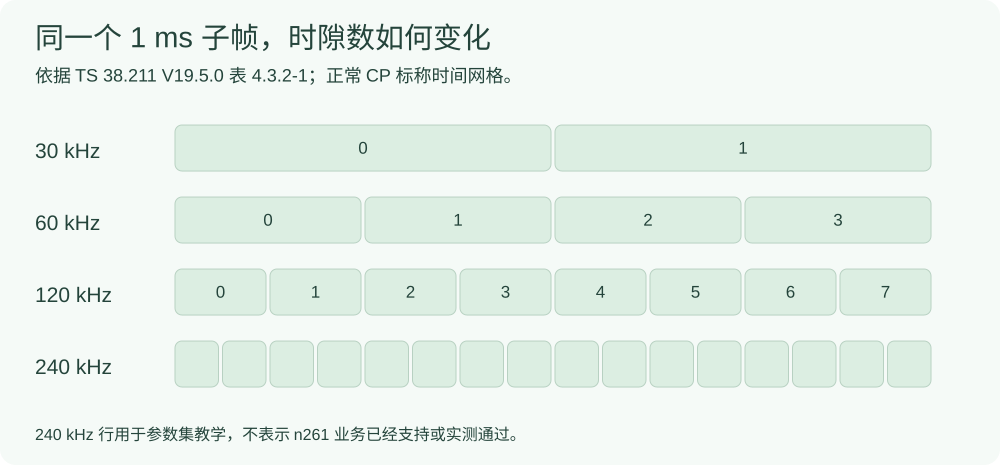

# 不同 SCS：时隙更短之前，先看参数集与频段边界

SCS 是子载波间隔，单位 kHz。它决定时间/频率网格的一部分，但“参数集中有这个数”不等于“当前频段和软件能用它完成业务”。

## 3GPP 参数集与正常 CP 槽数表

下表按 [TS 38.211 V19.5.0 表 4.2-1](#/protocol/38.211?q=Table%204.2-1&version=19.5.0) 和 [表 4.3.2-1](#/protocol/38.211?q=Table%204.3.2-1&version=19.5.0) 合并重排。时长列由 1 ms 子帧的槽数作**常用标称换算**。

|参数集 $\mu$|SCS / kHz|正常 CP 每槽符号数|每 1 ms 的槽数|标称槽时长 / ms|
|---|---|---|---|---|
|0|15|14|1|1|
|1|30|14|2|0.5|
|2|60|14|4|0.25|
|3|120|14|8|0.125|
|4|240|14|16|0.0625|
|5|480|14|32|0.03125|
|6|960|14|64|0.015625|

```math
\begin{aligned}
\Delta f&=15\times2^\mu\;\mathrm{kHz},\\
N_{\mathrm{slot/subframe}}&=2^\mu,\\
T_{\mathrm{slot,nom}}&=\frac{1}{2^\mu}\;\mathrm{ms}.
\end{aligned}
```



**正常 CP 与扩展 CP 不可混淆**。原文表 4.3.2-2 单列扩展 CP：$\mu=2$、每槽 12 个符号、每子帧 4 槽。上表的 14 不能无条件套用。图只用于槽计数与标称时长，不把每个矩形或槽长除以 14 当成精确的逐符号 CP 时长。

## 同一个带宽，PRB 数也可能一起变化

下表摘取 [TS 38.104 V20.1.0 表 5.3.2-2](#/protocol/38.104?q=Table%205.3.2-2&version=20.1.0) 的 FR2-1、100 MHz 一列；并结合 [表 5.3.5-2](#/protocol/38.104?q=Table%205.3.5-2&version=20.1.0) 核对 n261。

|n261 数据 SCS|100 MHz 对应的 $N_{\mathrm{RB}}$|能否由此证明本机业务支持|
|---|---|---|
|60 kHz|132|不能，还需实现与完整业务验证|
|120 kHz|66|原研究有对应基线，仍应核对该次实验配置|
|240 kHz|此处 n261 表未给出该数据 SCS 组合|不能把抽象模型当成 n261 实测|

**实验对照要求**：如果比较 30 kHz/n78 与 120 kHz/n261，同时改变了频段、PRB 或符号资源，就不能把端到端时延差全归因于 SCS。

## 时隙偏移也要带上单位和前提

依据 [TS 38.214 V19.5.0 §6.1.2.1](#/protocol/38.214?clause=6.1.2.1&version=19.5.0)，K2 是按 PUSCH 参数集解释的槽偏移。同参数集、没有额外偏移项的教学简化下：

```math
\Delta T_{K2,\mathrm{nom}}=K_2T_{\mathrm{slot,nom}}.
```

例如原实现示例 $K_2=4$、120 kHz 对应 $4\times0.125=0.5$ ms 的标称槽间隔。它不是整包端到端时延；跨参数集、额外偏移与处理能力约束须按原条款重新解释。

## 实验结果的前置核对

|需要固定或声明的项|容易出现的误解|
|---|---|
|频段、带宽、PRB、数据/参考 SCS、CP|只按参数集表宣布任意频段都支持|
|TDD 的实际时间图样、K2 与 TDA|槽数相同就认为绝对时间相同|
|业务包长、速率、UE 数和程序版本|把负载或实现差异归为 SCS 效果|
|是否有完整 UE 业务与有效包样本|把模型、仅启动 gNB、接入成功当成业务实测|

## 来源与原结果

- TS 38.211 V19.5.0、TS 38.214 V19.5.0、TS 38.104 V20.1.0，封面均为 2026-09，具体表号/条款见上文。
- 教材 [§4.2–4.3.1，本地 PDF 第 77–80 页](#/paper/book?page=77)；[§6.4.3，本地 PDF 第 211–213 页](#/paper/book?page=211)。
- P02《5G New Radio Numerologies and their Impact on the End-To-End Latency》，本地 6 页版本，[§II–III，本地 PDF 第 2 页](#/paper/P02?page=2)，用于理解参数集与处理时延的不同作用，不移植其仿真结果。
- [原 SCS 实验与完整报告入口](#/doc/d8349e58d7a9d785c)。

这些是本次已读取的用户本地版本；未据此声称官网最高版，也未新增业务实验。
