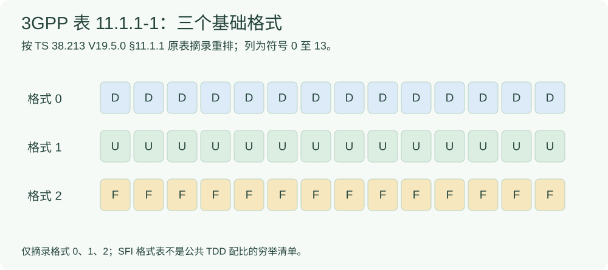
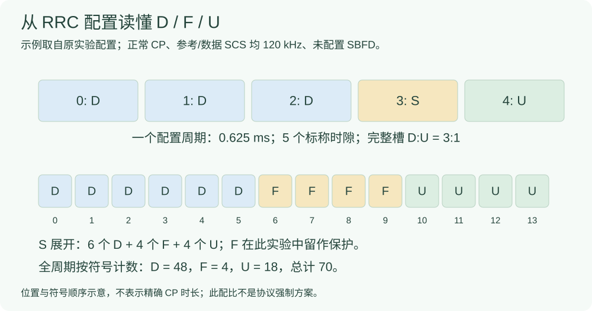

# 不同 TDD：先读配置、符号表与时间网格

看 TDD 结果之前，先回答四件事：周期有多长、参考 SCS 是多少、D/U/F 怎样排列，以及业务和接入是否真的完成。本页以**正常 CP、传统非 SBFD 配置**说明原实验，不能外推为 Release 19 所有双工形式。

## 3GPP 的 D、U、F 先是什么意思



依据 [TS 38.213 V19.5.0 §11.1.1、表 11.1.1-1](#/protocol/38.213?q=Table%2011.1.1-1&version=19.5.0)，上图只摘录格式 0、1、2。D 是下行符号，U 是上行符号，F 是灵活符号。**F 不是天然等于保护间隔**；将部分 F 留作收发保护是本实验的使用方式。

S 是本项目图中“混合/特殊时隙”的简写，不是一个与 D、U、F 并列的新符号类型。该时隙里仍要逐个符号看 D/F/U。

## 配置字段与实验取值分开看

下表按 [TS 38.331 V19.4.0 §6.3.2，TDD-UL-DL-ConfigCommon/Pattern](#/protocol/38.331?q=TDD-UL-DL-Pattern%20field%20descriptions&version=19.4.0) 的字段定义重排；最后一列是本项目取值，**不是标准规定的唯一配置**。

|RRC 字段|含义与原文边界|原实验示例|
|---|---|---|
|`referenceSubcarrierSpacing`|用于确定公共图样的时间边界；本地版本 FR2-1 可用参考值为 60/120 kHz|120 kHz，与本例数据 SCS 相同|
|`dl-UL-TransmissionPeriodicity`|DL-UL 图样周期|0.625 ms|
|`nrofDownlinkSlots`|周期开头连续完整 DL 槽数；该版本字段上限 320|3|
|`nrofDownlinkSymbols`|完整 DL 槽之后的部分槽开头 DL 符号数|6|
|`nrofUplinkSlots`|周期末尾连续完整 UL 槽数；该版本字段上限 320|1|
|`nrofUplinkSymbols`|首个完整 UL 槽之前的部分槽末尾 UL 符号数|4|
|`pattern2`|可选第二个图样，不能把双图样忽略成单图样|本例没有使用|

该 IE 的基础周期枚举是 0.5、0.625、1、1.25、2、2.5、5、10 ms；`-v1530` 扩展另提供 3、4 ms。**有枚举值不等于任意参考 SCS 都能使用它**。例如 [TS 38.213 §11.1](#/protocol/38.213?clause=11.1&version=19.5.0) 明确规定 0.625 ms 只适用于参考参数集 $\mu_{\mathrm{ref}}=3,5,6$。本例还受 FR2-1 的参考 SCS 范围约束，因此选 $\mu_{\mathrm{ref}}=3$。

## 从字段算出整周期，而不是只记“3:1”

设 $P_{\mathrm{ms}}$ 是以 ms 表示的周期数值，$N_{\mathrm{slot}}$ 是该周期在参考 SCS 网格上的槽数（原条款记为 $S$，与图中“特殊时隙”的简写不是同一含义）。根据 TS 38.213 §11.1：

```math
N_{\mathrm{slot}}=P_{\mathrm{ms}}\,2^{\mu_{\mathrm{ref}}}
 =0.625\times2^3=5.
```

正常 CP 每槽 14 个符号，依据 [TS 38.211 V19.5.0 表 4.3.2-1](#/protocol/38.211?q=Table%204.3.2-1&version=19.5.0)。令 $n_D,n_U$ 为完整槽数，$s_D,s_U$ 为部分槽的 DL/UL 符号数，本例计数为：

```math
\begin{aligned}
N_D&=14n_D+s_D=14\times3+6=48,\\
N_U&=14n_U+s_U=14\times1+4=18,\\
N_F&=14(N_{\mathrm{slot}}-n_D-n_U)-s_D-s_U=14-6-4=4,\\
N_D+N_U+N_F&=70.
\end{aligned}
```



因此“完整槽 D:U = 3:1”不代表按符号计算仍然是 3:1；特殊时隙还提供了 6 个 D 和 4 个 U。这里的矩形表达顺序和计数，不是逐符号 CP 精度的时间轴，也不能用符号比例直接代替实际吞吐或时延。

## 为什么周期可能带来等待

先看一个**教学简化模型**：每个周期只有一次瞬时发送机会，到达相位在周期内独立均匀，没有排队、处理和重传。则等待上限与平均值为：

```math
0\le W<P,\qquad
\mathbb E[W]=\frac{1}{P}\int_0^P(P-x)\,dx=\frac{P}{2}.
```

这是模型假设下的积分推导，不是 3GPP 给出的总时延公式。真实 TDD 业务还受到 UL/DL 方向、授权、可用资源、处理和分段等约束；本例实际有多个 UL 符号，不能把上述单机会模型的数值当成实验预测。

## 读每张结果图前的核对表

|必须确认|为什么会影响结论|
|---|---|
|参考 SCS、数据 SCS、CP、周期和 pattern1/2|同名配比可能对应不同时间网格|
|部分槽里的 D/F/U 计数、是否配置 SBFD|不能只统计完整槽，也不能把非 SBFD 解释外推到所有 Release 19 配置|
|接入、Msg3 和编号业务是否完成|启动失败没有业务时延；未测项不填 0|
|K2、TDA、MCS、PRB、包长和业务速率|标准字段合法不等于当前实现能执行，也不等于只改变了一个变量|

## 来源与对应结果

- TS 38.211 V19.5.0，封面 2026-09，§4.2、§4.3.2、表 4.3.2-1。
- TS 38.213 V19.5.0，封面 2026-09，§11.1、§11.1.1、表 11.1.1-1。
- TS 38.331 V19.4.0，封面 2026-09，§6.3.2，以上 IE 及字段说明。
- 教材 [§4.2–4.3.1，本地 PDF 第 77–80 页，图 4-5](#/paper/book?page=79)；教材较早版本的概括仍需服从上述原文的 CP 与 SBFD 边界。
- [原 TDD 实验与完整报告入口](#/doc/d5b7a9bc2704a2e54)；[原始 120 kHz 基线说明](#/doc/d3b8a054c724c6ede)。3D/S/1U、6D/4F/4U 是原实验工程取值。

表格和图为按已读取原文摘录/重绘的学习材料，不冒称官方原图或标准强制配比，也不声明这些本地版本是官网最高版。
