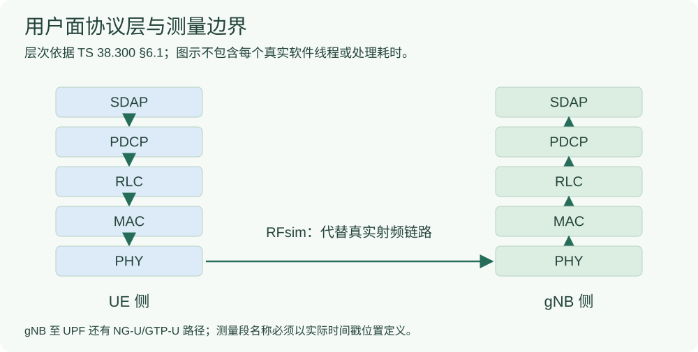

# 分层时延：协议层次与时间戳区间不是同一张表

协议层说明“数据经过哪些功能”；计时点说明“两个时刻之间实际混合了哪些等待和处理”。只有明确探针位置，才能给测量段取名。

## 3GPP 用户面层次的功能表



按原文重排下列功能，未加入“每层固定耗时”：

|层/接口|需要先理解的功能|本地原文定位|
|---|---|---|
|SDAP|QoS flow 与 DRB 的映射|[TS 37.324 V19.0.0 §4.4](#/protocol/37.324?clause=4.4&version=19.0.0)|
|PDCP|序号、重排序、重复处理、定时丢弃等，具体依配置|[TS 38.323 V19.1.0 §4.4](#/protocol/38.323?clause=4.4&version=19.1.0)|
|RLC|UM/AM 的分段与重组，AM 另有 ARQ 重传|[TS 38.322 V19.3.0 §4.2.1.3、§4.4](#/protocol/38.322?clause=4.4&version=19.3.0)|
|MAC / PHY|逻辑信道/传输信道与物理资源、调度和传输相关功能|[TS 38.300 V19.4.0 §6.1](#/protocol/38.300?clause=6.1&version=19.4.0)|
|NG-U|NG-RAN 与 UPF 间通过 UDP/IP 上的 GTP-U 承载用户面|[TS 38.300 §4.3.1.1](#/protocol/38.300?clause=4.3.1.1&version=19.4.0)、[TS 29.281 V19.2.0 §4](#/protocol/29.281?clause=4&version=19.2.0)|

图是依据协议功能重绘的概念图，不是原论文时间戳图的逐点复现，也不声明本研究已分离出每一层的独立 CPU 耗时。

## 分段必须按同一包、同一口径闭合

设同一包在可比较的时钟域中依次记录了 $t_0,\ldots,t_K$，则：

```math
\begin{aligned}
\Delta T_k&=t_{k+1}-t_k,\\
T_{\mathrm{total}}&=t_K-t_0=\sum_{k=0}^{K-1}\Delta T_k.
\end{aligned}
```

如果使用 ns 的整数时间戳，换为 ms 的数值时除以 $10^6$。若分段不覆盖全路径，缺口要作为残差报告，不能凭空分给某一层。

在**同一个包集合、同样本权重**下：

```math
\begin{aligned}
\overline T_{\mathrm{total}}&=\sum_k\overline{\Delta T_k},\\
Q_{0.99}(T_{\mathrm{total}})&\ne\sum_kQ_{0.99}(\Delta T_k)\quad\text{通常不相等}.
\end{aligned}
```

一个仅用于证明的反例：两个包的 A 段为 `[0,10]` ms、B 段为 `[10,0]` ms。每包总量都是 10 ms。线性插值下两段 P99 各为 9.9 ms，直接相加得到 19.8 ms，显然不是总量 P99 的 10 ms。

## 慢包分解要选同一批包

|步骤|正确做法|常见错误|
|---|---|---|
|先选慢包|按总时延选定包 ID|每一段各自挑最慢的一批|
|再看分段|对同一批 ID 求各段条件均值|把各段独立 P99 当成慢包组成|
|命名区间|写出发送侧/接收侧、入队/出队、函数与时钟|仅凭层名字就归因到协议内部处理|
|分清机制|RLC 接纳到对端 SDU 可能混合排队、授权、传输和重组|直接把整个区间叫 HARQ 时延或 CPU 时间|

## 来源与原结果

- [已做的分层时延实验：结果图、批次和错误案例](#/doc/e4c1f2a8800000004)。

- TS 37.324 封面 2025-09，TS 38.323 封面 2025-12，TS 38.322 封面 2026-06，TS 38.300 封面 2026-09，TS 29.281 封面 2025-09；版本和条款见上表。
- P01，IFIP Networking 2025，[§III-A–E、图 1，本地 PDF 第 2–3 页](#/paper/P01?page=2)：提供逐层关联和计时边界的方法参考。本项目探针不等于完整移植论文全部点位。
- 教材 [第 2 章，本地 PDF 第 49–55 页](#/paper/book?page=49)。
- [原分层测量与第四阶段报告入口](#/doc/d145d7af5790e37a2)。

求和恒等式、均值关系和反例是数学说明，不是协议规定的各层固定耗时或新实验结果。
