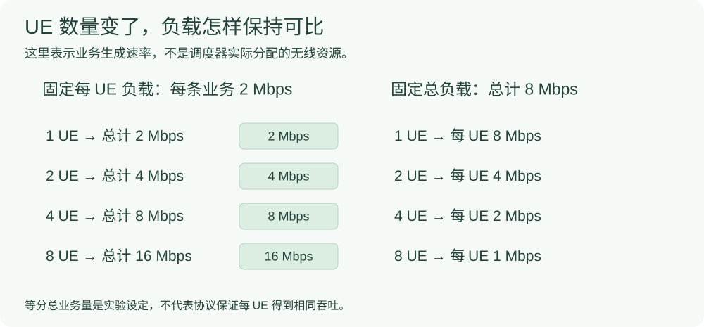

# 多 UE：先把业务负载与资源竞争分开

UE 是用户设备。增加 UE 数之前，要说清楚“每台设备都产生同样多的数据”，还是“同一份总业务由更多设备分担”。这两种实验回答的问题不同。

## 两种负载口径

设有 $N$ 个 UE，第 $i$ 个 UE 的业务到达速率为 $r_i$ Mbps。总到达速率为：

```math
R_{\mathrm{total}}=\sum_{i=1}^{N}r_i.
```

若每个 UE 都固定产生 $r$ Mbps，总量随设备数增加；若总量固定为 $R$ Mbps 且按设计等分，每 UE 是 $R/N$ Mbps。



|UE 数 $N$|每 UE 固定 2 Mbps：总到达率|总量固定 8 Mbps：每 UE 到达率|
|---|---|---|
|1|2 Mbps|8 Mbps|
|2|4 Mbps|4 Mbps|
|4|8 Mbps|2 Mbps|
|8|16 Mbps|1 Mbps|

这些是业务生成器的设计/换算，不是无线资源分配保证，也不是某个 UE 已达到的实测吞吐。2/8 Mbps 对应原多 UE 分析口径的示例；不同批次报告应以各自条件表为准。

## 3GPP 的调度对象与本实验的控制量

按 [TS 38.300 V19.4.0 §10.2、§10.3](#/protocol/38.300?clause=10.3&version=19.4.0) 与 [TS 38.321 V19.4.0 §5.4.1](#/protocol/38.321?clause=5.4.1&version=19.4.0) 整理：

|协议侧概念|含义|实验需要另外声明|
|---|---|---|
|上/下行调度|共享无线资源的分配与相应信令过程|调度算法、资源预算与具体实现|
|SR|请求新传输的 UL-SCH 资源，见 §5.4.4|是否触发、周期、是否已有可用授权|
|BSR|向服务 gNB 提供 MAC 实体的 UL 数据量信息，见 §5.4.5|报告是否及时，是否有私有增强|
|设备和业务配置|协议实体与承载的配置关系|UE 数、每 UE 负载、业务顺序、CPU 放置和运行期限|

**不能预设每个业务包都会先独立执行一次 SR，再独立执行一次 BSR**。触发条件、既有授权和实现路径都会影响实际过程。

## 逐 UE 统计，才能发现服务不均

```math
Q_{0.99}^{\mathrm{worst}}=\max_{1\le i\le N}Q_{0.99}(T_i).
```

这里 $T_i$ 是第 $i$ 个 UE 的包时延样本。它不是把所有 UE 样本混在一起后的 P99。不同 UE 的样本量不同、交付率不同，还应分别保留；不能用一个总体分位数遮住某个 UE 的积压或未交付。

## 看结果前逐项核对

|控制项|必须写清|
|---|---|
|业务|包长、每 UE/总量口径、到达分布、业务种子、预热与统计样本|
|无线配置|TDD、SCS、带宽、PRB、MCS、K2/TDA、QoS 配置|
|软件与运行|同一程序、接入顺序、CPU/线程设置、运行期限、观测开关|
|完整性|哪些 UE 接入、哪些开始业务、哪些包完成；失败与在途包保留|

RFsim 下墙钟推进与主机执行条件也是运行背景；观察到相关性不等于已确定 CPU 是唯一原因。

## 来源与原结果

- [已做的多 UE实验：结果图、批次和错误案例](#/doc/e4c1f2a8800000003)。

- TS 38.300 V19.4.0，封面 2026-09，§10.2、§10.3。
- TS 38.321 V19.4.0，封面 2026-09，§5.4.1、§5.4.4、§5.4.5。
- 教材 [§13.1.1.2，本地 PDF 第 530–532 页](#/paper/book?page=530) 与 [§13.1.1.4/5，本地 PDF 第 537–539 页](#/paper/book?page=537)。
- [原多 UE 结果入口](#/doc/da5059f48a6b9b4d5)；[如何选择多 UE 基线与场景](#/doc/d7294d5c598fdae89)。

等分到达率、逐 UE 分位数与最差 UE 指标是本项目实验设计/统计定义，不冒称 3GPP 指定唯一方法；未新增运行结果。
