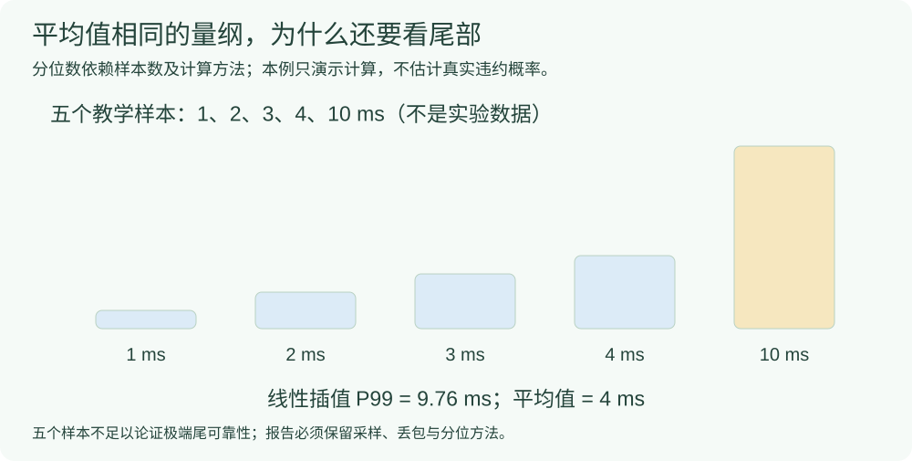

# 尾时延：先读分位数方法、样本和慢包身份

平均时延回答“整体平均多慢”；P99/P99.9 观察分布尾部。数字越靠近尾部，对样本量、相关性、截断和统计口径越敏感。

## 先用通俗的话理解尾时延

把一批包按时延从小到大排，靠右侧的少数慢包就是这里关心的“尾部”。尾时延不等于最后收到的包，也不只等于最大值。P99 可以通俗理解为约 99% 的统计包时延不超过的值；它的严格计算方法见下文。

假设多数包平时只等 1–2 ms，少数包偶尔等到 20–30 ms，这些偶发慢包就值得分析；这句话是教学情景，不是本机新测量，也未指定该情景的 P99。平均值、P99、最大值分别回答不同问题，不能互相替代。

为什么排队或授权可能影响慢包，先读[基础知识中的授权、队列积压与尾时延](../00_通信与时延基础知识.md#授权提前授权队列积压和尾时延)。增加资源或改调度也可能让其他 UE 变慢，应逐 UE 检查，不能只挑改善的部分。

## 先把统计量写完整

|指标|本页定义|不能替代什么|
|---|---|---|
|均值|同一统计包集的算术平均|不能替代尾部分布|
|P99 / P99.9|对应 $p=0.99/0.999$ 的样本分位数，需声明方法|不能自动证明未来违约概率|
|CCDF|超过给定时延阈值的样本比例|零观测不能当成真实概率为零|
|丢包/在途/超时|独立保留计数与运行边界|不能删除后只报交付包的好看分位数|

对 $N$ 个样本 $x_i$，经验分布与严格超越比例为：

```math
\begin{aligned}
\widehat F_N(t)&=\frac{1}{N}\sum_{i=1}^N\mathbf1\{x_i\le t\},\\
\widehat P_N(T>t)&=1-\widehat F_N(t).
\end{aligned}
```

阈值 $t$ 与时延使用相同单位。阈值是业务要求、协议相关预算，还是教学/敏感性例值，必须单独说明。

## 本项目长流分析的线性插值口径

原 `long-baseline/collect.py` 使用 `np.quantile(..., interpolation='linear')`。将已排序样本写为 $x_{(1)}\le\cdots\le x_{(N)}$，对 $0\le p<1$、$N\ge2$：

```math
\begin{aligned}
h&=(N-1)p,\\
j&=\lfloor h\rfloor,\quad \gamma=h-j,\\
Q_p&=(1-\gamma)x_{(j+1)}+\gamma x_{(j+2)}.
\end{aligned}
```

端点 $p=1$ 直接取最大值，$N=1$ 取唯一样本；没有有效样本时不填 0。其他报告应核对其实际代码，而不是默认沿用这一方法。



教学数组 `[1,2,3,4,10]` ms 中，$h=3.96$，所以 $Q_{0.99}=4+0.96(10-4)=9.76$ ms，均值是 4 ms。数组只用于演示计算，**五个样本不能论证极端尾部可靠性**。

## 为什么样本与配对很重要

|前置要求|读图时检查|
|---|---|
|足够样本与可比时窗|统计前是否去预热；是否将长短流混作一组|
|逐 UE、逐条件报告|是否把不同 UE 的样本合池；样本权重是否变化|
|保留相关性和漂移背景|是否直接套用 IID 置信结论而未检查假设|
|同编号比较|“新算法最慢 40 包”和“旧算法最慢 40 包”可能不是同一批 ID|
|相同包集做分解|不能把各段独立 P99 相加；不能把短流内部观察直接当成长流 P99.9 归因|

## 与协议预算怎样衔接

[TS 23.501 V20.3.0 §5.7.3.4](#/protocol/23.501?clause=5.7.3.4&version=20.3.0) 定义 PDB 的 UE–UPF N6 终止点边界，并区分资源类型。它不替本项目规定 `numpy` 分位数方法，也不意味着任意应用闭环都满足同一个 PDB 判据。不要把一个统计阈值直接命名为已经确认的机械臂 deadline。

## 来源与原结果

- [已做的尾时延实验：结果图、批次和错误案例](#/doc/e4c1f2a8800000005)。

- TS 23.501 V20.3.0，封面 2026-09，§5.7.3.1–5.7.3.4。
- P19《Analysis of Outage Latency and Throughput Performance in Industrial Factory 5G TDD Deployments》，本地 6 页、arXiv:2012.05507v1，封面侧栏日期 2020-12-10，[§IV、CCDF 图，本地 PDF 第 4–5 页](#/paper/P19?page=4)。仅参考展示方法，不移用其业务或性能承诺，也不将该文件改标为未取得的后续版本。
- 原研究 `long-baseline/collect.py` 的 `quantiles()` 与对应独立复算记录；此页展开统计定义，不重新认证旧测量值。
- [原尾时延入口及第五阶段报告](#/doc/dbaa16cc570f10b65)；[固定每 UE 负载与长流尾时延图](#/doc/df9e74999c778198f)；[同业务编号慢包配对说明](#/doc/dba48a74191b79dd7)。

经验分布、插值公式和教学数组均为统计解释；不冒称 3GPP 指定的分位数算法，也不是新运行数据。
