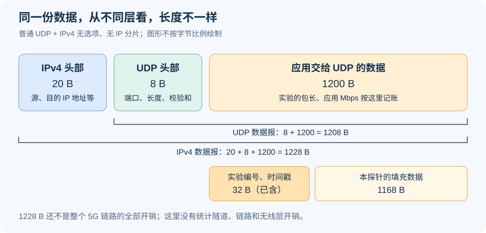

# 原始版本、当前研究版本与测量方法对比

这是独立的测量方法知识页，统一放源码版本、原 80 B / 精简 16 B、ping / UDP、包长与测量边界。**它不占主线十二步中的一个步骤。** 主线只引用已经确定的基线条件。

对应结果：[独立测量实验：原始版本 ping 与包头对照](../研究结果与分析/独立实验_原始版本ping与包头对照.md)。[返回通信基础](00_通信与时延基础知识.md)。

## 先区分三个“版本”

|对象|实际身份|不能混淆的事|
|---|---|---|
|原始 RAN|`oi-wireless-ran`，源 HEAD `383aa52a31`；本次复制其现有 gNB / UE / RFsim 等 12 个运行文件|没有重新编译；已记源码 HEAD 和二进制 SHA，尚无本次源码到旧二进制的完整构建证明|
|当前研究 RAN|运行源 `159208eb2f`，对应修正源基 `61654513d5`；原 10 个已核二进制用于上一组正式数据|研究仓库随后新增 Python / 文档提交，不等于每次都重新编译通信 C|
|应用测量格式|原 80 B 和精简 16 B 都是 UDP 数据内的项目测量元数据|不是 NR/UDP 标准头，也不是 MAC 的 BSR / HOL 报告；与 RAN 源版本是两条不同维度|

## 原始源码与当前代码主要差在哪里

|位置与功能|原始源码|当前研究代码与本次启用状态|对时延解释的边界|
|---|---|---|---|
|`gNB_scheduler_ulsch.c::pf_ul` 的调度资格|计算资格后，对遍历到的第一个 UE 执行 `if (cnt == 1) do_sched = true`；空队列时可进入 5 RB 预分配分支|已使用共同资格判断；本次固定 PF / legacy / F = 10 帧|原始单 UE 可能更早拿到授权；是否是全部差异主因、具体空授权开销还没有测明。共同资格是工程研究选择，不是 3GPP 规定必须这样排 UE|
|同函数的 MCS 选择|无外部控制时，对首个遍历 UE 有 `max_mcs = 9` 分支|研究版统一资格/MCS约束，本次运行配置上限 9|不能把此前提过的摄像头 14/25 自动套成本次实际每个 TB 的 MCS；本次不改视频内容|
|`nr_rrc_config.c::set_SR_periodandoffset`|由 SCS 和首 UL 位置选择 SR 周期；当前原始配置对应源码分支为 40 槽|研究代码增加可配置入口，上一组明确为 40 槽 / offset = 3|原始复测尚未接入，不能声称本轮已解码确认原始 RRC 配置；更不能直接把所有差异归因 SR 周期|
|重传、PHY/MIB 等正确性修正|保留历史实现，例如 UL 重传预算指针问题|修正过预算扣减、SSB/MIB 等实现问题|正确性修复不是自动的时延优化收益；不能反推每个旧 ping 都经过问题分支|
|C 层观察器与研究算法入口|原始版本无后续全部研究观察/评分入口|当前有研究代码，但上一组层内观察器关闭，采用 PF|编译进去不等于本次启用，不能把所有源码差异都当作当前性能因素|
|启动参数与配置|原始命令/NR配置、默认线程放置、原 SS bitmap|上一组为冻结工作点、单 SSB 配置、明确绑核和 MCS 上限，并使用 RFsim 连续供样等选项|整组比较有配置/主机/版本混杂，不能只凭 RTT 差给某一行代码定因果|

已核原始到实际运行源的生产范围有 41 个文件差异，完整表保留在[原始源码与当前版本](../五类时延分析/原始源码与当前研究版本_修改问题与影响.md)。本页只提直接影响解释的类别，不把 Python 编排/统计当成改写整个通信协议栈。原目录的两处历史日志删除状态也不被本次恢复或改动。

源码依据为实际读取的原始 `pf_ul` / `set_SR_periodandoffset`、运行源提交和已有逐文件审计；协议背景为 TS 38.321 V19.4.0 §5.4.1 / §5.4.4 / §5.4.5、TS 38.213 V19.5.0 §9.2.4、TS 38.331 V19.4.0 §6.3.2。协议要求使用有效 UL 授权，不规定每个应用包必须先单独发 SR，也不强制本项目选用 PF 或首 UE 例外。

## 近期提问：学术化问题与回答

这里把近期围绕包长、ping / UDP、测量头精简、四时刻、多 UE 和分层测量的问题归纳起来。每条先给适合研究讨论的问法，再解释本项目实际能做什么。后续同类提问继续补充或修订对应条目，不把聊天原话反复堆在文末。

### Q1：测量元数据压缩是否改变时延测量的可观测性

提问归纳：“精简字段后，是不是测量功能也没有了？”

回答：新格式把应用标记从 80 B 缩为 16 B，时间戳改存两端日志。格式识别、请求响应分类、UE / 轮次 / 序号关联仍保留。完整四时刻测量依赖两端日志齐全、编号一致及跨端时钟可比较；只拿抓包不能恢复全部应用时刻。旧回复虽能携带前三个时刻，最终接收时刻原本也要在 UE 本地记。

### Q2：四时间戳应用层测量如何定义端到端往返时延及其分解

提问归纳：“什么是四时刻应用测量？”

回答：“应用”指当前 UDP 测试程序。t0 是 UE 准备发送请求前，t1 是服务端收到请求后，t2 是服务端准备回复前，t3 是 UE 收到对应回复后。上行按 t1−t0、回复区间按 t2−t1、下行按 t3−t2、总 RTT 按 t3−t0 计算；详细实现表见本页末尾，通用公式见通信基础。这些是定义的应用区间，不是每层固定耗时，也不是机械臂物理动作周期。

### Q3：时间戳转移到端点日志后，时延估计成立的条件是什么

提问归纳：“那精简后也可以算，对吗？”

回答：可以。计算客户端 RTT 只需同一事务的 t0、t3，使用客户端同一时钟；分开计算上、下行还需服务端 t1、t2 与客户端时钟可比较。日志缺失、重复、错轮次或时序异常必须记录失败。本项目当前严格四时刻收集器不会在这些条件不满足时输出正常分段分位数；它没有自动降级为只算 RTT。另行做 RTT-only 分析需要明确边界。

### Q4：精简报文是否保留多 UE 的事务身份关联能力

提问归纳：“精简后，多 UE 区分是不是没有了？”

回答：仍有 2 B UE 编号、4 B 本轮标识、4 B 序号，能在各轮独立日志范围内区分 UE 和事务。后续还需把探针 UE 编号与实际实例、IP / RNTI 等运行身份对应起来；不能仅有一个编号字段就称为完成多 UE 实验。本轮编排仍为单 UE，精简格式的多实例采集与身份映射要在多 UE 阶段验证。2 B 只是标识容量，不是平台支持 UE 数的承诺。

### Q5：应用区间分解能否替代协议栈的细粒度分层时延测量

提问归纳：“精简后，精细分层是不是没有了？”

回答：应用四时刻只分出上行应用区间、回复区间和下行应用区间。PDCP、RLC、MAC、PHY 的细分需要各层本地探针和跨层关联；原 80 B 头也没有自动记录每层时间戳。分段、复用、重组和重传可能使一个应用包对应多条层内事件，不能直接假设一包一记录。精简后的事务编号可作为关联起点，但目前本轮关闭层内观察器，尚未完成精简格式与全套层内事件的映射，不能声称各层已经测齐。

### Q6：ICMP 与 UDP 的往返时延能否直接作同口径比较

提问归纳：“直接用 ping 是不是更好？工业上都是 UDP 吗？”

回答：两者都可作通信测试，但本机 ping 由内核处理回显，当前 UDP 由测试应用回显，端点处理与自身计时边界不同。先比较各自包长表现，再用共同 UE TUN 抓包边界辅助对照，不能把全部差异归因于无线调度。工业协议并非全部 UDP；具体协议由应用决定。本文后面的工具选择与工业协议段落保留已核验官方例子，本项目合成 UDP 不冒称真实工业协议实现。

### Q7：如何构造控制包长与到达过程的可重复测量矩阵

提问归纳：“先 ping 和 UDP，再分别测大包，是这样吗？”

回答：本独立实验采用 1 UE、ping / UDP 各 56、256、1200 B，共六条件，统一 20 ms 目标间隔，先短测再三轮正式对照。相同目标间隔不保证实际发送间隔完全一致，必须报告实际值。固定包率时增大包长会提高 Mbps，结果不能解释为排除了负载因素的纯包长效应。执行状态与工程参数见[独立实验结果](../研究结果与分析/独立实验_原始版本ping与包头对照.md)。

### Q8：测量头长度减少是否必然降低通信 RTT

补充研究问题：“测量头变短是否意味着 RTT 必然下降？”

回答：80 B 缩为 16 B，只能直接说明测量字段少了 64 B。若应用数据仍固定 256 B，只是填充变多，总包长未变；不能据此声称 RTT 下降。它允许测 56 B 等原头部放不下的小包，但日志采集也有开销，时延变化要用同条件实验验证。

### Q9：应用数据长度、协议头部和业务速率应怎样统一记账

提问归纳：“56 B、UDP/IP 头部和 Mbps 这些怎么对应？”

回答：B 是字节，Mbps 是每秒百万比特；包长与每秒包数共同决定速率。当前六条件的长度是 ICMP / UDP 数据，后者包含 16 B 测量标记。ICMP / UDP 头各另计 8 B，普通 IPv4 头另计 20 B；隧道、链路和无线开销另有口径。单位和内外层算例见[通信与时延基础](00_通信与时延基础知识.md)，不把应用 Mbps 当成空口实际吞吐。

这些回答的源头分三类：测量格式与现有能力查本项目 `step1-ping-udp-v2/codec.py`、`probe.py`、`collect.py`、`wire.py`、`run.py`；层功能与分段背景查 TS 38.300 V19.4.0 §6.1、TS 38.322 V19.3.0 §4.2.1.3.3 / §4.3、TS 38.323 V19.1.0 §4.4；包关联思路参考 P01《Dissecting 5G New-Radio Latency》本地 PDF 第 2–4 页 §III–IV。教材第 2 章本地 PDF 第 49–55 页用于层功能背景。它们不规定本项目 16 B、四应用边界或具体矩阵；AM RLC 的重传说明不能外推到所有 RLC 模式。工具和网络头部来源沿本文相应段落。

## 原 256 B 基线的包长、随机到达和统计口径

2026-11-11 的原基线使用 **256 B 请求和 256 B 响应**；新六条件方案已改用精简格式，旧格式的说明保留在这里便于追溯。下文旧单向探针的 1200 B / 32 B 标记示例保留原身份，不能直接套到原 256 B 基线或新的六条件测量。

- 原基线探针在 256 B 应用数据内使用 32 B 基础标记和 48 B 事务扩展，共 80 B，另有 176 B 填充；这 80 B 已在 256 B 中，不要再加一次。普通 UDP 8 B、无选项 IPv4 20 B 另计，IP 包名义为 284 B。
- 指数到达的平均 20 ms 不代表每包固定隔 20 ms；种子固定用于重复，实际间隔还会受发送线程唤醒影响。0.1024 Mbps 是应用目标速率，换算为平均 50 包/s；低负载起点不直接证明无线容量或排队稳定性。
- 请求按预设到达独立发送，不等上一条响应才发下一条。这样当响应变慢时，探针不会自动降低请求速率，把压力降下来后误以为时延很好；同时仍记录所有请求及未完成事务。
- 每轮 2200 次事务先排除前 200 次预热，再统计 2000 次；三轮分开报告 P99。预热用于减少启动过程影响，不是看到慢包后选择性删除；规则在运行前已写入计划。
- 同一主机也要排除应用旁路：本次客户端与服务端在不同网络命名空间，路由经 TUN，并用 N3/TUN 双向包关联。只是“两端在同一电脑”不能直接说明数据经过空口栈。

### 256 B 包里面有什么，为什么测量头占了 80 B

原基线发送的是合成测试包：**80 B 测量字段 + 176 B 全零填充 = 256 B 应用数据**。填充用于固定测试包长，没有承载真实机械臂状态或图像；UDP/IP 头部在这 256 B 之外。

|测量字段|长度|作用|
|---|---:|---|
|两段格式标记 `TDDLAT01`、`LOOP0001`|16 B|识别基础格式和请求—响应扩展，检查收到的包是否符合测量格式|
|事务序号 `seq`|8 B|把请求、响应和本地记录关联到同一次事务，识别重复或缺失|
|版本 `version` 与请求/响应类型 `kind`|2 B|区分格式版本，以及当前包是请求还是回复|
|UE 编号 `ue`|2 B|区分终端|
|本轮标识 `nonce`|4 B|区分实验轮次，减少把其他轮次数据误配到当前轮次的可能|
|六个时间戳槽位|48 B|每个 8 B：当前发送、UE 最初发送、服务端接收这三个时刻，各保留单调时钟和系统时钟一份，单位为 ns|
|**测量字段合计**|**80 B**|**不是 3GPP 或 UDP 强制的头部**|

单调时钟用于计算耗时，系统时钟用于辅助对照抓包；两种时钟不直接相减。UE 最后收到响应的时刻是在接收端本地记录，不需要提前放进这个包。

为什么看起来有重复？发送请求时，“当前发送”与“UE 最初发送”两组时间相同，服务端接收时间先填 0；返回响应时，“当前发送”变成服务端发回复的时间，同时携带此前的 UE 发送与服务端接收时间。这样客户端收到回复后，就能直接关联四个应用边界。

80 B 来自沿用 **32 B 基础标记格式**后追加 **48 B 事务扩展**，偏重方便核验，并未设计成最小测量头。两段标记、两种时钟和部分重复字段都增加了长度。它们有测量用途，但不是必须全部在网络包内传输；可以重新设计较短格式，并把部分时间戳留在两端日志中按编号关联。

**80 B 不是引用某篇论文得到的尺寸。** P01《Dissecting 5G New-Radio Latency》§III-A（本地 PDF 第 2 页）、§IV-A.3 和 §IV-C（第 3–4 页）明确提到在 UDP 数据中放入 **64 位应用计数器，即 8 B** 来标识包；各层时间戳由 OAI 内部记录点采集。我参考的是包关联与分层测量思路，不是照搬其报文格式。论文提到的 8 B 计数器也不能直接解释成其全部报文或全部测量开销只有 8 B。原基线 80 B 的直接依据是本项目代码，应标为工程取值，不能用 P01 的引用替代这个说明。

论文 §IV-C（本地 PDF 第 4 页）实际采用的是 **1024 B UDP 载荷**，其中放应用计数器；8 B 是计数器大小，不是论文的包长。论文做上行 UDP 测量，原基线做 256 B 请求和响应的应用 RTT，业务与计时边界也有区别，不能把当前参数说成该论文的完整复现。

#### 作者开源实现用于测量的字段是多少

本次实际读取了论文参考文献 [11] 对应的 [Zenodo v2 配套代码包](https://zenodo.org/records/15377254)，包内版本名为 `v1.0.0`，不把它称为 GitLab 当前最新提交。作者 README 的业务命令启用 `--udp-counters-64bit`；UE `nr_sdap.c` 第 67–84 行从 UDP 载荷偏移 8 B 的位置读取 8 B 应用计数器，BS 侧对应代码一致。

对照已读的官方 iperf3 3.9 和 3.16 `iperf_udp_send`，该模式的应用测量前缀是：

|字段|长度|在 UDP 载荷中的位置|
|---|---:|---|
|发送时间的秒部分|4 B|偏移 0|
|发送时间的微秒部分|4 B|偏移 4|
|64 位包序号|8 B|偏移 8|
|**合计**|**16 B**|**已包含在论文的 1024 B UDP 载荷内，不再加一次**|

作者 LatSeq 的层内时间戳记录到本地 `.lseq` 日志，README 指定由 Tshark 收集端点时间；这些层内记录没有构成我们这样的 80 B 包内头部。日志采集仍可能消耗主机资源，本次没有测其开销。代码包没有附 iperf 源码或固定其具体版本；16 B 是作者公开命令、读取偏移与上述两版官方实现一致的结果，不冒称已逐包核验作者全部历史数据。可核对 [iperf3 3.9 源码](https://github.com/esnet/iperf/blob/3.9/src/iperf_udp.c#L199)和 [3.16 源码](https://github.com/esnet/iperf/blob/3.16/src/iperf_udp.c#L199)。作者包只读检查，未运行其命令或移植补丁。

#### 本项目怎样从 32 B 演变到原 80 B

|阶段|实际格式和包长|当时用途与可追溯依据|
|---|---|---|
|2026-10-14 单向 UDP|32 B 测量头；默认 1200 B 应用包|8 B 格式标记、8 B 序号、8 B 单调发送时间和 8 B 系统发送时间；代码 `tdd1/udp_packet_probe.py`，Git `240958d30c`。接收时间在接收端本地记录。|
|2026-10-27 请求—响应|保留 32 B，再追加 48 B，合计 80 B；请求/响应各 1200 B|为了区分请求/响应、UE 和轮次，并把原请求发送及服务端接收时间带回客户端，便于分解 UL/reply/DL。旧树 CHG-269 与 `app-closed-loop/probe.py`、`app-closed-loop-v2/probe.py` 明确记载；日期来自修改记录，不伪造未查到的 Git 提交。|
|2026-11-11 新版第一步|继续使用 80 B 测量头；请求/响应改为各 256 B|复用此前请求—响应探针，重新冻结修复版 OAI 程序和运行条件；新增提交 `9babda7b24`。本轮 v1/v2/v3 修正编排导入和 PFCP 端点，没有逐版增加测量头。|

经本次只读核对，旧 `app-closed-loop`、其 v2 和当前 `step1-rtt`、其 v2/v3 的五个 `probe.py` 文件 SHA256 完全相同。**因此，当前 80 B 是旧请求—响应格式的沿用，不是第一步重测时新加出来的，也不是从作者 16 B 格式逐版扩展而来。** 本项目当时保留已有识别格式，方便关联和核验，没有完成测量头最小化设计。

因此，原 80 B 格式不能直接发送 56 B 应用数据，是该自定义格式的限制。2026-11-12 我另外实现了下面的精简格式；旧格式、源码与基线结果继续保留。后续比较需要用同一新探针重新测各包长，不能只给 56 B 换新探针后就把与旧结果的差值全部归因于包长。

本节依据实际 [`step1-rtt-v3/probe.py`](https://github.com/ming0526288/oiwireless-latency-analysis/blob/505e7426b7/research/latency-analysis/step1-rtt-v3/probe.py)：`HEADER`/`EXT`、`encode`/`decode`、`client.send_requests` 与 `server`。字段解释属于本项目测量工程，**3GPP/新增数学推导不适用**；只做字节和代码一致性核对，不新增协议要求或时延结论。

### 16 B 精简探针：字段与日志如何配合

2026-11-12，我在独立目录 `research/latency-analysis/udp-compact-v1/` 实现了精简版。**包里只带事务标识，四个时间戳留在两端日志，结束后按 UE、轮次和序号关联。** 这里参考 P01 的编号关联和本地记录思想；16 B 的具体布局是本项目设计，与作者 iperf 的 16 B 时间/序号前缀内容不同。

|包内字段|长度|
|---|---:|
|格式标记 `ULC1`|4 B|
|版本|1 B|
|请求/响应类型|1 B|
|UE 编号|2 B|
|本轮标识|4 B|
|事务序号|4 B|
|**合计**|**16 B**|

UE 本地记录 t0、t3，服务端本地记录 t1、t2，再关联成同一事务。计算 UL/reply/DL 前，检查两端 boot ID、时间命名空间和单调时钟定义；不满足就拒绝输出分段结果。错轮次、重复、缺失或时间逆序也会报失败，不能用 0 填补，失败不输出正常分位数。

#### 精简以后，原来的测量功能是不是没有了

**完整的四时刻应用测量改为依赖“两端日志＋包编号”。时间戳不在包里，不等于不记录时间。** 原 80 B 回复可携带此前的 t0、t1、t2；t3 本来就要在 UE 收到回复时本地记录。新 16 B 格式把四个时刻都留在产生它们的端点。

|原字段的作用|精简后怎样完成|需要注意什么|
|---|---|---|
|识别测量格式|4 B `ULC1` 标记，另有版本与类型|两段旧标记不再沿用；旧解码器不能直接解析新格式|
|关联请求与响应|UE 编号＋本轮标识＋序号，配合各轮独立日志目录|编号要一致且不冲突；轮次标识不是全球唯一或安全认证|
|区分请求、回复和终端|版本、类型各 1 B，UE 编号 2 B，本轮标识 4 B|这些功能仍在包内|
|携带事务序号|由 8 B 改为 4 B|序号范围缩至 0～4294967295；当前每轮 2200 次远小于此范围，长流仍须防重复/回绕|
|记录应用时间|UE 日志记 t0 发送、t3 收到；服务端日志记 t1 收到、t2 准备回复|包内时间戳为 0 B；必须取得并关联两端日志|
|识别重复、缺失、错轮次|比较预期编号集合、两端日志与抓包|缺失/重复要报错并保留证据，不能填 0 或只挑匹配成功包宣称通过|

可以把它理解为：**包内只带“编号牌”，时间记录保存在两端的“登记本”。** 我用编号牌把两个登记本中同一事务的记录找出来，再计算时延。

这里有明确的能力边界：

- 只有抓包、没有两端日志时，无法还原完整的四个应用时刻。若同一 UE TUN 抓包中请求和回复完整，仍可统计该抓包边界的往返区间；它与应用 RTT 不是同一个边界。
- 两端日志齐全但时钟不可比较时，客户端自己的 t3−t0 仍可用于客户端 RTT；跨端的 t1−t0、t3−t2 不能直接相减。本项目当前严格四时刻收集器遇到时钟不一致会拒绝正常分段统计，不自动降级冒称全部可测。跨主机需要另行同步和误差评估。
- 本地日志会占 CPU、内存和存储，时间戳位置变化也影响计时边界。需要固定采集方式并检查开销，不能保证功能代价和数值与旧版完全相同。
- 相同总数据长度下，80 B 换成 16 B 只增加填充空间，不自动缩短包或降低 RTT。精简使小于 80 B 的应用数据成为可测输入，性能收益仍由同条件实验判断。

依据为本项目 `step1-ping-udp-v2/codec.py::HEADER`、`probe.py::client/server`、`collect.py::join_rows`、`wire.py::capture/correlate`；对应新代码由 CHG399 / CHG400 引入。P01 的本地计数器与层内日志思路只作方法参考，不把本项目 16 B 或这些取舍写成论文原格式或 3GPP 功能。

这使 **56 B 应用包 = 16 B 标记 + 40 B 填充** 成为可运行格式。若仍发送 256 B，则是 16 B 标记 + 240 B 填充，总包长并未减小。80 B 降到 16 B，只能说测量头减少 64 B，不能据此声称 RTT 降低 80%。包率不变时，改包长还会改变 Mbps；本轮探针用独立 `--rate-pps` 明确控制包率。

最初 `udp-compact-v1` 的功能验证记录为：8 组离线检查及 4 组真实 IPv4 UDP 回环通过：56 B/256 B、两个种子、正反顺序，共 512 次完整请求—响应，四时刻关联成功；另外用不导入新统计代码的方法复核了原始 CSV 的编号、长度和时间顺序。原 80 B 探针未改。这是**本机 socket 功能验证**，没有启动核心网、gNB、UE 或 RFsim；回环耗时不能写成 5G 业务时延或算法收益。

旧抓包验证器按 `TDDLAT01` 与包内时间戳解析，不能直接套用精简格式。2026-11-12 新建独立测量工具，已补固定周期与新格式 / ICMP 的 N3/TUN 关联，14 组离线检查通过，周期 UDP 三包长六次本机功能测试共 768 个事务通过；新全栈六条件先导及 18 次正式运行均已通过，正式共 39600 完整 / 36000 统计事务，最终结果见[独立实验结果](../研究结果与分析/独立实验_原始版本ping与包头对照.md)。本机功能测试与正式 RFsim 数据仍各保留独立身份，不混合统计。原 80 B 三轮作为历史保留；主线当前基线引用精简 UDP 256 B 的三轮正式子集，不与历史结果混同。运行与来源见[精简探针 README](https://github.com/ming0526288/oiwireless-latency-analysis/blob/latency-standards-audit/research/latency-analysis/udp-compact-v1/README.md)，最初记录为 CHG393/TEST543；新测量工具与先导见[新版 README](https://github.com/ming0526288/oiwireless-latency-analysis/blob/latency-standards-audit/research/latency-analysis/step1-ping-udp-v2/README.md)、CHG399–401 / TEST549–551。这个格式是应用测量工程，不是新增 3GPP 功能。

### 编排脚本启动核心网是什么意思

编排脚本是把多个启动、检查和清理命令按顺序执行的程序。本次它**实际启动了核心网 AMF、SMF、UPF 和数据库副本**，然后启动 gNB、UE 和业务；不是省略核心网。测试结束才回收这些副本。

“核心网副本”表示本轮使用独立容器、地址和配置，保持原部署状态。没有调用原部署的 `run-5gc.sh`，只是换了启动入口，不表示没有运行核心网。实际依据是 `step1-rtt-v3/core_control.py::start_core`、每轮 `core-identity.json`、PFCP 抓包与 UE 的真实业务链路。编排和副本是工程安排，不是新增 3GPP 协议功能。

本页的这些是实验口径和工程方法，3GPP 不指定 256 B、80 B 标记、20 ms 或预热数量。实际探针来源为研究树 `step1-rtt-v3/probe.py`，两个头结构为 `HEADER` 与 `EXT`；测量关联方法参考 P01 §III–IV、本地 PDF 第 2–4 页。图表与精确条件见[独立实验结果](../研究结果与分析/独立实验_原始版本ping与包头对照.md)。本段没有据 RTT 推算纯空口时延。

## ping 的字段、工具选择与历史测量说明

### 默认 56 B ping 的头部和填充各是多少

按本机已核对的 **iputils 20211215、64 位 x86_64 Linux**，默认 IPv4 Echo 的 56 B 数据里也包含计时信息，并非全是填充：

|组成|长度|是否属于显示的 56 B 数据|
|---|---:|---|
|ICMP 头：类型、校验和、标识与序号等|8 B|否|
|发送时间 `struct timeval`|16 B|是|
|其余填充数据|40 B|是|
|IPv4 头，无选项|20 B|否|

所以，**56 B 数据 = 16 B 计时 + 40 B 填充**；ICMP 报文是 8 + 56 = 64 B，无选项 IPv4 包是 20 + 64 = 84 B。这不含隧道或无线开销。该版默认填充采用字节模式，不是本项目 UDP 探针的全零填充。

“ping 没有我们的 80 B 自定义测量头”不等于“ping 包里没有计时信息”。本机 timeval 为秒和微秒两个字段，各 8 B；其他实现、ABI 或指定 `-s` 后不能照搬这个 16/40 B 拆分。精简 UDP 的 16 B 放格式/事务标识，ping 这里的 16 B 放发送时间，长度相同而内容不同。

实际来源：[iputils 20211215 `ping4_send_probe`](https://github.com/iputils/iputils/blob/20211215/ping/ping.c#L1343) 把 timeval 写在 ICMP 头后，[同版本 `setup`](https://github.com/iputils/iputils/blob/20211215/ping/ping_common.c#L492) 初始化填充；[ping 手册 DESCRIPTION/ICMP PACKET DETAILS](https://man7.org/linux/man-pages/man8/ping.8.html)解释数据布局。本轮只查版本、ABI 和上游源码，没有发 ping 或进行新链路测量；属于 IETF/工具实现知识，3GPP/新增数学推导不适用。

#### ping 可以发送更大的包

可以。**56 B 只是默认数据长度，不是 ping 的固定上限。** `-s` 指定 ICMP 数据部分的字节数；例如 `-s 256`、`-s 1200`，仍不包含 ICMP 和 IP 头。

|`-s` 数据长度|本机计时字段|其余填充|无选项 IPv4 包长|
|---|---:|---:|---:|
|56 B|16 B|40 B|84 B|
|256 B|16 B|240 B|284 B|
|1200 B|16 B|1184 B|1228 B|

参数示例，`目标IP` 必须替换成实际地址；在 UE 接口所在的网络命名空间执行，接口名也以当前运行环境为准：

```bash
ping -I oaitun_ue1 -s 256 -c 20 目标IP
ping -I oaitun_ue1 -s 1200 -c 20 目标IP
```

这些是参数用法示例，本次没有执行发包或核验当前 UE 路由。大包能否在路径上不分片，还取决于实际 MTU；不能把示例写成已经通过的无线结果。不同 ping 包长的对照仍需固定/说明频率、路径、UE 数与程序版本。

来源为 [iputils 20211215 的 `-s` 参数说明](https://github.com/iputils/iputils/blob/20211215/ping/ping_common.c#L65)及上节同标签发送实现。表中计时字段和填充限定本机 64 位 ABI，包长是无选项 IPv4 条件下的算术，不是新增测量。3GPP/新增数学推导不适用于此工具用法整理。

### ping 与 UDP 怎样选择，工业是否都用 UDP

**工业通信不是都用 UDP，我的通信研究也不必强制使用 UDP。** 如果问题是固定条件下的通信往返时延，ping 完全可以作为主要基线；它可以改包长、间隔，也可以让多个 UE 同时发。选择 UDP 是为了构造可控的应用业务，不是因为 ping 只能检查连通性。

|我想回答什么|ping 的作用|本项目 UDP 探针的作用|
|---|---|---|
|同程序、同包长/频率下，TDD/SCS/UE 数如何影响 RTT|可以直接作对照，仍须核真实路由、QoS、丢失和样本量|也可以做，但计时边界单独声明|
|不同包到达规律、并发负载和应用消息如何竞争|默认命令以回显诊断为主；复杂到达计划需要额外编排|方便固定随机种子、独立发包计划、每 UE 输入、请求与回复行为|
|UL、服务端处理、DL 分别占多少|仅看 ping 输出不提供四个应用边界；可另加抓包/内部观测，不是原则上不能分层|当前四时刻日志可以分应用区间；它同样不能自动给出每层纯处理时延|

**ping 数值较低不等于无线链路变快，也不等于 UDP 天然更慢。** [Linux icmp(7) DESCRIPTION](https://man7.org/linux/man-pages/man7/icmp.7.html)说明内核 ICMP 模块处理并回答请求；我们的 UDP 服务端实际执行 Python `recvfrom`、校验、封包和 `sendto`，还涉及应用唤醒。测量端点和处理路径不同，可能影响数值；尚不能把旧 ping 与 UDP 的差值全部归因于这些开销。包长、包率、路径、实际 QoS、CPU 条件及程序版本须明确，同条件配对后才能判断原因。两者都可以有网络侧 QoS 配置，UDP 本身不会自动得到更好的 5QI。

工业协议的几个实际例子如下，不能把它们视为同一层的互换名称：

|工业通信方式|官方资料明确支持的机制|
|---|---|
|OPC UA 的 TCP 映射|[Part 6 §7.2](https://reference.opcfoundation.org/specs/OPC-10000-6/7.2)使用 TCP/IP，在两个应用之间传输|
|OPC UA PubSub 的 UDP 映射|[Part 14 §7.3.2](https://reference.opcfoundation.org/specs/OPC-10000-14/full)定义用 UDP 传输 UADP；同一标准也有 MQTT 等映射|
|PROFINET RT|[PI 官方技术说明的 Real Time Performance](https://www.profinet.com/profinet-explained/technology-description)说明 RT 通道绕过 TCP/IP 层；同一系统也可并存标准 TCP/IP 通信|

这些例子只证明工业技术有多种通信方式，不证明我们机械臂当前使用其中哪一种，也不代表本项目已实现这些工业协议。当前测试的是合成 UDP 请求—响应。若以后要代表某一具体设备业务，应先查该设备接口/配置，再确定协议、包长和到达规律。

对本项目的安排是：**ping 用于清晰的网络回显 RTT 对照，UDP 用于受控应用负载和应用区间分析，两套结果分别报告。** 选用工具依研究问题决定；不得把“UDP 更贴近某类测试需求”写成“工业全部用 UDP”，也不得仅因为 ping RTT 小就把它当作所有应用的耗时。

本节是工具与工业协议背景说明，3GPP/新增数学推导不适用；没有配置或部署 OPC UA/PROFINET，没有新增无线实验或性能结论。UDP 侧直接依据本研究 `step1-rtt-v3/probe.py` 和 `udp-compact-v1/probe.py` 的实际处理路径，工业例子依据上面的官方原文。

### 之前 120 kHz 仿真的 ping 时延是多少，能代表业务吗

**查到的早期“2 ms 以内”记录，是小包 ping 的往返时延 RTT，不是视频处理、机械臂动作或完整 5G 注册过程的时延。** 2026-10-14 的单 UE RFsim 原始日志打印 `56(84) bytes of data`：56 B 是 ICMP Echo 的数据，另有 8 B ICMP 头；IPv4 无选项的包长为 84 B。回复行的 `64 bytes` 是 ICMP 头加数据，不含 IPv4 头。这里应称“当时使用的默认小包 ping”，不是 3GPP 规定一种固定包长的时延认证测试。

|旧日志中的完整槽 D:U 配置标签|包数|ping 平均 RTT / ms|观测最大 RTT / ms|
|---|---:|---:|---:|
|3:1|5|0.737|0.851|
|2:2|5|0.807|0.897|
|1:3|5|0.822|0.889|

另一轮 3:1 的平均/最大 RTT 为 0.769/0.868 ms，也是 5 包。以上均为**原程序、原配置的历史连通性记录**；完整槽比例标签不包含特殊槽内部符号，不能直接当成标准逐项强制方案。均值不是 P99，更不是“所有负载下都低于 2 ms”的保证；每轮只有 5 包也不足以支持可靠尾时延结论。原 runner 在 UE TUN 出现后执行 `ping -I oaitun_ue1 -c 5 -W 2 172.11.200.25`，UE 参数为 `--numerology 3`。这些记录没有被重新测量或改标成后续修复版结果；也不能只凭 TUN 绑定/低 RTT 认证无同机旁路或纯空口时延。

ping 发送 ICMP Echo Request 并等待 Echo Reply，计量的是去、回与响应处理构成的往返时间，不能直接称上行单向时延，也不能简单除以 2 认证上下行各耗时多少。其报文依据为 [RFC 792 的 Echo or Echo Reply Message](https://www.rfc-editor.org/info/rfc792/)；包长和 RTT 输出含义见 [iputils ping 手册的 -s 与 ICMP PACKET DETAILS](https://man7.org/linux/man-pages/man8/ping.8.html)。这里不是说 ICMP “绕过无线”：若实际路由经过完整用户面，它也会经历相关通信处理，区别在于端点、报文、负载和计时边界必须分别核对。

**真实业务并非必然超过 2 ms，而是不能沿用这组 ping 数值。** 小包、低负载、短路径的业务也可能很快；包长、到达频率、并发 UE、排队/资源机会、响应计算等变化时，需要按实际业务重新测。旧小包 ping 与后来的 UDP 业务不是严格同程序/同负载对照，不能把两者差值全部归因于包长或 UDP。

项目另有 2026-10-27 的历史通信应用闭环：UE 应用发 1200 B UDP 请求，UPF 侧回显应用收取并回复 1200 B，UE 应用收到响应才结束计时；总请求负载 4 Mbps，回复约 4 Mbps，120 kHz、PF、实际 5QI 9，1/2/3 UE 各 3 次。已有结果为：

|UE 数|应用请求—响应闭环均值 / ms|每轮最差单 UE 闭环 P99 的三次中位 / ms|
|---|---:|---:|
|1|2.441689|4.288529|
|2|4.676991|9.091126|
|3|7.037485|14.431726|

该批是已完成的历史回显业务，不是本次新测，也不是重传预算 C 修复后的新程序基线。闭环按同一事务 $t_3-t_0$ 计算，包含上行、实测回显处理与下行；不是三段 P99 相加。它仍没有包含视频采集/编解码、图像推理、真实控制算法或机械臂动作完成时间，不能将回显处理冒充这些业务计算。RFsim 墙钟结果也不能直接外推真实射频。

最后区分两种“控制”：**机械臂运动指令属于应用业务；RRC 建连接、NAS 注册等属于 5G 网络控制过程。** 后者有自己的流程边界，前述接入成功后 ping 不包含整段注册/建会话时间。控制面/用户面区分依据 [TS 38.300 V19.4.0 §4.3.1.1](#/protocol/38.300?clause=4.3.1.1&version=19.4.0)、[§4.3.1.2](#/protocol/38.300?clause=4.3.1.2&version=19.4.0) 和 [§6.1](#/protocol/38.300?clause=6.1&version=19.4.0)。

### 一个 Slot 是 0.125 ms，能否把处理算 3 槽、等待算 0～4 槽

**120 kHz、正常 CP 下，每个标称 Slot 为 0.125 ms，这一点是对的。** [TS 38.211 V19.5.0 §4.2、表 4.2-1](#/protocol/38.211?clause=4.2&version=19.5.0) 对应参数集 $\mu=3$；[§4.3.2、表 4.3.2-1](#/protocol/38.211?clause=4.3.2&version=19.5.0) 给出每个 1 ms 子帧的 8 个槽和每槽 14 个符号。因此：

```math
T_{\mathrm{slot}}=\frac{1\ \mathrm{ms}}{8}=0.125\ \mathrm{ms},\qquad
3T_{\mathrm{slot}}=0.375\ \mathrm{ms},\qquad
4T_{\mathrm{slot}}=0.5\ \mathrm{ms}.
```

**“一次完整往返通常需要 2～3 个 Slot，统一按 3 槽算处理”不能直接作为协议规定或本机测量结论。** 编码/译码等物理层处理见 [TS 38.300 V19.4.0 §5.2.2](#/protocol/38.300?clause=5.2.2&version=19.4.0)、[§5.3.2](#/protocol/38.300?clause=5.3.2&version=19.4.0)；MAC 调度、协议栈计算和等待发送机会还应区分。参数集会影响无线处理时序约束，但 CPU 上实际计算和排队耗时不能统一认定为 Slot 的固定倍数。

[TS 38.214 V19.5.0 §5.3](#/protocol/38.214?clause=5.3&version=19.5.0) 讨论 UE 的 PDSCH 处理与 HARQ-ACK 时序，使用 N1 等条件；[§6.4](#/protocol/38.214?clause=6.4&version=19.5.0) 讨论收到上行授权后准备 PUSCH 的时序，使用 N2 等条件，取决于参数集、处理能力和具体配置。**这些是特定无线过程的处理时序条件，不是 gNB、UE、UPF 和应用全部往返处理固定耗时 3 槽。HARQ-ACK 是无线链路反馈，也不是 ping 的 ICMP 回显回复。** 本页不从这些条款给出本机未测的固定处理时间。

如果为了先做敏感性分析暂设 $T_{\mathrm{proc}}=3T_{\mathrm{slot}}=0.375$ ms，必须写成“工程模型假设，待探针实测校准”，说明包含哪些处理、是否包含发射持续时间，不能写成通用经验定律或已测数值。

**“方向没到就要等”这个理解是对的，但“上下行合计一般等待 0～4 个 Slot”不是通用结论。** 对本项目传统非 SBFD TDD 工作点，方向由完整槽和混合槽中的 D/U/F 符号共同决定；还需要有效授权、准备完成和足够资源。原例完整槽 3:1 实际为 `D D D S U`，S 是 6D/4F/4U，周期 0.625 ms，而不是没有 S 的 `D D D U`。F 不能一概当成保护间隔，S 中的 U 符号能否承载该业务还须核 TDA、授权和实现。

只有明确了时隙边界到达、已有授权、无排队/重传、只使用完整 U 槽等教学假设，才能给出某一次上行方向等待 0～4 槽；任意时刻到达、上下行回包整体或错过当前发送准备时点时，不能沿用这个上限。[详细五相位表与连续到达反例见 TDD 知识页](不同TDD/实验结果之前_TDD配置与时隙图.md#为什么不是统一等待04个slot)。如果两个完整 D 槽之后紧接可用的上行起点，并且包恰在第一个 D 槽开始时准备好、其他条件全满足，才可在这个简化例子中说等 $2\times0.125=0.25$ ms；中间有 S 或还未取得授权时要另算。

此外，授权到目标 PUSCH 的 K2 偏移与发送准备、TDD 对齐可能覆盖同一段时间。**不能不核切点，就把 K2、固定“处理 3 槽”和整段方向等待全部再加一遍。** K2 定义见 [TS 38.214 §6.1.2.1](#/protocol/38.214?clause=6.1.2.1&version=19.5.0)，上行授权前提见 [TS 38.321 V19.4.0 §5.4.1](#/protocol/38.321?clause=5.4.1&version=19.4.0)。RFsim 的应用时间戳是主机墙钟/单调时钟口径，还需核对它与标称无线时间的推进关系，不能只靠若干槽相加拟合旧 ping RTT。

用于报告的建议表述：**“处理时延由物理层、协议栈和主机实际执行决定，按探针边界测量；TDD 方向等待取决于实际周期、符号图样、到达相位及授权条件，按可用发送机会计算。3 槽处理或 0～4 槽等待仅在明示的工程简化假设下使用，不是标准规定的完整往返时延。”**

#### 新实验：实际 ping 能验证到哪一步

2026-11-09 已新做 **gNB＋1 UE＋独立 5GC 的完整栈 RFsim**，不是只启动 gNB，也不是重用旧 5 包结果。新程序包含重传 RB 指针修复（构建源基 `61654513d5`），120 kHz、正常 CP、66 PRB，周期 0.625 ms，`D D D S U`、S 为 6D/4F/4U；PF、原主动探测 F=10 帧和 SR=40 槽配置保持。上述具体配置是工程取值，不是 3GPP 指定的唯一方案。

**这批 ping 每次从 UE 发起，先上行、再下行，测的是一次完整往返 RTT。** 实际 UE 业务地址为 `192.169.0.3`，目标是 UPF 容器内 `tun0` 的 `192.169.0.1`。请求到达该容器的本地 IP 协议栈，由内核生成 ICMP Echo Reply；没有另接视频/控制应用服务器，也没有延伸到外部数据网络服务器。

```text
请求：UE 内 ping → oaitun_ue1 → UE 用户面协议栈 → RFsim → gNB → N3/GTP-U → UPF 容器内核
回复：UPF 容器内核 → N3/GTP-U → gNB → RFsim → UE 用户面协议栈 → oaitun_ue1 → UE 内 ping
```

可以通俗说“出去再回来一圈”，论文中宜称 **ICMP 往返时延 RTT**。这里的“回环”若指 `127.0.0.1`/`lo` 的本机 loopback，就不是本次路径；同一物理主机上的 UE/gNB 网络命名空间与核心网容器相互隔离，实际路由为 `dev oaitun_ue1`、不是 `local`，双向 TUN/N3 抓包均有同一事务。它也不是包含感知、控制计算和机械执行的完整工业控制闭环。

“先上行”说的是**请求的业务方向**，不是让 TDD 周期从 U 槽开始。当前周期仍为 `D D D S U`，请求可能先等授权/可用 U 资源；回复再按 D 资源发送。若另做网络侧主动 ping UE，才是先下行、再上行；本表没有测那个相反起始方向。RTT 包含上行请求、对端回显处理和下行回复，不能直接当单向时延或默认上下行各占一半。

该路径的协议依据为 [TS 38.300 V19.4.0 §4.3.1.1](#/protocol/38.300?clause=4.3.1.1&version=19.4.0) 的 NG-U 用户面关系，以及 [TS 23.501 V20.3.0 §4.2.3、图 4.2.3-2](#/protocol/23.501?clause=4.2.3&version=20.3.0) 的系统架构；**实际 ping 端点与发起方向来自本批 `run.py`、`status.json`、路由和抓包，不是 3GPP 强制测试方案。** 本次仅补充已完成测试的解释，没有重启实验。

原生 ping 每 20 ms 发一个请求，分别用 56 B 和 1200 B **ICMP 数据**；每种包长做内部观察关闭/开启、3 次重复，共 12 条件。每轮 300 请求全部收到回复，前 20 包只预热：共 3600 完整事务、3360 统计事务。既有 `internet` 身份配置沿用 5QI 9，本批直接核验到双向 N3 的 **QFI 9**，没有重新从 NAS 空口独立认证 5QI；QFI 与 5QI 不可当成同一个字段。

|ICMP 数据长度|观察关闭：三轮平均 RTT 的中位数 / ms|观察开启：三轮平均 RTT 的中位数 / ms|关闭/开启各组实际最大 RTT / ms|
|---|---:|---:|---:|
|56 B|1.979|1.984|4.130 / 5.200|
|1200 B|2.901|2.863|5.240 / 9.160|

这里的“平均 RTT 的中位数”是先求各轮平均值、再取三轮中间值，不是逐包中位数。56 B 关闭观察的三轮均值为 2.231/1.979/1.870 ms；1200 B 为 3.031/2.901/2.778 ms。因此不能写成“120 kHz 的 ping 恒在 2 ms 内”。观察开关的配对均值差有正有负、尾部也有差异，不能据此宣布观察器零开销或开启观察能改善时延。每轮仅 280 个统计包，P99 是描述性统计，不能认证 P99.9 或长期可靠性。

同一批包还能在 UE TUN 与 gNB N3 上逐请求/回复对应，确认经过无线栈和隧道。下表用**观察开启组同一批 840 个统计事务的均值**，三段不重叠，所以可相加；工具 RTT 与抓包切点不同，另报而不强行混成一个数：

|ICMP 数据|TUN 请求→N3 请求 / ms|N3 请求→N3 回复 / ms|N3 回复→TUN 回复 / ms|三段抓包 RTT 均值 / ms|工具 RTT 均值 / ms|
|---|---:|---:|---:|---:|---:|
|56 B|1.688156|0.039656|0.284703|2.012514|2.020440|
|1200 B|2.381331|0.034664|0.465514|2.881508|2.888655|

上行、下行两段都混有协议处理、调度/发送等待和主机推进；中间段包含 UPF 转发、内核回显及主机网络路径，不能叫纯 UPF CPU 时间。表中因四舍五入可能有末位差；三段 **P99 不能照这样相加**。

现有内部探针得到两个局部量。每事务所用 UL `nr_ulsch_encoding` 调用累计墙钟耗时，56/1200 B 的组均值为 **5.55/30.36 µs**，只覆盖上行编码函数，未覆盖全部节点的计算。UE RLC 入队至第一次 PHY 编码开始，组均值为 **1.428/1.441 ms**，是混合等待，不是独立测出的纯 TDD 等待。56 B 统计包均为 1 个初传 RLC 片段；1200 B 为 770 个包用 2 片、70 个包用 3 片。固定包间隔下大包同时增加了字节负载，不能把全部 RTT 差都归于编码或分段。

已关联的 840/1750 次 UL 服务尝试均为 K2=4、目标槽号模 5 等于 4，即当前完整 U 槽位置。这支持本批实际服务方向与配置一致，不能据此断言标准禁止使用 S 中的 U 符号，也不能将 K2=4 解释成整个往返仅等 4 槽。

还有一个关键限制：观察开启条件的完整统计时间段内，RFsim 读取样本对应的无线时间与主机时间之比为 **3.106～3.337**，并非 1∶1。这个比例是时间段内样本推进观察，不是每包修正因子；不能将各包 RTT 直接乘除该比例，也不能把名义 0.125 ms 槽长直接当作本机同长度的等待。当前结果是软件仿真的主机时延，不是天线真实发射时刻。

**本次可下的结论：槽长 0.125 ms 正确；“方向没到需要等待”正确；完整往返处理固定 3 槽、UL/DL 总等待固定 0～4 槽，仍没有被本次测量证明，应作为有条件假设而非实测分项。** 尚未独立测全节点纯 CPU 和方向单独等待，不能用总 RTT 减去若干假设量填出这些缺项。数学反例说明 0～4 槽不是一般上界；混合等待大于 0.5 ms 本身不证明纯方向等待超过 4 槽。旧约 0.737 ms 的 5 包结果来自历史不同程序/配置，不能用它直接诊断当前退化。视频/机器人计算和动作仍未测。

复核未导入主分析器，独立解码并核对 3600 请求、7200 个 ICMP 校验和、TUN/N3 时间戳及统计；三份实验根共 7040 个冻结清单项保持。首次先导因本机 ping 不支持 `-e` 而未发出正式包，失败证据保留；新兼容方法另建根完成 80 包先导后才做本表，不拼接失败或先导样本。原四核心网容器身份保持，全部自建运行资源已回收。

本地原始根：`analysis-source-audit/ping-slot-validation-20261109/main-01`；复算代码与安全表：`oi-wireless-ran-ping-slot-validation/research/latency-analysis/ping-slot-results/`，分支 `latency-ping-slot-validation`，记录 CHG-369、TEST-518/519。来源版本/条款沿本节及方法 README，论文依据 P01 §III/IV（本地 PDF 2～4 页）、P02 §II/III（本地 PDF 2 页），教材 §13.1.1.2（本地 PDF 530～532 页）。本地用户提供版本已读，未冒称独立核实官网最高版。


## 怎样阅读本独立实验

- 先区分“包头字段/日志能力对比”和“性能因果对照”：字段已从 80 B 变为 16 B，不表示固定总数据长度时空口包必然变小。
- 现有原 80 B 三轮是指数输入；精简 16 B 正式数据是周期目标输入。两组不能直接证明头压缩收益。
- 真正的 80 / 16 B 性能 A/B 仍需冻结同一 RAN、总数据长度、到达计划、计时与观察开销，仅改测量实现；目前未完成这项受控对照，不预填收益。
- 原始代码 ping 复测是本独立实验的一个子项，失败/未执行也列入结果页；不并入主线十二步的时延优化结论。

普通单位、UDP/IP 与协议路径见[通信与时延基础](00_通信与时延基础知识.md)，四应用时刻定义仍在基础页；本页解释具体探针怎样实现，不复制主线算法结果。

## 旧 32 B 探针的字节记账（历史实现）

### 本实验的 1200 B 到底包括什么



核对原实验 `tdd1/udp_packet_probe.py::send`、`multi-ue/probe.py::send`：程序先构造指定长度的数据，再通过 `sendto` 交给普通 IPv4 UDP 套接字。**设置 1200 B 时，是 UDP 的应用数据为 1200 B；UDP/IP 头由协议栈另外处理。**

|观察位置|算哪些字节|本例长度|
|---|---|---:|
|应用交给 UDP 的数据|应用数据|1200 B|
|UDP 数据报|UDP 头 + 应用数据|8 + 1200 = 1208 B|
|IPv4 数据报，无选项、无 IP 分片|IPv4 头 + UDP 头 + 应用数据|20 + 8 + 1200 = 1228 B|

还有一种容易混淆的“头”：此处旧单向探针在应用数据里放了 **32 B 测量标记**，包含识别标志、包编号和发送时间戳，之后再填充 1168 B，合计 1200 B。这个标记是实验程序定义的，**已经算在 1200 B 里面，不要再加一次 32 B**；它也不是标准 UDP 的 8 B 头部。填充数据用于测试，不代表已经处理摄像头或机械臂的真实内容。


## 当前 UDP 程序的四时刻实现边界

四时刻定义应用请求—响应的计时边界，不是四个协议层或四个方向。字段保存方式由具体探针决定，本项目实现如下：

|时刻|在哪记录|本程序的具体边界|
|---|---|---|
|t0|UE 客户端日志|构造并发送请求前；随后才编码和调用发送|
|t1|服务端日志|`recvfrom` 返回、收到请求后|
|t2|服务端日志|准备构造响应前；回复编码与发送在此之后|
|t3|UE 客户端日志|`recvfrom` 返回、收到对应响应后|

例如，同一事务 t0 = 0 ms、t1 = 2 ms、t2 = 2.1 ms、t3 = 3 ms，则定义的上行区间为 2 ms、回复区间为 0.1 ms、下行区间为 0.9 ms，总 RTT 为 3 ms。**这是教学例子，不是本次实验结果。** 回复区间只覆盖两次记录之间的代码，不代表全部服务端工作；响应编码等后续开销归入当前定义的下行区间。
