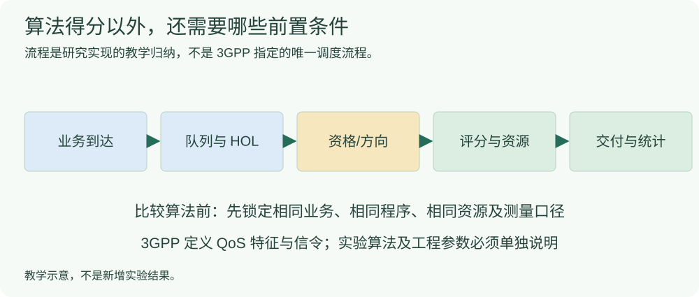

# 算法知识点：比较实验结果前的共同条件

PF、WAIT、QUEST、SR 分配、授权时机等各有独立知识说明。本页先交代共同前提：输入是否相同、QoS 字段是什么意思、调度资格是否满足，以及结果怎样公平比较。

## 协议定义、论文定义与工程实现分开记

按 [TS 23.501 V20.3.0 §5.7.3.1–5.7.3.4](#/protocol/23.501?clause=5.7.3.3&version=20.3.0)、[TS 38.321 V19.4.0 §5.4.4/5.4.5](#/protocol/38.321?clause=5.4.4&version=19.4.0) 重排下表：

|概念|标准/方法中的含义|实验中容易混淆的地方|
|---|---|---|
|5QI|标识一组 5G QoS 特征|5QI 数字不是 Priority Level 本身|
|Priority Level|数值越小，调度优先级越高；还需考虑其他调度因素|不能把 Priority = 5 当成“第 5 个 UE”|
|PDB|规定边界上的包时延预算|不能无条件作为应用闭环或本地 RLC 队列的完整剩余预算|
|SR / BSR|请求资源 / 报告 UL 数据量|不是每包都必走一遍的固定链条|
|HOL|本实验在声明的队列入口定义的队首等待时间|必须写出时间戳来自哪一层；私有报告不等于标准 DSR|

标准对 QoS 特征和相关处理提出要求，**不指定本研究必须使用唯一的 PF、QUEST 或 WAIT 得分公式**。论文中的归一化常量、实现中的配比和阈值要分别溯源。

## 从到达到交付，先锁定哪些条件



|比较前固定/声明|具体项目|
|---|---|
|业务输入|包长、UE 数、QoS 配置、逐 UE 速率、到达分布和业务种子|
|无线环境|TDD、SCS、PRB、MCS/TDA、K2、方向及反馈/控制资源|
|程序与报告|同一程序版本；BSR/HOL 是否私有扩展；是否关闭某项报告|
|调度约束|是否有资格、是否有积压、资源与预算是否可用|
|统计|预热、统计包集、每 UE 指标、配对方法、失败和在途包|

## HOL 公式需要先声明起点

```math
\begin{aligned}
\mathrm{HOL}_{\mathrm{RLC}}(t)&=t-t_{\mathrm{RLC,in}},\\
D_{\mathrm{local}}(t)&=D_{\mathrm{configured}}-\mathrm{HOL}_{\mathrm{RLC}}(t).
\end{aligned}
```

所有量使用相同时间单位。右式是**本地队列的实现记账表达**；如果配置预算原本指 UE–UPF 边界，还没有扣除入队前已消耗的时间，就不能把它直接称为标准意义上精确的剩余 PDB。

## 改善率也要写清分母和配对

对同一控制口径、相互配对的基线与候选指标：

```math
G=\frac{Q_{\mathrm{baseline}}-Q_{\mathrm{candidate}}}
        {Q_{\mathrm{baseline}}}\times100\%.
```

分母必须非零。$G>0$ 表示该项时延下降，$G<0$ 表示该项变差；不能只选改善的 seed，也不能混合不同版本结果。时延收益还应同时报告资源代价和各 UE 的差异。

## 继续读各算法及结果

- [PF](#/doc/da37365378580228f)、[WAIT](#/doc/daf22a818fd9fe114)、[QUEST](#/doc/d99a69159f894326f)。
- [SR 周期分配](#/doc/dcee72dfbdfa892b4)、[授权时机](#/doc/d01bcd72243803688)、[剩余资源预算探测](#/doc/df1ea8b748c1e8c8f)。
- [算法实现与结果列表](#/browse/algorithms)、[全部算法知识点](#/browse/algorithm-knowledge)。

## 来源与版本

- TS 23.501 V20.3.0、TS 38.321 V19.4.0，封面均为 2026-09；具体条款见上表。TS 38.214 V19.5.0 [§6.1.2.1](#/protocol/38.214?clause=6.1.2.1&version=19.5.0) 用于理解 K2/TDA 的时间关系。
- P24《QUEST: User-Based Quality of Service Aware Uplink Resource Scheduling》，IEEE TNSM Vol.23 (2026)，本地 15 页期刊版本；封面载明 2026-04-20 发表、2026-04-28 当前版本，[§V–VI，本地 PDF 第 6–10 页](#/paper/P24?page=6)。只把论文定义作为对应知识来源，不将本项目的工程取值或结果改称论文原实验。
- 教材 [§6.4.3，本地 PDF 第 211–213 页](#/paper/book?page=211)、[§13.1.1.2，本地 PDF 第 530–532 页](#/paper/book?page=530)。

本地队列记账和改善率为项目实现/数学口径，不是协议指定唯一算法，也不代表本次运行了新实验。
